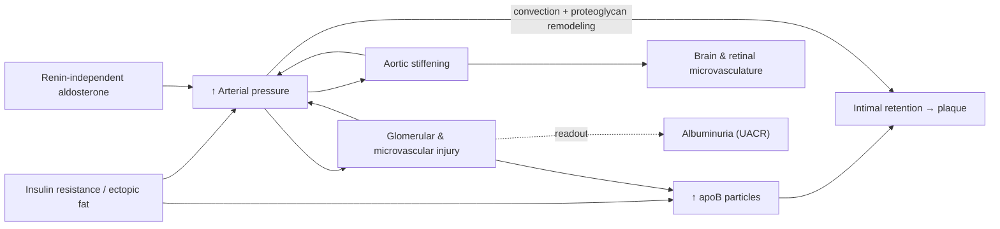

# Lipidology Won the Argument. Pressure Is Winning the War.

*How preventive cardiology mastered the particle, mislaid the pressure, and why the two are one problem in the arterial wall*

---

**Three numbers of the same size.** In October 2024, a randomized crossover trial showed that letting a patient's arm hang unsupported during an automated reading raises the measured systolic pressure by 6.5 mmHg.[^liu2024] In May 2026, the FDA approved the first aldosterone-synthase inhibitor on the strength of a placebo-adjusted systolic reduction of 8.7–9.8 mmHg.[^baxhtn] In 2023, a network meta-analysis of 270 randomized trials estimated that isometric exercise training lowers resting systolic pressure by about 8.2 mmHg.[^edwards2023] The three effects are about the same size. The middle one got a press release and a new drug class. The first is a routine, uncorrected error in clinical measurement. Almost nobody in the prevention-minded public does the third.

This essay explains why that pattern is not an accident, and why it matters more than almost anything else in cardiovascular prevention.

---

## Abstract

Atherosclerotic cardiovascular disease has two causal exposures that no serious investigator disputes: the plasma concentration of apolipoprotein B–containing lipoproteins, and arterial pressure. Over three decades, preventive lipidology turned the first into one of the best-adjudicated causal claims in medicine, and in doing so it set the epistemic standard for the whole field. Part I reconstructs that achievement at the level a biochemist or lipidologist would recognize. The topics are the receptor-mediated transcytosis and proteoglycan retention of apoB particles; the human loss-of-function experiments in *PCSK9*, *ANGPTL3*, *APOC3* and *SCARB1*; the per-particle equivalence of triglyceride-lowering and LDL-lowering variants; the hepatic and muscular biochemistry that makes the lipoprotein profile a decade-leading readout of insulin resistance; and the time-integral structure of risk. It also covers developments through late 2026. VESALIUS-CV extended PCSK9 benefit to people with no prior infarction or stroke. Lp(a)HORIZON failed. The 2026 ACC/AHA dyslipidemia guideline restored absolute targets.

Part II argues that pressure satisfies every criterion that made apoB a hard cause, and several of them more strongly. Yet both clinical practice and the longevity-medicine movement treat it with the threshold logic that lipidology abandoned. Six findings, each of which sits outside the working knowledge of most specialists in the other half of the field, carry the argument:

1. Aortic stiffening *precedes* and predicts hypertension, rather than merely following it.
2. Cyclic mechanical strain upregulates the very proteoglycans that retain apoB, so pressure makes the arterial wall stickier for particles.
3. Primary aldosteronism is present in about one in nine normotensive adults and is screened for in about 2% of the resistant hypertensives who should be screened.
4. Albuminuria goes unmeasured in about 96% of hypertensive patients.
5. Positioning errors in routine measurement are as large as the effect of a new drug class.
6. The largest dietary trial with hard cardiovascular outcomes is a salt-substitute trial from rural China, not a lipid trial.

The essay closes with the practical consequence. Pressure is a drug-agnostic, baseline-agnostic surrogate, so a cheap, safe intervention that reliably lowers it does not need its own outcome trial. Isometric training, now in the 2025 AHA/ACC guideline, is such an intervention, and the case for normotensive adults adopting it now is stronger than the case for most of what the longevity movement currently recommends. The argument has one condition, which I make explicit: the reduction must be real in the individual. That is a measurement problem, not an outcome-trial problem.

---

## Prologue: Where the Light Fell

The intellectual history of cardiovascular prevention over the past thirty years is, to a first approximation, the history of lipidology winning an argument. In the 1990s, "cholesterol" was a contested risk factor with a dietary folklore. By the mid-2020s it had become a causal particle with a molecular address, a mechanism of entry, a human genetic proof and five pharmacological classes that lower events in proportion to the particle reduction they achieve. The European Atherosclerosis Society's consensus panels could write, without hedging, that LDL *causes* atherosclerotic cardiovascular disease, and that its effect is set by both concentration and the duration of exposure.[^ference2017] [^boren2020]

That victory had a cultural consequence. The prevention movement that grew around it, rebranded in the 2020s as "Medicine 3.0" in Peter Attia's formulation,[^attia2023] took lipidology as its template. ApoB, Lp(a), coronary calcium and CT angiography became household words among the educated, prevention-minded public. Pressure did not receive the same treatment. My own count of the 389 published episode notes of *The Drive*, the most influential longevity-medicine podcast, illustrates this: roughly twenty episodes are substantially devoted to lipoproteins, often with the field's leading investigators, one is devoted to blood pressure, and none mentions isometric exercise as an antihypertensive.[^audit]

Meanwhile the mortality ledger runs the other way. The Global Burden of Disease study ranks high systolic pressure as the leading risk factor for death worldwide: 10.8 million deaths in 2019, about one in five of all deaths.[^gbd2019] In China, stroke rather than myocardial infarction was the leading cause of death, and high systolic pressure the leading risk factor.[^zhou2019] Only 12% of Chinese adults with hypertension had it controlled in the most recent national surveillance round.[^zhang2023] The template built around the American coronary patient and the particle carries a blind spot, and the blind spot is largest exactly where pressure does the most damage.

The essay has two halves of equal weight. Part I reconstructs what lipidology settled, at the depth required to appreciate *why* its causal claims are so secure. Those reasons are the standards Part II applies to pressure. Part II argues that pressure meets those standards, that it interacts with the particle mechanistically in the arterial wall rather than merely adding to it statistically, and that medicine's failure to act on pressure is structural rather than a failure of knowledge.

On evidence: I distinguish what is established (with primary sources), what I infer from established findings, and what remains open. Where a figure comes from a press release or secondary report rather than a peer-reviewed paper, the note says so.

---

# Part I — The Particle

## 1. Atherosclerosis Is a Disease of Particle Trafficking

The working model of atherogenesis is the *response-to-retention* hypothesis, proposed by Williams and Tabas in 1995.[^williams1995] [^tabas2007] Its core claim is that the initiating event is not oxidation, not inflammation and not endothelial "injury". It is the **retention of apoB-containing lipoproteins in the subendothelial matrix**. Oxidation, inflammation, foam-cell formation, necrotic-core expansion and calcification follow from that retention, and none of them occurs without it.

Two discoveries since then have made the model mechanistically concrete. Most generalists, and many cardiologists, do not know them.

**Entry is active, not passive.** For decades, LDL entry into the intima was described as leakage through a damaged or permeable endothelium. The modern picture is that a substantial fraction of LDL crosses intact endothelium by **receptor-mediated transcytosis**. A genome-wide RNAi screen identified ALK1 (activin receptor-like kinase 1) as an LDL-binding receptor that mediates LDL uptake and transcytosis in endothelial cells independently of the classical LDL receptor.[^kraehling2016] Huang and colleagues then showed in *Nature* that endothelial SR-B1 (scavenger receptor class B type 1) drives LDL transcytosis in vivo by coupling LDL binding to RAC1 activation through the guanine-nucleotide exchange factor DOCK4. SR-B1 and DOCK4 are expressed at higher levels in atherosclerosis-prone aortic regions, and endothelial SR-B1 deletion reduced LDL delivery into the artery wall and atherosclerosis in mice.[^huang2019]

Endothelium is therefore not a passive filter but a gate with receptors, and the gate is preferentially open where plaques form. Part II returns to this point, because it explains why low and oscillatory shear and high pressure both matter.

**Retention has a molecular address.** Borén and colleagues identified the principal proteoglycan-binding site of apoB-100, a cluster of basic residues (site B, residues 3359–3369) that binds the negatively charged glycosaminoglycan chains of arterial proteoglycans. A single substitution there severely impairs proteoglycan binding without affecting LDL-receptor binding.[^boren1998] In 2002, Skålén and colleagues used that mutation to perform the decisive experiment. Mice expressing proteoglycan-binding-defective human LDL developed markedly less atherosclerosis than mice expressing wild-type LDL *at the same plasma concentration*.[^skalen2002] Retention is not a correlate of atherosclerosis. In this model, it is the rate-limiting step.

Two consequences organize everything that follows.

1. **The unit of causation is the particle.** Every atherogenic lipoprotein (VLDL, IDL, LDL and Lp(a)) carries exactly one molecule of apoB-100. Cholesterol is cargo. What crosses, binds and is retained is a particle. The probability of entry and retention per unit time scales with the number of particles presented to the wall, which plasma apoB counts directly.[^sniderman2019]
2. **The process is an integral.** Retention is a flux, and plaque is its accumulated product. The disease begins early. In the PDAY autopsy study of young Americans who died of external causes, aortic fatty streaks were present in essentially all subjects aged 15–19, and coronary lesions in a substantial fraction.[^strong1999] Fetal aortas from hypercholesterolemic mothers already show increased fatty-streak formation.[^napoli1997] The infarcts of the sixth and seventh decades are laid down in the second and third.

## 2. Count, Not Cargo

LDL cholesterol (LDL-C) measures the cholesterol mass carried in LDL particles. ApoB measures the number of atherogenic particles. The two are concordant in most people and discordant in exactly the people prevention most needs to catch. In insulin resistance, hypertriglyceridemia and type 2 diabetes, LDL particles are cholesterol-depleted and triglyceride-enriched, so particle number runs ahead of cholesterol mass.

Three independent lines of evidence say that when the measures disagree, risk follows the particle:

- **Discordance analyses.** Across cohorts, individuals with apoB higher than their LDL-C would predict carry the higher risk, and vice versa.[^sniderman2014] In statin-treated participants of the Copenhagen General Population Study, apoB and non-HDL cholesterol captured residual risk that LDL-C missed.[^johannesen2021]
- **Multivariable Mendelian randomization** (genetic variants used as natural randomization). When genetically instrumented apoB, LDL-C and triglycerides are modeled together, apoB is the lipid trait whose association with coronary disease survives. LDL-C and triglycerides lose most of their independent signal.[^richardson2020]
- **Per-particle equivalence.** Discussed in section 3 below.

The obstacle to adopting apoB is now institutional rather than scientific. ApoB immunoassays are internationally standardized, inexpensive and do not require fasting. The 2026 ACC/AHA dyslipidemia guideline recommends apoB measurement in selected patients, notably those with triglycerides above 200 mg/dL, diabetes or LDL-C already below 70 mg/dL, while keeping LDL-C and non-HDL-C as primary targets.[^acc2026] Sniderman has argued for two decades that this is a historical artifact, not a biological judgment.[^sniderman2019]

## 3. The Human Knockouts

The causal case for apoB rests on something more powerful than trials: a set of natural human experiments in which a single gene variant shifts lipoprotein metabolism for an entire lifetime.

**PCSK9.** In 2006, Cohen, Boerwinkle, Mosley and Hobbs reported that among Black participants in the ARIC study, about 2.6% carried nonsense mutations in *PCSK9* (Y142X or C679X). Those carriers had about 28% lower LDL-C and an **88% lower** incidence of coronary heart disease over fifteen years. In White participants, the milder R46L variant lowered LDL-C by about 15% and coronary risk by about 47%.[^cohen2006] No five-year drug trial has produced anything like an 88% reduction from a 28% LDL change. The difference between the genetic and pharmacological effect sizes is the first quantitative clue that *time* is the dominant variable (section 8). The finding also led directly to a drug class.

**Familial hypercholesterolemia.** Heterozygous FH affects roughly 1 in 250 people. A defect in a single gene (*LDLR*, *APOB* or *PCSK9*) does nothing except impair LDL clearance, and it produces coronary disease decades early in untreated carriers, regardless of their metabolic health.[^nordestgaard2013] FH is the strongest available refutation of the idea that high LDL is benign in an otherwise healthy metabolism (section 12).

**ANGPTL3 and APOC3.** Loss-of-function variants in *ANGPTL3*, an inhibitor of lipoprotein and endothelial lipase, lower triglycerides and LDL-C and are associated with about 40% lower odds of coronary disease.[^dewey2017] Loss-of-function variants in *APOC3*, which encodes apolipoprotein C-III, an inhibitor of lipoprotein lipase and of hepatic uptake of triglyceride-rich remnants, lower triglycerides by about 40% and coronary risk by a similar proportion.[^tghdl2014] [^jorgensen2014]

**The per-particle test.** These variants raise an obvious question: is triglyceride-rich lipoprotein risk separate from LDL risk, or is it the same particle risk expressed through a different pool? Ference and colleagues answered it with a 2×2 factorial Mendelian randomization. Triglyceride-lowering variants in *LPL* and LDL-lowering variants in *LDLR* produced **the same reduction in coronary risk per 10 mg/dL lower apoB**, even though their effects on triglycerides and LDL-C differed greatly.[^ference2019tg] The atherogenic quantity is the particle count, whichever lipid it carries.

## 4. HDL: The Most Thoroughly Falsified Hypothesis in Cardiology

The inverse association between HDL cholesterol and coronary disease is one of the most reproducible findings in epidemiology. The causal hypothesis built on it has failed every test.

- **Genetics.** The endothelial-lipase variant LIPG Asn396Ser raises HDL-C without changing other lipoproteins and confers no protection against myocardial infarction.[^voight2012]
- **The SR-B1 paradox.** In 2016, Zanoni and colleagues identified a loss-of-function variant in *SCARB1*, which encodes SR-B1, the hepatic receptor for selective uptake of HDL cholesteryl ester. P376L impairs SR-B1 processing and abolishes selective HDL uptake. Carriers have markedly *higher* HDL-C and *higher* coronary risk (odds ratio about 1.79).[^zanoni2016] SR-B1-knockout mice show the same pattern. High HDL-C produced by blocking HDL's exit route is not protective, and may be harmful. The measured quantity reflects flux through a pathway, not the benefit of that pathway.
- **CETP inhibitors.** Torcetrapib raised HDL-C by more than 70% and increased mortality, a harm attributed partly to off-target aldosterone and blood-pressure effects.[^barter2007] Dalcetrapib and evacetrapib were neutral despite large HDL-C increases. Anacetrapib reduced major coronary events by 9% in REVEAL, in proportion to its reduction in non-HDL cholesterol and apoB rather than its doubling of HDL-C.[^reveal2017]
- **Niacin.** AIM-HIGH and HPS2-THRIVE showed no benefit on top of statins. HPS2-THRIVE also produced an instructive ethnic signal: myopathy rates were several-fold higher in its Chinese participants than in its European ones.[^hps2thrive]

Rader and Hovingh's synthesis is the field's settled position. HDL-C is a biomarker of triglyceride metabolism and insulin sensitivity. HDL *function*, in particular macrophage cholesterol-efflux capacity, may still be biologically important, but raising HDL-C is not a therapeutic goal.[^rader2014]

CETP has a coda that matters for the frontier. Obicetrapib, a next-generation CETP inhibitor, lowers LDL-C by about a third on top of statins. Its outcome trial, PREVAIL, had not reported at the time of writing.[^prevail] If it succeeds, it will be as an apoB-lowering drug that happens to raise HDL-C, not the reverse.

## 5. Triglycerides: Real Risk, Wrong Target

Remnant cholesterol, the cholesterol carried in partially lipolyzed VLDL and chylomicron remnants, is causally associated with coronary disease in Mendelian randomization.[^varbo2013] This does not make triglycerides a target in their own right, as PROMINENT demonstrated.

In 10,497 patients with type 2 diabetes, triglycerides of 200–499 mg/dL and low HDL-C, the selective PPARα modulator pemafibrate lowered triglycerides by 26%, with parallel falls in VLDL and remnant cholesterol. Cardiovascular events did not fall (HR 1.03; 95% CI 0.91–1.15). ApoB rose by about 5%.[^prominent] The investigators' own interpretation is that the rise in apoB and LDL-C may have offset any benefit from lower triglycerides.

PROMINENT is the cleanest clinical illustration of the per-particle principle in section 3. The drug moved the metabolic marker a great deal, left the particle count unchanged or slightly higher, and the outcome followed the particle count. Pemafibrate converted large VLDL into a larger number of smaller apoB particles: it changed the cargo without reducing the count.

## 6. The Biochemistry That Connects the Particle to the Metabolic System

This is the point at which cardiovascular and metabolic physiology turn out to be one system, and the mechanism is more specific than "metabolic syndrome."

**Hepatic insulin resistance.** In the liver, intracellular diacylglycerol accumulates under lipid oversupply and activates PKCε, which phosphorylates the insulin receptor kinase at Thr1160 and impairs insulin signaling to glycogen synthesis and to suppression of gluconeogenesis.[^petersen2018] The result is the paradox Brown and Goldstein named *selective insulin resistance*. Insulin fails to suppress hepatic glucose production, yet hepatic lipogenesis continues and even accelerates.[^brown2008]

Two explanations compete, and the difference matters for intervention. Brown and Goldstein proposed a bifurcation in the insulin signaling pathway, with the lipogenic SREBP-1c branch staying sensitive while the gluconeogenic FOXO1 branch becomes resistant.[^brown2008] Shulman's group argued for a substrate-push model. Adipose-tissue insulin resistance and inflammation increase lipolysis, delivering fatty acids and glycerol to the liver. Hepatic acetyl-CoA rises and allosterically activates pyruvate carboxylase, which drives gluconeogenesis without any change in hepatic insulin signaling. Meanwhile, hyperinsulinemia and the oversupply of lipogenic substrate drive triglyceride synthesis.[^perry2015]

**Muscle reroutes carbohydrate to the liver.** The less familiar part of the story is muscle. Petersen and colleagues used magnetic resonance spectroscopy in lean, young, insulin-resistant adults to show that skeletal-muscle insulin resistance diverts ingested carbohydrate away from muscle glycogen synthesis and toward hepatic *de novo* lipogenesis. Postprandial hepatic triglyceride synthesis rose, and plasma triglycerides rose, *before* any change in body weight or hepatic insulin signaling.[^petersen2007] Rabøl and colleagues then showed that a single bout of exercise reversed the muscle defect and reduced postprandial hepatic *de novo* lipogenesis.[^rabol2011]

Skeletal muscle is therefore a lipid organ by proxy. Muscle insulin sensitivity is upstream of hepatic VLDL output. This explains why exercise moves the lipoprotein profile through a route entirely separate from LDL-receptor biology.

**From the liver to the profile.** The insulin-resistant liver secretes more and larger triglyceride-rich VLDL, with excess apoC-III that slows their lipolytic clearance. CETP exchanges VLDL triglyceride for LDL and HDL cholesteryl ester. Hepatic lipase then hydrolyzes the triglyceride in the enriched particles. The products are small, cholesterol-depleted LDL particles, more of them per milligram of LDL-C, and small HDL that is rapidly catabolized.

Garvey and colleagues characterized this signature by NMR lipoprotein profiling against euglycemic clamps: larger VLDL, smaller LDL, higher LDL particle number and depletion of large HDL, graded with insulin resistance.[^garvey2003] Because euglycemia is defended for years by compensatory hyperinsulinemia, glucose is a *lagging* indicator, and it moves only when β-cell compensation fails. In the Whitehall II cohort, insulin sensitivity began declining years before diabetes was diagnosed, while fasting glucose rose steeply only in the final few years.[^tabak2009] The lipoprotein profile changes during the compensated phase, which makes it one of the earliest routinely measurable readouts of the metabolic disorder.

**Two causal accounts.** The lipoprotein signature is a readout of hepatic and muscular insulin resistance. It is not an independent cardiovascular cause once apoB is known. Small dense LDL adds little to risk prediction after particle number is accounted for. Insulin resistance, however, also feeds the second hard cause. Insulin normally stimulates endothelial nitric oxide production through PI3K–Akt–eNOS, and in insulin resistance that branch is impaired while the MAPK–endothelin branch is preserved.[^muniyappa2007] Insulin is antinatriuretic at the renal tubule, an effect that persists in insulin-resistant states.[^defronzo1975] Hyperinsulinemia activates the sympathetic nervous system. The same upstream disorder therefore raises *both* apoB and pressure (section 16).

## 7. Lp(a): The Inherited Particle, and the Trial That Failed

Lipoprotein(a) is an LDL-like particle whose apoB-100 is disulfide-linked to apolipoprotein(a), a plasminogen-homologous glycoprotein with a variable number of kringle IV type 2 repeats. Plasma Lp(a) concentration is about 90% heritable and set largely by *LPA* copy-number and isoform structure, with smaller isoforms associated with higher concentrations.

Its pathobiology is threefold:

- **Particle atherogenicity.** Björnson and colleagues exploited the fact that both Lp(a) and LDL carry one apoB per particle. In UK Biobank genetics, they estimated Lp(a) to be about **6.6 times** as atherogenic as LDL per particle (95% CI 5.1–8.8).[^bjornson2024]
- **Oxidized phospholipids.** Lp(a) is the principal plasma carrier of oxidized phospholipids (OxPL). In humans, OxPL on Lp(a) drive arterial-wall inflammation measured by FDG-PET and a pro-inflammatory monocyte phenotype, effects abolished by inactivating the OxPL.[^vandervalk2016]
- **Valve calcification.** A common *LPA* variant is associated with aortic-valve calcification and incident aortic stenosis, independently of its coronary effect.[^thanassoulis2013]

Two pieces of arithmetic govern the clinical implications. First, because Lp(a) particles usually make up a small fraction of total apoB, the per-particle multiplier does not translate into a proportional population burden. Second, Burgess and colleagues estimated from Mendelian randomization that lowering Lp(a) by roughly 100 mg/dL would be needed to match the coronary benefit of lowering LDL-C by 1 mmol/L.[^burgess2018]

That arithmetic now has a clinical test. In September 2026, Novartis announced that **Lp(a)HORIZON**, the phase 3 trial of the antisense oligonucleotide pelacarsen in 8,323 patients with established cardiovascular disease and elevated Lp(a), did not meet its primary endpoint.[^horizon] Full data had not been presented at the time of writing, so interpretation is provisional. Background therapy was intensive, with mean LDL-C around 66 mg/dL. Candidate explanations include absolute Lp(a) reductions below the threshold that the Mendelian-randomization arithmetic implies, a five-year trial window too short to reverse a lifetime of exposure, and a contribution of OxPL-mediated or valvular pathology that particle lowering on this scale does not address.

The siRNA agents (olpasiran, lepodisiran, zerlasiran), which lower Lp(a) more deeply, still have outcome trials pending. The general lesson is the one Part II depends on: **a causal exposure is not automatically a target whose short-term manipulation reverses risk.** Whether a surrogate can be acted on without its own outcome trial depends on whether *manipulating* it, by any mechanism, reliably moves outcomes. ApoB, so far, meets that test. Lp(a) has just failed its first attempt.

One practical point is often mishandled: Lp(a) is reported in mg/dL (mass) or nmol/L (particle number). Because particle mass varies with isoform size, no single conversion factor is valid. The 2025 ESC/EAS focused update treats values above about 50 mg/dL (105 nmol/L) as a risk modifier.[^esc2025]

## 8. Time Is the Hidden Variable

The deepest contribution of preventive lipidology may not be any biomarker. It may be the recognition that risk is an *integral*.

The quantitative core is a comparison of two kinds of evidence. In five-year statin trials, each 1 mmol/L reduction in LDL-C lowers major vascular events by about 22%.[^ctt2010] In Mendelian randomization, a lifelong 1 mmol/L lower LDL-C, conferred by inherited variants, is associated with about **54%** lower coronary risk.[^ference2012] The *PCSK9* nonsense-mutation carriers in section 3 are the extreme case. The same reduction in concentration buys two to three times the relative benefit when applied for a lifetime rather than for five years.

The policy consequence is that ten-year risk systematically defers prevention until disease is established. Ten-year risk is dominated by age, so a 35-year-old with an apoB of 130 mg/dL has a low ten-year risk while accumulating the exposure that will produce events in the sixth decade. Pencina, Sniderman and colleagues modeled the expected 30-year benefit of early versus delayed lipid lowering and found that starting in young adulthood prevented substantially more events than starting later.[^pencina2020]

Late-2025 trial evidence pushed the boundary between secondary and primary prevention outward. **VESALIUS-CV** randomized 12,257 adults aged 50–79 with atherosclerosis or diabetes but *no prior myocardial infarction or stroke* to evolocumab or placebo on top of background therapy. Over a median of about 4.5 years, evolocumab reduced coronary death, myocardial infarction or ischemic stroke by 25% (HR 0.75; 95% CI 0.65–0.86), with a median on-treatment LDL-C of about 45 mg/dL.[^vesalius]

On very low concentrations, a prespecified FOURIER analysis found no excess of adverse events among patients whose LDL-C fell below 20 mg/dL, although follow-up was only about two years.[^giugliano2017] Physiological LDL-C in neonates, hunter-gatherer populations and free-living non-human primates lies roughly in the 50–70 mg/dL range.[^okeefe2004] The adult "reference interval" on a laboratory report describes a population whose hepatic clearance capacity has been degraded by decades of exposure. It is not a recommended level.

## 9. Inflammation Is Downstream of Retention, Not an Alternative to It

"Residual inflammatory risk" is often presented as a third axis of cardiovascular risk, parallel to lipids and pressure. The biochemistry says it is better understood as a consequence of the first two.

**Retained particles make the inflammatory stimulus.** Duewell, Latz and colleagues showed that cholesterol crystals, which form within macrophages that have taken up retained and modified apoB particles, activate the NLRP3 inflammasome. That leads to caspase-1 activation and IL-1β release, and NLRP3- or IL-1-deficient mice develop less atherosclerosis.[^duewell2010] The cascade continues downstream. IL-1β induces IL-6, and IL-6 drives hepatic C-reactive protein. CRP is therefore the bottom of a chain that starts with a retained particle in the intima.

**Which link is causal.** Mendelian randomization separates the links cleanly. Genetically raised CRP does not raise coronary risk. The IL-6 receptor variant Asp358Ala, which dampens IL-6 signaling, does lower it.[^il6r2012] CRP is a marker. The IL-1β–IL-6 axis is a cause.

**The trials.** CANTOS randomized 10,061 post-infarction patients with hsCRP ≥ 2 mg/L to canakinumab, an IL-1β antibody, without any change in lipids. The 150 mg dose reduced major cardiovascular events by 15% (HR 0.85) and increased fatal infections.[^ridker2017] Low-dose colchicine, a microtubule inhibitor that blunts NLRP3 assembly among other effects, reduced events in chronic coronary disease (LoDoCo2, HR 0.69)[^nidorf2020] and after recent infarction (COLCOT, HR 0.77).[^tardif2019] The larger CLEAR SYNERGY trial, however, found no benefit of colchicine after myocardial infarction (HR about 0.99).[^jolly2025] The antagonist strategy is causally sound but clinically modest and inconsistent.

**Clonal hematopoiesis.** The less familiar development is *clonal hematopoiesis of indeterminate potential* (CHIP). It is the age-related expansion of hematopoietic stem-cell clones carrying somatic mutations in genes such as *DNMT3A* and *TET2*, without hematological malignancy. Jaiswal and colleagues found that CHIP carriers had about 1.9 times the coronary risk of non-carriers, and up to about four times among those with larger clones. In mice, *Tet2*-deficient macrophages secreted more IL-1β and accelerated atherosclerosis.[^jaiswal2017] Somatic aging of the blood system thus amplifies the inflammatory response to the same retained particles.

**Pressure is inflammatory too.** Angiotensin II–induced hypertension in mice requires T cells. *Rag1*-deficient mice, which lack lymphocytes, show blunted hypertensive and vascular responses to angiotensin II, and adoptive transfer of T cells restores them.[^guzik2007] The immune system is part of how pressure is *set*, not just a bystander to its damage.

The implication for this essay is a matter of hierarchy, not of dismissal. Inflammation sits **downstream** of both hard causes and amplifies their effects. In the integral model of section 19 it raises the gain on retention. Lowering apoB removes the stimulus. Lowering pressure removes a mechanical and immunological driver. Anti-inflammatory therapy treats the amplifier. For residual risk after both causes are controlled, the amplifier may matter. As a primary strategy, it addresses the wrong layer.

## 10. Seeing the Wall

Biomarkers measure exposure. Imaging measures what exposure has already done. The two answer different questions, and confusing them is a common error.

Coronary artery calcium (CAC) scoring detects calcified plaque. A positive score establishes that disease exists. A zero score is weaker evidence than it looks, especially in younger adults, because calcification is a late feature of plaque and non-calcified disease escapes it. Coronary CT angiography adds quantification of non-calcified plaque.

The strategic point follows from section 8. Imaging answers "has the integral already crossed into disease?" It does not answer "should apoB be lowered?" Waiting for a calcium score to turn positive before acting is waiting for the outcome the intervention was meant to prevent, a point Wilkins and Lloyd-Jones made explicitly.[^wilkins2021] Imaging is most useful for *escalating* intensity when plaque is found, and least useful as permission to do nothing when it is not.

## 11. The Toolkit and Its Frontier

Nearly every effective lipid-lowering therapy works through a single physiological lever: increased hepatic clearance of apoB particles, mostly through more LDL receptors at the hepatocyte surface. Their mechanistic convergence is itself evidence.

| Agent | Mechanism | Outcome evidence (late 2026) |
|---|---|---|
| Statins | HMG-CoA reductase inhibition → SREBP-2 activation → ↑ LDLR | ~22% event reduction per mmol/L LDL-C[^ctt2010] |
| Ezetimibe | NPC1L1 inhibition → ↓ intestinal cholesterol → ↑ LDLR | Positive on top of statin (IMPROVE-IT)[^improveit] |
| Bempedoic acid | ATP-citrate lyase inhibition (liver-specific prodrug activation) | Positive in statin intolerance (CLEAR Outcomes)[^clear] |
| PCSK9 antibodies | Block PCSK9-mediated LDLR degradation | FOURIER, ODYSSEY OUTCOMES; VESALIUS-CV in people without prior MI or stroke[^vesalius] |
| Inclisiran | siRNA against hepatic *PCSK9*, twice yearly | LDL-C lowering established; outcome trials not yet reported[^victorion] |
| Enlicitide | Oral macrocyclic-peptide PCSK9 inhibitor | Positive phase 3 lipid trials (2025); outcome trial ongoing[^coralreef] |
| Obicetrapib | CETP inhibition (LDL-lowering in practice) | PREVAIL pending[^prevail] |
| Lp(a) agents | Antisense (pelacarsen), siRNA (olpasiran, lepodisiran, zerlasiran) | Pelacarsen failed (Lp(a)HORIZON);[^horizon] siRNA trials pending |

Statins, ezetimibe, bempedoic acid and PCSK9 inhibition are pharmacologically unrelated, yet each lowers events in proportion to the apoB reduction it achieves. That is the property this essay calls a **hard surrogate**: a variable whose manipulation by *any* mechanism tested yields benefit proportional to the change. CETP inhibition is the mirror image. Its HDL effect contributed nothing, and its benefit tracked its non-HDL effect.

The frontier is now durability more than potency. Twice-yearly siRNA dosing and oral PCSK9 inhibition address the real constraint on population benefit, which is that people stop taking daily pills. Under the integral model, a therapy that keeps working for forty years is worth more than a slightly more potent one that people take for five.

**An East Asian pharmacological note.** The ABCG2 c.421C>A (Q141K) variant, which reduces efflux transport of rosuvastatin, is common in East Asian populations and roughly doubles rosuvastatin exposure in homozygotes.[^keskitalo2009] This is part of the basis for lower starting doses in Asian patients on the U.S. label. Together with the niacin myopathy signal in Chinese HPS2-THRIVE participants, it shows that lipid pharmacology transfers across ancestries less cleanly than its epidemiology does. One more caution applies in every population: in the SAMSON n-of-1 trial, about 90% of the symptom burden reported on statins was also reported on placebo.[^wood2020] Much "statin intolerance" is nocebo, and an n-of-1 design can resolve it, the same instrument Part II proposes for pressure.

## 12. The Strongest Objection

The best current challenge to the particle model comes from individuals on very-low-carbohydrate diets who develop markedly elevated LDL-C and apoB alongside low triglycerides, high HDL-C and excellent insulin sensitivity. They are sometimes called "lean mass hyper-responders." The associated "lipid energy model" proposes that in this metabolic context high LDL reflects increased lipid trafficking for energy and does not carry the usual risk.

The 2025 KETO-CTA longitudinal analysis in *JACC: Advances* reported that, in about 100 such individuals followed by serial CT angiography for about a year, baseline plaque predicted plaque progression whereas apoB and LDL-C did not.[^ketocta] Its methods and reporting have been sharply disputed. Critics argue that the cohort in fact showed substantial progression and that the analytic choices obscured it. Secondary sources have claimed the paper was retracted, which I could not verify against the journal.

Even read charitably, the study cannot bear the weight placed on it. "No detectable association within one year in 100 selected people" is a statement about statistical power, not about causation. It must be weighed against the Mendelian-randomization data on hundreds of thousands of people and against FH. In FH, a single-gene defect that raises LDL and does nothing else produces premature atherosclerosis regardless of metabolic health.[^nordestgaard2013] The retention biology in section 1 is also indifferent to *why* particle number is high. Proteoglycans bind apoB, not dietary intentions.

Metabolic health is necessary for cardiovascular health. It is not sufficient, and it does not neutralize particle number.

## 13. Targets

| Source | Position |
|---|---|
| 2019 ESC/EAS[^esc2019] | apoB < 65 mg/dL (very high risk), < 80 (high), < 100 (moderate) |
| 2025 ESC/EAS focused update[^esc2025] | LDL-C goals unchanged; Lp(a) > ~50 mg/dL as risk modifier; bempedoic acid expanded |
| 2026 ACC/AHA dyslipidemia guideline[^acc2026] | Restores absolute targets (LDL-C < 100 borderline/intermediate risk, < 70 high, < 55 very high); PREVENT-ASCVD equations; apoB in selected patients |

My own position goes beyond the guidelines and I label it as inference. For an adult who has chosen aggressive primary prevention, an apoB of about 60 mg/dL (0.6 g/L) is a defensible aim. It lies within the range achieved in outcome trials, near the physiological level of youth, and is consistent with the integral model. No outcome data support pushing apoB below 20 mg/dL. That range overlaps the genetic hypobetalipoproteinemias, and the FOURIER "below 20" figure refers to LDL-C, not apoB. Chinese and European laboratories often report apoB in g/L, so 60 mg/dL is 0.60 g/L.

## 14. The Template

Lipidology's achievement is a method as much as a set of findings, and it is this method that Part II applies:

1. **Mechanism with a molecular address**: transcytosis receptors, a proteoglycan-binding site and a decisive knock-in experiment.
2. **Human genetic experiments** that fix exposure for a lifetime: *PCSK9*, *LDLR*, *ANGPTL3*, *APOC3*, *SCARB1*.
3. **Mechanistically independent interventions** that converge on proportional benefit: the definition of a hard surrogate.
4. **Falsification of attractive alternatives** by hard-outcome trials: HDL, triglycerides as a standalone target, and, provisionally, Lp(a) lowering at the magnitude tested.
5. **Reframing risk from a ten-year probability to a lifetime integral.**

Part II asks what happens when the same five tests are applied to pressure. The answer is that pressure passes all five, and that the second cause is coupled to the first inside the arterial wall.

---

# Part II — The Pressure

## 15. The Asymmetry, Measured

By the standards just described, the epidemiology of pressure is at least as strong as that of apoB, and its burden is larger.

- **Worldwide.** High systolic pressure was the leading risk factor for attributable death in 2019 (10.8 million deaths; 19.2% of all deaths).[^gbd2019] In GBD 2021 it accounted for 7.8% of all disability-adjusted life years, second only to ambient particulate matter.[^gbd2021]
- **China and East Asia.** Stroke was the leading cause of death and high systolic pressure the leading risk factor in China's provincial burden analysis.[^zhou2019] In East Asia, high systolic pressure leads the attributable risk for ischemic stroke, ahead of particulate pollution and high LDL-C.[^gbdstroke] Hemorrhagic stroke, driven more directly by pressure than by particles, accounts for a substantially larger share of strokes in China than in Western populations.
- **Control.** In the 2018 round of China's national surveillance, 38.3% of hypertensive adults were aware of their condition, 34.6% were treated and 12.0% were controlled. About 240 million of 274 million hypertensive adults had inadequately controlled pressure.[^zhang2023]

A prevention culture centered on coronary plaque and apoB, exported to East Asia without reweighting, underweights the exposure that kills the most people there. Even in the West, it underweights the exposure with the larger attributable mortality.

## 16. What Sets the Pressure

Lipidology's power came partly from knowing exactly what controls apoB: hepatic clearance through LDL receptors. The equivalent knowledge exists for pressure, but specialists outside nephrology and hypertension rarely hold it.

**The kidney sets the long-term level.** Guyton's analysis, still the dominant framework, holds that chronic arterial pressure is determined by the renal pressure–natriuresis relationship. Pressure settles at the level at which the kidney excretes the sodium and water ingested. Any sustained hypertension therefore implies a rightward shift of that curve, so that more pressure is required to excrete the same load.[^guyton1991] Neural, hormonal and vascular mechanisms raise pressure chronically largely by acting *on the kidney*. In this framework the kidney is not one target among many; it is the setpoint.

**Insulin and obesity shift the curve.** In 1975, DeFronzo and colleagues showed that insulin, at physiological concentrations and without changes in glucose, reduces urinary sodium excretion.[^defronzo1975] Hall's synthesis of obesity-related hypertension adds sympathetic activation driven partly by leptin and the brain melanocortin system, activation of the renin–angiotensin–aldosterone system, and physical compression of the kidneys by perirenal and renal-sinus fat.[^hall2015] These are the same metabolic inputs that, in section 6, raise apoB. A single upstream disorder shifts both causal curves.

**Aldosterone is a continuum, not a rare tumor.** Primary aldosteronism is still taught as an uncommon cause of secondary hypertension. In 2020, Brown and colleagues measured 24-hour urinary aldosterone under sodium loading in carefully phenotyped U.S. adults. Biochemically overt, renin-independent aldosteronism was present in **11.3% of normotensive** participants, 15.7% with stage 1 hypertension, 21.6% with stage 2 and 22.0% with resistant hypertension.[^brown2020] The aldosterone-to-renin ratio screening test performed poorly. In a large academic health system, only **2.1%** of patients meeting criteria for resistant hypertension were screened for primary aldosteronism within two years.[^jaffe2020]

Taken together, a renin-independent aldosterone excess is present across the pressure spectrum, including in normotensive people, and is almost never looked for. This is the biological context for the 2026 approval of baxdrostat (section 28). A disorder that clinical teaching calls rare is a common, continuous driver of the pressure distribution.

## 17. Pressure Is an Exposure, Not a Diagnosis

Lipidology's central conceptual move was to stop treating "hypercholesterolemia" as a binary diagnosis and to treat apoB as a continuous exposure. For pressure the evidence for the same move is at least as strong. Practice has moved much less.

**The observational curve has no threshold.** In the Prospective Studies Collaboration's individual-participant meta-analysis of one million adults in 61 cohorts, vascular mortality rose log-linearly with usual pressure from at least 115/75 mmHg upward. At ages 40–69, each 20 mmHg higher systolic (or 10 mmHg higher diastolic) pressure was associated with roughly twice the stroke and ischemic heart disease mortality.[^lewington2002]

**The trial evidence is drug-agnostic and baseline-agnostic.** The Blood Pressure Lowering Treatment Trialists' Collaboration (BPLTTC) pooled 48 randomized trials and 344,716 participants. Each 5 mmHg reduction in systolic pressure lowered major cardiovascular events by about 10% (HR 0.91 without prior cardiovascular disease; 0.89 with it). There was no reliable heterogeneity by baseline systolic category, and the categories began **below 120 mmHg**.[^bpltt2021] This is the pressure equivalent of the convergence of lipid drug classes in section 11. Benefit is proportional to the reduction achieved, irrespective of how it is achieved within the drug classes studied, and irrespective of whether the starting pressure is labeled hypertensive.

**Intensive targets work, including in Chinese populations.**

| Trial | Population | Comparison | Primary result |
|---|---|---|---|
| SPRINT (2015)[^sprint2015] | 9,361 high-risk U.S. adults without diabetes | SBP < 120 vs < 140 | Major CV events HR 0.75; all-cause death HR 0.73 |
| STEP (2021)[^step2021] | 8,511 Chinese adults aged 60–80 | 110–<130 vs 130–<150 | Composite CV outcome HR 0.74 |
| ESPRIT (2024)[^esprit2024] | 11,255 high-risk Chinese adults, with or without diabetes or prior stroke | < 120 vs < 140 | Major vascular events HR 0.88 |
| BPROAD (2024)[^bproad2024] | 12,821 Chinese adults with type 2 diabetes | < 120 vs < 140 | Composite CV outcome HR 0.79 |

The harms of intensive treatment are real: syncope, symptomatic hypotension, hyperkalemia and acute kidney injury. They are the harms of drugs titrated to a target, which becomes important in section 25. Cognition is affected too. In SPRINT MIND, intensive control reduced mild cognitive impairment (HR 0.81), while the reduction in probable dementia did not reach significance.[^sprintmind2019]

**The integral begins in childhood.** Blood pressure *tracks*. A meta-analysis of cohort studies found moderate correlation between childhood and adult pressure, strengthening with age at first measurement.[^chen2008] In CARDIA, people whose pressure trajectory rose through young adulthood, even within ranges labeled normal or prehypertensive, had higher odds of coronary calcium in middle age than those with stable low trajectories.[^allen2014] Pressure, like apoB, is a lifetime exposure whose early years carry the most leverage.

**The guidelines have moved, but not all the way.** The 2024 ESC guideline created an "elevated blood pressure" category of 120–139/70–89 mmHg and set a treated systolic target of 120–129 mmHg for most patients who tolerate it.[^esc2024] The 2025 AHA/ACC guideline kept a target below 130/80. It adopted the PREVENT equations, with a 7.5% ten-year total cardiovascular risk threshold for treating stage 1 hypertension, expanded urine albumin testing and primary-aldosteronism screening, and included isometric resistance exercise among its lifestyle options.[^aha2025] [^aha2025summary] Both guidelines still use a threshold-then-treat architecture triggered by ten-year risk, the architecture lipidology spent two decades dismantling.

## 18. The Arrow That Points the Other Way: Stiffness Before Pressure

A common clinical assumption holds that hypertension stiffens arteries. The Framingham data say the dominant temporal arrow runs the other way.

Kaess and colleagues followed 1,759 Framingham Offspring participants across two examinations about seven years apart, with arterial tonometry at both. Higher aortic stiffness (carotid–femoral pulse-wave velocity) and higher forward-wave amplitude at the first examination predicted later rises in systolic pressure and incident hypertension (338 new cases among 1,048 initially normotensive participants), after adjustment for baseline pressure. Baseline pressure did **not** predict later stiffness.[^kaess2012] Lower brachial flow-mediated dilation, a measure of endothelial function, also predicted incident hypertension.

If the arrow runs this way, the clinical sequence is as follows. Large-artery stiffening, from elastin fatigue, collagen cross-linking, advanced glycation, calcification and endothelial dysfunction, comes first. Stiffening raises pulse pressure and systolic load. Higher systolic load accelerates stiffening, a positive feedback loop. The finding is observational and cannot exclude reverse confounding by treatment. Its implication, though, mirrors lipidology's: **the window in which intervention changes the trajectory, rather than chasing it, is early**, while arteries are still compliant. A normal blood-pressure reading in a 35-year-old does not mean nothing is happening. The arterial substrate whose stiffening will later produce hypertension may already be degrading.

## 19. Where the Two Causes Meet: Pressure Makes the Wall Stickier

This is the central mechanistic claim of the essay. Pressure and particle are not merely two independent risk factors whose effects add in a regression model. They interact in the arterial wall, at the exact step that Part I identified as rate-limiting.

**First, a correction.** A misconception circulates widely in longevity discussions: that lowering pressure helps by "reducing shear stress." Wall shear stress is the frictional force of flowing blood on the endothelial surface. It depends on flow velocity, vessel geometry and viscosity, not on transmural pressure. Steady, laminar, relatively **high** shear is atheroprotective. Through mechanosensitive transcription factors such as KLF2 and KLF4, it maintains endothelial quiescence and eNOS expression. Plaque forms where shear is **low and oscillatory**: at bifurcations, inner curvatures and branch ostia. Those are the same regions where Huang and colleagues found SR-B1 and DOCK4, the transcytosis machinery of section 1, more highly expressed.[^huang2019] Exercise raises shear, which is part of why it protects. Pressure does its damage through other routes, and three of them couple directly to the particle.

**Route 1: convection drives particles in.** Transmural pressure drives water filtration across the arterial wall, and that flow carries macromolecules, including LDL, into the intima by convection as well as diffusion.[^tarbell2003] Higher pressure increases particle *delivery*.

**Route 2: strain builds the retention matrix.** Lee, Libby, Wight and colleagues subjected human vascular smooth-muscle cells to controlled cyclic mechanical strain. Strain increased mRNA for **versican** by about 3.2-fold and **biglycan** by about 2.0-fold, with parallel increases in core proteins, while decorin fell to about a third of control levels. Sulfate incorporation into chondroitin/dermatan sulfate chains increased, and versican–hyaluronan aggregation was enhanced.[^lee2001] Versican and biglycan are the principal apoB-binding proteoglycans of the atherosclerosis-prone intima. Sulfation density determines the negative charge that site B of apoB-100 binds (section 1). Mechanical load therefore remodels the extracellular matrix toward a composition that **retains more apoB per particle delivered**.

**Route 3: wall tension and remodeling.** By Laplace's relation, circumferential wall stress scales with transmural pressure times radius divided by wall thickness. Sustained high stress drives medial hypertrophy, elastin fatigue and collagen deposition, which in turn drive the stiffening of section 18.

Put the three together. Pressure delivers more particles into the wall, increases the wall's capacity to hold them, and accelerates the stiffening that raises pressure further. On this account the two causes are not parallel. **Pressure acts as a gain on the particle's rate-limiting step.**

The prediction is that their effects should multiply rather than add, and the human genetic data show exactly that. Ference and colleagues combined genetic scores for lifelong lower LDL-C and lower systolic pressure in UK Biobank. A combined exposure equivalent to 38.7 mg/dL lower LDL-C and 10 mmHg lower systolic pressure was associated with an odds ratio of **0.22** for major coronary events and 0.32 for cardiovascular death. The effects were independent, dose-dependent and log-additive, which means multiplicative on the risk scale.[^ference2019bp] The authors caution that lifelong genetic effects need not equal what treatment achieves. As a description of causal architecture, though, the result matches the mechanism.

A heuristic statement of the model:

$$
\log \text{risk}(T) \;\approx\; \beta_{B}\int_0^T \text{apoB}(t)\,dt \;+\; \beta_{P}\int_0^T \text{SBP}(t)\,dt \;+\; \beta_{BP}\int_0^T \text{apoB}(t)\,\text{SBP}(t)\,dt \;+\;\ldots
$$

This is not a fitted model. The first two terms state what the genetic evidence already implies: risk accumulates as the area under two curves that start in adolescence. The third term is my inference from the mechanism in this section. It is a testable hypothesis: in the arterial wall, pressure scales the retention of particles. If it is right, lowering pressure in someone with high apoB, or apoB in someone with high pressure, is worth more than either reduction alone.

## 20. The Brain Is Where Pressure Becomes Aging

The brain and kidney are high-flow, low-impedance organs. Their small vessels receive the pulsatile energy that a compliant aorta would normally absorb. O'Rourke and Safar argued that this explains the shared microvascular pathology of the two organs in people with stiff arteries.[^orourke2005] In the AGES–Reykjavik study, higher aortic stiffness was associated with more cerebral small-vessel disease (white-matter hyperintensities, subcortical infarcts, microbleeds) and with worse memory, and the relation was partly mediated by those lesions.[^mitchell2011]

A further mechanism is less familiar. In mice, Mestre and colleagues used particle tracking to show that cerebrospinal fluid flow in perivascular spaces is pulsatile and driven primarily by arterial wall motion over the cardiac cycle. Experimentally induced hypertension changed the arterial wall pulsation pattern, increased backflow and **reduced net perivascular CSF flow**.[^mestre2018] This is animal evidence, not established human physiology. It suggests that pressure may impair a brain solute-clearance route as well as damaging small vessels.

Clinically, SPRINT MIND showed that intensive pressure control reduced mild cognitive impairment.[^sprintmind2019] Among the interventions that the longevity movement discusses for brain health, sustained pressure reduction has some of the strongest randomized evidence. It is rarely presented that way.

## 21. The Kidney Is the Amplifier

The kidney sets the pressure (section 16), is damaged by pressure, and, once damaged, raises both pressure and apoB. That makes it the point at which the two causes and the metabolic engine form a loop.

**Albuminuria is a systemic sign.** The Steno hypothesis, proposed by Deckert and colleagues in 1989, holds that albuminuria in diabetes reflects a *generalized* vascular abnormality: loss of the negatively charged glycocalyx and endothelial dysfunction throughout the vasculature, of which the glomerulus is simply the most visible bed.[^deckert1989] This explains why albuminuria predicts cardiovascular events and dementia as well as kidney failure. The urine albumin-to-creatinine ratio (UACR) is a cheap, non-invasive readout of microvascular endothelial health.

**It is almost never measured.** In the CKD Prognosis Consortium's analysis of nearly four million adults across multiple countries, only 35.1% of people with diabetes and **4.1%** of people with hypertension had a UACR measured over two years. The estimated ratio of undetected to detected albuminuria was 1.8 in diabetes and **19.5** in hypertension.[^shin2021] The 2025 AHA/ACC guideline expanded albumin testing in response.[^aha2025summary]

## 22. Measurement: The Error Is the Size of the Effect

Lipidology owes some of its clarity to measurement. ApoB has a coefficient of variation of a few percent and needs no fasting. Pressure is an intrinsically variable quantity measured, in most of the world, by a single office reading.

- **Positioning.** In the ARMS crossover trial (Liu, Brady and colleagues, 2024), supporting the arm on the lap overestimated systolic pressure by 3.9 mmHg compared with desk support, and an unsupported arm hanging at the side overestimated it by **6.5 mmHg**.[^liu2024] That error is about the size of the effect of a new antihypertensive class (section 28). In most clinics it is never corrected.
- **Which pressure predicts outcomes.** In the Spanish ambulatory registry of 63,910 adults, 24-hour ambulatory systolic pressure predicted all-cause and cardiovascular mortality far more strongly than clinic pressure, and nighttime pressure was among the strongest predictors. Masked hypertension, normal in clinic and elevated on ambulatory monitoring, carried a risk at least as high as sustained hypertension.[^banegas2018] A clinic reading is a poor estimate of the variable that matters.
- **A myth refuted.** The large pragmatic TIME trial randomized 21,104 patients to morning or evening dosing of antihypertensives and found no difference in major cardiovascular outcomes.[^mackenzie2022] When a dose is taken matters much less than measuring accurately and reaching the target.

The implication for the n-of-1 in section 27 is that the instrument matters as much as the intervention. A properly conducted home protocol is not a refinement. It is the prerequisite for knowing whether anything happened.

## 23. Salt: The Dietary Evidence That Lipidology Never Had

For all its rigor, lipidology has never produced a dietary trial with hard outcomes that is as clean as the salt-substitute trials. The longevity discourse often treats sodium as "controversial." The strongest randomized evidence in the area comes from China.

- **SSaSS** randomized 20,995 people with prior stroke, or aged 60 or older with poorly controlled hypertension, across 600 villages in rural China. The intervention replaced household salt with a 75% sodium chloride / 25% potassium chloride substitute. Over a mean of 4.74 years, stroke fell (rate ratio 0.86), major cardiovascular events fell (0.87) and all-cause death fell (0.88). There was no significant excess of clinical hyperkalemia.[^neal2021]
- **DECIDE-Salt** cluster-randomized 48 residential elderly-care facilities in China (1,612 residents). The salt substitute lowered systolic pressure by 7.1 mmHg and reduced definite cardiovascular events (HR 0.60; 95% CI 0.38–0.96). Restricting the salt supply alone had no detectable effect.[^yuan2023]

Two lessons follow. Substitution worked where restriction failed, because it changes the default without requiring sustained effort. And the effect operates on the renal pressure–natriuresis mechanism of section 16, both reducing the sodium load and adding potassium, which is natriuretic in its own right. Potassium-enriched salt is contraindicated in advanced kidney disease and with drugs that impair potassium excretion. For the general population it is one of the most strongly evidenced cardiovascular interventions available.

## 24. Medicine 2.0's Blind Spots Are Structural, Not Cognitive

It would be wrong to say that clinicians "don't know" these things. Every cardiologist knows SPRINT, and every guideline committee read BPLTTC. The failure is that the system knows but does not act, and the reasons are built into how care is organized.

1. **Threshold architecture.** Exposure is continuous; diagnosis is binary. A patient at 128/82 is "normal" in most clinics.
2. **Ten-year horizons.** The PREVENT-based thresholds in both the pressure and lipid guidelines still decide on ten-year risk, which ignores the integral logic their own background sections accept.
3. **Measurement.** Treatment decisions rest on office readings with known errors of the same size as treatment effects (section 22).
4. **Kidney invisibility.** About 96% of hypertensive patients never have albuminuria measured (section 21).
5. **Aldosterone invisibility.** About 98% of eligible resistant-hypertension patients are not screened for primary aldosteronism (section 16).
6. **Template transfer.** Western coronary frameworks are applied in East Asia, where stroke and pressure dominate.
7. **Prescriptions that are not prescriptions.** "Exercise more" and "reduce salt" are not prescriptions. "Four two-minute isometric holds, three times a week" and "replace household salt with a potassium-enriched substitute" are.

## 25. The Drug Nobody Takes

If an orally available molecule lowered systolic pressure by about 8 mmHg, cost nothing, took fourteen minutes three times a week, had no drug interactions and had a benign adverse-effect profile, it would be a blockbuster. That intervention exists.

Edwards and colleagues' 2023 network meta-analysis in the *British Journal of Sports Medicine* included 270 randomized trials and 15,827 participants. Isometric exercise training reduced resting systolic and diastolic pressure by about 8.2 and 4.0 mmHg relative to controls. It ranked first among all exercise modes for systolic reduction (SUCRA 98%), ahead of combined training, dynamic resistance, aerobic training and high-intensity intervals, which produced roughly 4–6 mmHg each. Among isometric modes, the wall squat ranked highest for systolic reduction.[^edwards2023] An earlier review reached the same direction (about 7/3 mmHg) and found isometric training safe, with acute pressor responses during holds often smaller than those of guideline-recommended aerobic or dynamic training.[^baffour2022]

The guidelines have absorbed this. The 2025 AHA/ACC guideline lists isometric handgrip: four two-minute contractions with one minute of rest, at 30–40% of maximal voluntary contraction, three times weekly, with an expected systolic reduction of about 5–10 mmHg, framed as an adjunct to established measures.[^aha2025summary] The 2024 ESC guideline lists dynamic *or* isometric resistance training two to three times weekly.[^esc2024]

| | Isometric exercise training |
|---|---|
| **Indication (evidence-based)** | Adjunct for elevated BP and stage 1–2 hypertension (2025 AHA/ACC; 2024 ESC) |
| **Indication (inferred; §26)** | Primary prevention in normotensive adults seeking lower lifetime pressure exposure |
| **Dose** | 4 × 2-min holds, 1–2 min rest, 3 sessions/week. Handgrip at 30–40% MVC, or wall squat at a knee angle that is hard but sustainable for 2 min (perceived exertion ~7–8/10 by the end of each hold) |
| **Onset** | Reductions reported from ~2–4 weeks; most trials run 4–12 weeks |
| **Offset** | Uncertain. In a small trial in young normotensives (n = 25), resting systolic pressure fell ~6 mmHg and remained ~4 mmHg below baseline eight weeks after stopping, with ambulatory reductions also maintained;[^baross2022] older studies suggest return toward baseline over ~5–8 weeks. Treat as maintenance therapy |
| **Expected effect** | ~5–10 mmHg systolic (guideline estimate); ~8 mmHg in pooled trials, with wide uncertainty |
| **Proposed mechanisms** | Repeated post-contraction reactive hyperemia, a high-shear stimulus to the endothelium (§19); reduced sympathetic outflow; baroreflex resetting. None definitively established |
| **Adverse effects** | Transient pressor rise during holds; musculoskeletal strain (knee with wall squat) |
| **Precautions** | Breathe continuously; no Valsalva. Conventional exercise cautions apply: severely uncontrolled pressure, unstable cardiac disease, recent cardiac events, known aortic aneurysm, or recent ocular surgery or proliferative retinopathy warrant clearance first |
| **Interactions** | None pharmacological. Additive with aerobic training, weight loss and salt substitution |
| **Cost** | ~42 minutes/week |

The proposed mechanism has a pleasing symmetry with section 19. Pressure harms by load. Exercise, including isometric holds and the reactive hyperemia that follows them, protects partly through *shear*. Raising shear and lowering pressure are not in tension. They act on different variables.

## 26. Extrapolating to the Normotensive: When Not Waiting Is Rational

Isometric training has no cardiovascular outcome trial and will probably never have one. No sponsor will fund a ten-year, thirty-thousand-person trial of an unpatentable exercise. The question is whether that absence should stop a normotensive adult from adopting it now.

**A hard surrogate licenses action; a soft one does not.** Part I showed what happens when a soft marker is moved: HDL-C rose under CETP inhibition, triglycerides fell under pemafibrate, and outcomes did not change. Lp(a) has just shown that even a causal particle can fail as a short-term target. ApoB and systolic pressure behave differently. Across mechanistically distinct interventions, benefit is proportional to the reduction achieved, and for pressure this holds across baseline categories beginning below 120 mmHg.[^bpltt2021] When a surrogate is hard in this sense, an outcome trial for each new, safe intervention that moves it is largely redundant, because the expected benefit can be read off the existing dose–response relationship. What remains uncertain is whether the intervention moves the surrogate *in this person*, by how much and for how long. That is a measurement question, and an individual can answer it in eight weeks with a validated cuff.

**The arithmetic, with honest error bars.** Assume a sustained 8 mmHg reduction, and apply the BPLTTC primary-prevention hazard ratio log-linearly: $0.91^{8/5} \approx 0.86$, a relative reduction of about 14% in major cardiovascular events. For a 40-year-old with a ten-year total risk of 2%, that is an absolute reduction of about 0.3 percentage points over ten years. On a ten-year view, the benefit is small.

The case rests on the integral. The lipid evidence shows that lifelong exposure differences produce two to three times the relative benefit of five-year treatment differences.[^ctt2010] [^ference2012] The pressure evidence has the same structure. The observational gradient (roughly a doubling of mortality per 20 mmHg)[^lewington2002] is steeper than five-year trials achieve, consistent with time leverage. The genetic evidence shows lifelong pressure differences multiplying with lipid differences.[^ference2019bp] Kaess's data imply that early pressure reduction may slow the stiffening that drives later hypertension.[^kaess2012] It is an inference, not an established fact, that a sustained 5–8 mmHg reduction from age 35 or 40 produces a lifetime relative benefit larger than the 14% trial-based figure. It is, however, the inference the same evidence structure already forced on lipidology.

The cost is about forty minutes a week and a small musculoskeletal risk. The plausible benefit is a meaningful reduction in lifetime stroke, infarction, heart failure and vascular cognitive impairment. With costs that low and a surrogate that hard, waiting for an outcome trial that will never be run is itself a decision, and a poor one.

**What would make this wrong.** I state the conditions as falsifiable checkpoints.

1. **Ambulatory measurement finds smaller effects.** If well-conducted trials with 24-hour endpoints find reductions of 2–3 mmHg rather than 6–8, the expected benefit falls proportionally. The near-term tests are a Hong Kong trial (n = 390, ambulatory endpoint, stretching control)[^hktrial] and the UK ISOFITTER trial (home wall squats, 5 mmHg target).[^isofitter]
2. **The effect does not persist** despite continued training.
3. **Exercise-lowered pressure turns out to be less protective than drug-lowered pressure.** BPLTTC's drug-agnosticism covers pharmacological classes. Extending it to non-pharmacological mechanisms is an inference, though a reasonable one. Salt substitution, a non-drug intervention that lowers pressure, reduced hard outcomes in SSaSS and DECIDE-Salt roughly as its pressure effect would predict.[^neal2021] [^yuan2023]
4. **Individual non-response.** Pooled means hide responders and non-responders, which is why the measurement in the next section is not optional.

## 27. A Protocol, and the N-of-1 That Should Follow

I have not yet run this on myself, so I give the protocol and not results. The value lies in the measurement discipline more than in the holds.

**Measurement**, consistent with section 22: a validated upper-arm cuff of the correct size; seated with the back supported, feet flat and the arm *supported at heart level on a desk*; five minutes of quiet rest; no caffeine, exercise or nicotine in the preceding thirty minutes; two readings one minute apart, morning (before medication or breakfast) and evening, each day of a measurement week. Discard the first day and average the rest.

| Phase | Duration | Content |
|---|---|---|
| Baseline | 2 weeks | Home BP as above; other habits unchanged |
| Intervention | 8 weeks | 4 × 2-min wall squat or handgrip, 3×/week; home BP in weeks 4 and 8 |
| Washout | 4–8 weeks | Stop holds; home BP in the final week |
| Re-challenge (optional) | 4 weeks | Resume; confirm the reduction returns |

**Analysis:** the difference between baseline and week-8 mean systolic pressure, with the day-to-day standard deviation as the noise estimate. A reduction that exceeds the noise, reverses in washout and returns on re-challenge is about as much evidence as one person can obtain. Keep body weight, sodium, alcohol, sleep and aerobic volume stable, or record them. This is the same design that SAMSON used to separate pharmacology from nocebo in statin intolerance.[^wood2020] An annual 24-hour ambulatory recording would turn the experiment into a time series, which is what the integral model in section 19 actually cares about.

## 28. Coda: Pressure's PCSK9 Moment

Lipidology's pharmacological arc ran from statins to ezetimibe, then PCSK9 antibodies, then a twice-yearly siRNA, and now an oral PCSK9 inhibitor. Hypertension is entering the equivalent arc.

- **Aldosterone-synthase inhibition.** In BaxHTN, baxdrostat lowered office systolic pressure by a placebo-adjusted 8.7 mmHg (1 mg) and 9.8 mmHg (2 mg) in uncontrolled or resistant hypertension. The FDA approved it in May 2026, the first agent of its class.[^baxhtn] In Launch-HTN, lorundrostat produced placebo-adjusted reductions of 9.1 mmHg at six weeks and 11.6 mmHg at twelve weeks. Its application has an FDA action date of 22 December 2026.[^launchhtn] The prevalence data in section 16 suggest these drugs address a far more common biology than "primary aldosteronism" implies.
- **RNA interference.** Zilebesiran, an siRNA against hepatic angiotensinogen dosed every six months, is in ZENITH, an approximately 11,000-patient cardiovascular outcome trial whose first patient was dosed in late 2025.[^zenith]
- **Devices.** Renal denervation now has a guideline foothold (class 2b) for resistant hypertension.[^aha2025summary]

These drugs were tested in populations whose pressure stayed uncontrolled on two or more agents, so their effect sizes are not directly comparable with exercise trials in normotensive people. The two kinds of trial also differ in quality: BaxHTN was large, blinded and placebo-controlled, whereas isometric trials are small, short and unblinded. The comparison does establish one thing, however. The magnitude of reduction the field considered sufficient to approve a first-in-class drug in 2026 is the magnitude the best available meta-analysis attributes to a wall squat.

None of it requires waiting. The integral model gives the practical program. Measure both curves early: apoB and Lp(a) once in young adulthood, home blood pressure properly, and UACR alongside them. Lower both curves early, because the earliest years carry the most leverage. Fix the metabolic engine, meaning muscle insulin sensitivity, ectopic fat and the hepatic VLDL output those drive, because it pushes both curves upward. Replace the salt. Do the holds.

Lipidology won the argument. Pressure is still winning the war.

---

## Coda for Specialists: Twelve Propositions

For readers who skipped to the end, here are the claims of this essay that I expect to be least familiar to specialists on the *other* side of the field.

1. LDL crosses intact endothelium by receptor-mediated transcytosis (SR-B1/DOCK4, ALK1), and the machinery is enriched at atheroprone sites.[^huang2019] [^kraehling2016]
2. Abolishing apoB-100's proteoglycan-binding site reduces atherosclerosis at unchanged plasma LDL. Retention is rate-limiting.[^skalen2002]
3. Triglyceride-lowering and LDL-lowering variants reduce coronary risk equally per unit apoB.[^ference2019tg]
4. A loss-of-function variant in the HDL receptor raises HDL-C *and* coronary risk.[^zanoni2016]
5. Muscle insulin resistance reroutes ingested carbohydrate into hepatic *de novo* lipogenesis, and one bout of exercise partly reverses it.[^petersen2007] [^rabol2011]
6. Lp(a) is about six times as atherogenic per particle as LDL, yet the first Lp(a)-lowering outcome trial failed.[^bjornson2024] [^horizon]
7. Aortic stiffening predicts incident hypertension; pressure does not predict later stiffening.[^kaess2012]
8. Cyclic strain upregulates versican and biglycan and increases proteoglycan sulfation, so pressure builds the matrix that retains apoB.[^lee2001]
9. Biochemically overt renin-independent aldosteronism is present in about 11% of normotensive adults.[^brown2020]
10. Albuminuria goes unmeasured in about 96% of hypertensive patients, and the undetected-to-detected ratio is about 20:1.[^shin2021]
11. An unsupported arm adds 6.5 mmHg to a systolic reading, the same magnitude as a new drug class.[^liu2024]
12. The cleanest dietary trial with hard cardiovascular outcomes is a salt-substitute trial in rural China.[^neal2021]

---

## Notes and References

[^liu2024]: Liu H, Zhao D, Sabit A, et al. Arm position and blood pressure readings: the ARMS crossover randomized clinical trial. *JAMA Intern Med* 2024. doi:10.1001/jamainternmed.2024.5213.

[^baxhtn]: Baxdrostat BaxHTN phase 3 trial (AstraZeneca press release, 2025; full results presented 2025); FDA approval reported May 2026 (Pharmacy Times; HCPLive). Placebo-adjusted office SBP at 12 weeks.

[^edwards2023]: Edwards JJ, Deenmamode AHP, Griffiths M, et al. Exercise training and resting blood pressure: a large-scale pairwise and network meta-analysis of randomised controlled trials. *Br J Sports Med* 2023;57:1317–1326. doi:10.1136/bjsports-2022-106503.

[^ference2017]: Ference BA, Ginsberg HN, Graham I, et al. Low-density lipoproteins cause atherosclerotic cardiovascular disease. 1. Evidence from genetic, epidemiologic, and clinical studies. *Eur Heart J* 2017;38:2459–2472.

[^boren2020]: Borén J, Chapman MJ, Krauss RM, et al. Low-density lipoproteins cause atherosclerotic cardiovascular disease: pathophysiological, genetic, and therapeutic insights. *Eur Heart J* 2020;41:2313–2330.

[^attia2023]: Attia P, with Gifford B. *Outlive: The Science and Art of Longevity*. Harmony; 2023.

[^audit]: Author's analysis of the 389 published episode notes of *The Drive* (peterattiamd.com), counting episodes whose primary subject was lipoproteins versus blood pressure, and searching all notes for isometric exercise as a blood-pressure intervention. This is used only as data about the discourse, not as a source for any scientific claim.

[^gbd2019]: GBD 2019 Risk Factors Collaborators. Global burden of 87 risk factors in 204 countries and territories, 1990–2019. *Lancet* 2020;396:1223–1249. doi:10.1016/S0140-6736(20)30752-2.

[^zhou2019]: Zhou M, Wang H, Zeng X, et al. Mortality, morbidity, and risk factors in China and its provinces, 1990–2017. *Lancet* 2019;394:1145–1158.

[^zhang2023]: Zhang M, Shi Y, Zhou B, et al. Prevalence, awareness, treatment, and control of hypertension in China, 2004–18: findings from six rounds of a national survey. *BMJ* 2023;380:e071952.

[^williams1995]: Williams KJ, Tabas I. The response-to-retention hypothesis of early atherogenesis. *Arterioscler Thromb Vasc Biol* 1995;15:551–561.

[^tabas2007]: Tabas I, Williams KJ, Borén J. Subendothelial lipoprotein retention as the initiating process in atherosclerosis. *Circulation* 2007;116:1832–1844.

[^kraehling2016]: Kraehling JR, Chidlow JH, Rajagopal C, et al. Genome-wide RNAi screen reveals ALK1 mediates LDL uptake and transcytosis in endothelial cells. *Nat Commun* 2016;7:13516.

[^huang2019]: Huang L, Chambliss KL, Gao X, et al. SR-B1 drives endothelial cell LDL transcytosis via DOCK4 to promote atherosclerosis. *Nature* 2019;569:565–569. doi:10.1038/s41586-019-1140-4.

[^boren1998]: Borén J, Olin K, Lee I, et al. Identification of the principal proteoglycan-binding site in LDL: a single-point mutation in apo-B100 severely affects proteoglycan interaction without affecting LDL receptor binding. *J Clin Invest* 1998;101:2658–2664.

[^skalen2002]: Skålén K, Gustafsson M, Rydberg EK, et al. Subendothelial retention of atherogenic lipoproteins in early atherosclerosis. *Nature* 2002;417:750–754.

[^sniderman2019]: Sniderman AD, Thanassoulis G, Glavinovic T, et al. Apolipoprotein B particles and cardiovascular disease: a narrative review. *JAMA Cardiol* 2019;4:1287–1295.

[^strong1999]: Strong JP, Malcom GT, McMahan CA, et al. Prevalence and extent of atherosclerosis in adolescents and young adults: implications for prevention from the Pathobiological Determinants of Atherosclerosis in Youth Study. *JAMA* 1999;281:727–735.

[^napoli1997]: Napoli C, D'Armiento FP, Mancini FP, et al. Fatty streak formation occurs in human fetal aortas and is greatly enhanced by maternal hypercholesterolemia. *J Clin Invest* 1997;100:2680–2690.

[^sniderman2014]: Sniderman AD, et al. Discordance analysis and the Gordian Knot of LDL and non-HDL cholesterol versus apoB. *Curr Opin Lipidol* 2014.

[^johannesen2021]: Johannesen CDL, Mortensen MB, Langsted A, Nordestgaard BG. Apolipoprotein B and non-HDL cholesterol better reflect residual risk than LDL cholesterol in statin-treated patients. *J Am Coll Cardiol* 2021;77:1439–1450.

[^richardson2020]: Richardson TG, Sanderson E, Palmer TM, et al. Evaluating the relationship between circulating lipoprotein lipids and apolipoproteins with risk of coronary heart disease: a multivariable Mendelian randomisation analysis. *PLoS Med* 2020;17:e1003062.

[^acc2026]: 2026 ACC/AHA multisociety guideline on the management of dyslipidemia (published spring 2026). Targets and apoB/Lp(a) recommendations as summarized in secondary reporting (Consultant360; Labcorp; Medical Dialogues); consult the primary document.

[^cohen2006]: Cohen JC, Boerwinkle E, Mosley TH Jr, Hobbs HH. Sequence variations in PCSK9, low LDL, and protection against coronary heart disease. *N Engl J Med* 2006;354:1264–1272.

[^nordestgaard2013]: Nordestgaard BG, Chapman MJ, Humphries SE, et al. Familial hypercholesterolaemia is underdiagnosed and undertreated in the general population: guidance for clinicians to prevent coronary heart disease. Consensus statement of the European Atherosclerosis Society. *Eur Heart J* 2013;34:3478–3490.

[^dewey2017]: Dewey FE, Gusarova V, Dunbar RL, et al. Genetic and pharmacologic inactivation of ANGPTL3 and cardiovascular disease. *N Engl J Med* 2017;377:211–221.

[^tghdl2014]: TG and HDL Working Group of the Exome Sequencing Project, NHLBI. Loss-of-function mutations in APOC3, triglycerides, and coronary disease. *N Engl J Med* 2014;371:22–31.

[^jorgensen2014]: Jørgensen AB, Frikke-Schmidt R, Nordestgaard BG, Tybjærg-Hansen A. Loss-of-function mutations in APOC3 and risk of ischemic vascular disease. *N Engl J Med* 2014;371:32–41.

[^ference2019tg]: Ference BA, Kastelein JJP, Ray KK, et al. Association of triglyceride-lowering LPL variants and LDL-C–lowering LDLR variants with risk of coronary heart disease. *JAMA* 2019;321:364–373.

[^voight2012]: Voight BF, Peloso GM, Orho-Melander M, et al. Plasma HDL cholesterol and risk of myocardial infarction: a Mendelian randomisation study. *Lancet* 2012;380:572–580.

[^zanoni2016]: Zanoni P, Khetarpal SA, Larach DB, et al. Rare variant in scavenger receptor BI raises HDL cholesterol and increases risk of coronary heart disease. *Science* 2016;351:1166–1171.

[^barter2007]: Barter PJ, Caulfield M, Eriksson M, et al. Effects of torcetrapib in patients at high risk for coronary events. *N Engl J Med* 2007;357:2109–2122.

[^reveal2017]: HPS3/TIMI55–REVEAL Collaborative Group. Effects of anacetrapib in patients with atherosclerotic vascular disease. *N Engl J Med* 2017;377:1217–1227.

[^hps2thrive]: HPS2-THRIVE Collaborative Group. Effects of extended-release niacin with laropiprant in high-risk patients. *N Engl J Med* 2014;371:203–212; and HPS2-THRIVE randomized placebo-controlled trial in 25,673 high-risk patients: trial design, pre-specified muscle and liver outcomes, and reasons for stopping study treatment. *Eur Heart J* 2013;34:1279–1291.

[^rader2014]: Rader DJ, Hovingh GK. HDL and cardiovascular disease. *Lancet* 2014;384:618–625.

[^prevail]: PREVAIL (NCT05202509), cardiovascular outcome trial of obicetrapib; status from ClinicalTrials.gov and company disclosures as reported in trade press (August 2026).

[^varbo2013]: Varbo A, Benn M, Tybjærg-Hansen A, et al. Remnant cholesterol as a causal risk factor for ischemic heart disease. *J Am Coll Cardiol* 2013;61:427–436.

[^prominent]: Das Pradhan A, Glynn RJ, Fruchart JC, et al. Triglyceride lowering with pemafibrate to reduce cardiovascular risk. *N Engl J Med* 2022;387:1923–1934. doi:10.1056/NEJMoa2210645.

[^petersen2018]: Petersen MC, Shulman GI. Mechanisms of insulin action and insulin resistance. *Physiol Rev* 2018;98:2133–2223.

[^brown2008]: Brown MS, Goldstein JL. Selective versus total insulin resistance: a pathogenic paradox. *Cell Metab* 2008;7:95–96.

[^perry2015]: Perry RJ, Camporez JPG, Kursawe R, et al. Hepatic acetyl CoA links adipose tissue inflammation to hepatic insulin resistance and type 2 diabetes. *Cell* 2015;160:745–758.

[^petersen2007]: Petersen KF, Dufour S, Savage DB, et al. The role of skeletal muscle insulin resistance in the pathogenesis of the metabolic syndrome. *Proc Natl Acad Sci USA* 2007;104:12587–12594.

[^rabol2011]: Rabøl R, Petersen KF, Dufour S, Flannery C, Shulman GI. Reversal of muscle insulin resistance with exercise reduces postprandial hepatic de novo lipogenesis in insulin resistant individuals. *Proc Natl Acad Sci USA* 2011;108:13705–13709.

[^garvey2003]: Garvey WT, Kwon S, Zheng D, et al. Effects of insulin resistance and type 2 diabetes on lipoprotein subclass particle size and concentration determined by nuclear magnetic resonance. *Diabetes* 2003;52:453–462.

[^tabak2009]: Tabák AG, Jokela M, Akbaraly TN, et al. Trajectories of glycaemia, insulin sensitivity, and insulin secretion before diagnosis of type 2 diabetes: an analysis from the Whitehall II study. *Lancet* 2009;373:2215–2221.

[^muniyappa2007]: Muniyappa R, Montagnani M, Koh KK, Quon MJ. Cardiovascular actions of insulin. *Endocr Rev* 2007;28:463–491.

[^defronzo1975]: DeFronzo RA, Cooke CR, Andres R, Faloona GR, Davis PJ. The effect of insulin on renal handling of sodium, potassium, calcium, and phosphate in man. *J Clin Invest* 1975;55:845–855.

[^bjornson2024]: Björnson E, Adiels M, Taskinen MR, et al. Lipoprotein(a) is markedly more atherogenic than LDL: an apolipoprotein B-based genetic analysis. *J Am Coll Cardiol* 2024;83:385–395. doi:10.1016/j.jacc.2023.10.039.

[^vandervalk2016]: van der Valk FM, Bekkering S, Kroon J, et al. Oxidized phospholipids on lipoprotein(a) elicit arterial wall inflammation and an inflammatory monocyte response in humans. *Circulation* 2016;134:611–624.

[^thanassoulis2013]: Thanassoulis G, Campbell CY, Owens DS, et al. Genetic associations with valvular calcification and aortic stenosis. *N Engl J Med* 2013;368:503–512.

[^burgess2018]: Burgess S, Ference BA, Staley JR, et al. Association of LPA variants with risk of coronary disease and the implications for lipoprotein(a)-lowering therapies: a Mendelian randomization analysis. *JAMA Cardiol* 2018;3:619–627.

[^horizon]: Novartis AG, Form 6-K (September 2026), topline results of Lp(a)HORIZON; coverage in TCTMD and Healio (8 September 2026). Full results not presented at time of writing.

[^esc2025]: Mach F, et al. 2025 Focused Update of the 2019 ESC/EAS Guidelines for the management of dyslipidaemias. *Eur Heart J* 2025. doi:10.1093/eurheartj/ehaf190.

[^ctt2010]: Cholesterol Treatment Trialists' (CTT) Collaboration. Efficacy and safety of more intensive lowering of LDL cholesterol: a meta-analysis of data from 170,000 participants in 26 randomised trials. *Lancet* 2010;376:1670–1681.

[^ference2012]: Ference BA, Yoo W, Alesh I, et al. Effect of long-term exposure to lower low-density lipoprotein cholesterol beginning early in life on the risk of coronary heart disease: a Mendelian randomization analysis. *J Am Coll Cardiol* 2012;60:2631–2639.

[^pencina2020]: Pencina MJ, Pencina KM, Lloyd-Jones D, Catapano AL, Thanassoulis G, Sniderman AD. The expected 30-year benefits of early versus delayed primary prevention of cardiovascular disease by lipid lowering. *Circulation* 2020.

[^vesalius]: VESALIUS-CV investigators. Evolocumab in patients without prior myocardial infarction or stroke. *N Engl J Med* 2025. doi:10.1056/NEJMoa2514428.

[^giugliano2017]: Giugliano RP, Pedersen TR, Park JG, et al. Clinical efficacy and safety of achieving very low LDL-cholesterol concentrations with the PCSK9 inhibitor evolocumab: a prespecified secondary analysis of the FOURIER trial. *Lancet* 2017;390:1962–1971.

[^okeefe2004]: O'Keefe JH, Cordain L, Harris CH, Moe RM, Vogel R. Optimal low-density lipoprotein is 50 to 70 mg/dl: lower is better and physiologically normal. *J Am Coll Cardiol* 2004;43:2142–2146.

[^wilkins2021]: Wilkins JT, Lloyd-Jones DM. Novel lipid-lowering therapies to reduce cardiovascular risk. *JAMA* 2021.

[^improveit]: Cannon CP, Blazing MA, Giugliano RP, et al. Ezetimibe added to statin therapy after acute coronary syndromes. *N Engl J Med* 2015;372:2387–2397.

[^clear]: Nissen SE, Lincoff AM, Brennan D, et al. Bempedoic acid and cardiovascular outcomes in statin-intolerant patients. *N Engl J Med* 2023;388:1353–1364.

[^victorion]: VICTORION-2 PREVENT (NCT05030428), active, not recruiting, estimated primary completion May 2027 (ClinicalTrials.gov, verified August 2026). ORION-4 results not located at time of writing.

[^coralreef]: Merck, topline results of CORALreef HeFH and CORALreef AddOn (June 2025); CORALreef Lipids and CORALreef Outcomes ongoing.

[^keskitalo2009]: Keskitalo JE, Zolk O, Fromm MF, Kurkinen KJ, Neuvonen PJ, Niemi M. ABCG2 polymorphism markedly affects the pharmacokinetics of atorvastatin and rosuvastatin. *Clin Pharmacol Ther* 2009;86:197–203.

[^wood2020]: Wood FA, Howard JP, Finegold JA, et al. N-of-1 trial of a statin, placebo, or no treatment to assess side effects. *N Engl J Med* 2020;383:2182–2184.

[^ketocta]: Soto-Mota A, et al. Longitudinal KETO-CTA analysis ("Plaque begets plaque, ApoB does not"). *JACC: Advances*, April 2025. For the dispute, see subsequent letters and commentary; a claimed retraction could not be verified at time of writing.

[^esc2019]: Mach F, Baigent C, Catapano AL, et al. 2019 ESC/EAS Guidelines for the management of dyslipidaemias. *Eur Heart J* 2020;41:111–188.

[^gbd2021]: GBD 2021 Risk Factors Collaborators. *Lancet* 2024;403(10440). Share of DALYs as reported in the IHME release (May 2024).

[^gbdstroke]: GBD 2021–based analysis of ischemic stroke attributable to high LDL-C. *Front Neurol* 2025;16:1607823.

[^guyton1991]: Guyton AC. Blood pressure control—special role of the kidneys and body fluids. *Science* 1991;252:1813–1816.

[^hall2015]: Hall JE, do Carmo JM, da Silva AA, Wang Z, Hall ME. Obesity-induced hypertension: interaction of neurohumoral and renal mechanisms. *Circ Res* 2015;116:991–1006.

[^brown2020]: Brown JM, Siddiqui M, Calhoun DA, et al. The unrecognized prevalence of primary aldosteronism: a cross-sectional study. *Ann Intern Med* 2020;173:10–20.

[^jaffe2020]: Jaffe G, Gray Z, Krishnan G, et al. Screening rates for primary aldosteronism in resistant hypertension: a cohort study. *Hypertension* 2020;75:650–659.

[^lewington2002]: Prospective Studies Collaboration. Age-specific relevance of usual blood pressure to vascular mortality: a meta-analysis of individual data for one million adults in 61 prospective studies. *Lancet* 2002;360:1903–1913.

[^bpltt2021]: Blood Pressure Lowering Treatment Trialists' Collaboration. Pharmacological blood pressure lowering for primary and secondary prevention of cardiovascular disease across different levels of blood pressure: an individual participant-level data meta-analysis. *Lancet* 2021;397:1625–1636. doi:10.1016/S0140-6736(21)00590-0.

[^sprint2015]: SPRINT Research Group. A randomized trial of intensive versus standard blood-pressure control. *N Engl J Med* 2015;373:2103–2116.

[^step2021]: Zhang W, Zhang S, Deng Y, et al. Trial of intensive blood-pressure control in older patients with hypertension. *N Engl J Med* 2021;385:1268–1279.

[^esprit2024]: Liu J, Li Y, Ge J, et al. Lowering systolic blood pressure to less than 120 mm Hg versus less than 140 mm Hg in patients with high cardiovascular risk with and without diabetes or previous stroke (ESPRIT). *Lancet* 2024.

[^bproad2024]: BPROAD Research Group. Intensive blood-pressure control in patients with type 2 diabetes. *N Engl J Med*, published online November 2024.

[^sprintmind2019]: SPRINT MIND Investigators. Effect of intensive vs standard blood pressure control on probable dementia: a randomized clinical trial. *JAMA* 2019;321:553–561.

[^chen2008]: Chen X, Wang Y. Tracking of blood pressure from childhood to adulthood: a systematic review and meta-regression analysis. *Circulation* 2008;117:3171–3180.

[^allen2014]: Allen NB, Siddique J, Wilkins JT, et al. Blood pressure trajectories in early adulthood and subclinical atherosclerosis in middle age. *JAMA* 2014;311:490–497.

[^esc2024]: McEvoy JW, et al. 2024 ESC Guidelines for the management of elevated blood pressure and hypertension. *Eur Heart J* 2024;45:3912–4018.

[^aha2025]: 2025 AHA/ACC/AANP/AAPA/ABC/ACCP/ACPM/AGS/AMA/ASPC/NMA/PCNA/SGIM Guideline for the Prevention, Detection, Evaluation, and Management of High Blood Pressure in Adults. *J Am Coll Cardiol* 2025;86:1567–1678. doi:10.1016/j.jacc.2025.05.007.

[^aha2025summary]: 2025 High Blood Pressure Guideline-at-a-Glance. *J Am Coll Cardiol* 2025. doi:10.1016/j.jacc.2025.07.010; and guideline summaries (Medscape; Radcliffe Cardiology; Guideline Central, October 2025).

[^kaess2012]: Kaess BM, Rong J, Larson MG, et al. Aortic stiffness, blood pressure progression, and incident hypertension. *JAMA* 2012;308:875–881.

[^tarbell2003]: Tarbell JM. Mass transport in arteries and the localization of atherosclerosis. *Annu Rev Biomed Eng* 2003;5:79–118.

[^lee2001]: Lee RT, Yamamoto C, Feng Y, et al. Mechanical strain induces specific changes in the synthesis and organization of proteoglycans by vascular smooth muscle cells. *J Biol Chem* 2001;276:13847–13851.

[^ference2019bp]: Ference BA, Bhatt DL, Catapano AL, et al. Association of genetic variants related to combined exposure to lower low-density lipoproteins and lower systolic blood pressure with lifetime risk of cardiovascular disease. *JAMA* 2019;322:1381–1391. doi:10.1001/jama.2019.14120.

[^orourke2005]: O'Rourke MF, Safar ME. Relationship between aortic stiffening and microvascular disease in brain and kidney: cause and logic of therapy. *Hypertension* 2005;46:200–204.

[^mitchell2011]: Mitchell GF, van Buchem MA, Sigurdsson S, et al. Arterial stiffness, pressure and flow pulsatility and brain structure and function: the Age, Gene/Environment Susceptibility–Reykjavik study. *Brain* 2011;134:3398–3407.

[^mestre2018]: Mestre H, Tithof J, Du T, et al. Flow of cerebrospinal fluid is driven by arterial pulsations and is reduced in hypertension. *Nat Commun* 2018;9:4878.

[^deckert1989]: Deckert T, Feldt-Rasmussen B, Borch-Johnsen K, Jensen T, Kofoed-Enevoldsen A. Albuminuria reflects widespread vascular damage. The Steno hypothesis. *Diabetologia* 1989;32:219–226.

[^shin2021]: Shin JI, Chang AR, Grams ME, et al. Albuminuria testing in hypertension and diabetes: an individual-participant data meta-analysis in a global consortium. *Hypertension* 2021;78:1042–1052.

[^banegas2018]: Banegas JR, Ruilope LM, de la Sierra A, et al. Relationship between clinic and ambulatory blood-pressure measurements and mortality. *N Engl J Med* 2018;378:1509–1520.

[^mackenzie2022]: Mackenzie IS, Rogers A, Poulter NR, et al. Cardiovascular outcomes in adults with hypertension with evening versus morning dosing of usual antihypertensives in the UK (TIME study). *Lancet* 2022;400:1417–1425.

[^neal2021]: Neal B, Wu Y, Feng X, et al. Effect of salt substitution on cardiovascular events and death. *N Engl J Med* 2021;385:1067–1077.

[^yuan2023]: Yuan Y, Jin A, Neal B, et al. Salt substitution and salt-supply restriction for lowering blood pressure in elderly care facilities: a cluster-randomized trial. *Nat Med* 2023. doi:10.1038/s41591-023-02286-8.

[^baffour2022]: Review of isometric resistance training in hypertension. *Clin Hypertens* 2022. doi:10.1186/s40885-022-00232-3.

[^baross2022]: Baross AW, Kay AD, Baxter BA, Wright BH, McGowan CL, Swaine IL. Effects of isometric resistance training and detraining on ambulatory blood pressure and morning blood pressure surge in young normotensives. *Front Physiol* 2022;13:958135.

[^hktrial]: Effectiveness and mechanisms of isometric resistance exercise to reduce blood pressure in a Chinese population: study protocol for a randomized-controlled trial (NCT06510998). PMC13449400.

[^isofitter]: Randomised controlled effectiveness study of isometric exercise in adults with stage 1 and 2 hypertension (ISOFITTER). PMC12869024.

[^launchhtn]: Launch-HTN (lorundrostat), *JAMA* 2025, per sponsor and secondary coverage; NDA acceptance with PDUFA date 22 December 2026 announced 9 March 2026.

[^zenith]: ZENITH (NCT07181109): zilebesiran 300 mg every six months vs placebo, ~11,000 patients; first patient dosed per Alnylam/Roche announcement, 1 October 2025.

[^duewell2010]: Duewell P, Kono H, Rayner KJ, et al. NLRP3 inflammasomes are required for atherogenesis and activated by cholesterol crystals. *Nature* 2010;464:1357–1361.

[^il6r2012]: Interleukin-6 Receptor Mendelian Randomisation Analysis (IL6R MR) Consortium. The interleukin-6 receptor as a target for prevention of coronary heart disease: a mendelian randomisation analysis. *Lancet* 2012;379:1214–1224.

[^ridker2017]: Ridker PM, Everett BM, Thuren T, et al. Antiinflammatory therapy with canakinumab for atherosclerotic disease. *N Engl J Med* 2017;377:1119–1131.

[^nidorf2020]: Nidorf SM, Fiolet ATL, Mosterd A, et al. Colchicine in patients with chronic coronary disease. *N Engl J Med* 2020;383:1838–1847.

[^tardif2019]: Tardif JC, Kouz S, Waters DD, et al. Efficacy and safety of low-dose colchicine after myocardial infarction. *N Engl J Med* 2019;381:2497–2505.

[^jolly2025]: Jolly SS, d'Entremont MA, Lee SF, et al. Colchicine in acute myocardial infarction (CLEAR SYNERGY / OASIS 9). *N Engl J Med* 2025.

[^jaiswal2017]: Jaiswal S, Natarajan P, Silver AJ, et al. Clonal hematopoiesis and risk of atherosclerotic cardiovascular disease. *N Engl J Med* 2017;377:111–121.

[^guzik2007]: Guzik TJ, Hoch NE, Brown KA, et al. Role of the T cell in the genesis of angiotensin II induced hypertension and vascular dysfunction. *J Exp Med* 2007;204:2449–2460.
