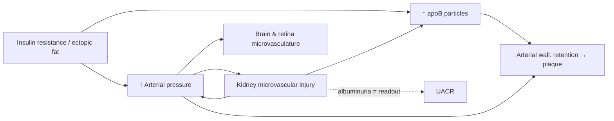

# The Other Hard Cause: What Lipidology Settled, and the Half of Cardiovascular Prevention It Left Behind

**Abstract.** Atherosclerotic cardiovascular disease has two causal exposures that no serious investigator disputes: the plasma concentration of apolipoprotein B–containing particles, and arterial pressure. Over three decades, preventive lipidology turned the first into one of the most rigorously adjudicated causal claims in medicine. It established that particle number beats cholesterol mass, that HDL cholesterol is a bystander, that triglycerides matter only through the particles that carry them, that Lp(a) is an inherited and potent particle, and that the decisive variable is cumulative exposure over decades rather than ten-year risk. Part I of this essay consolidates those propositions and updates them through late 2026: VESALIUS-CV extended PCSK9 benefit to people with no prior infarction or stroke, and Lp(a)HORIZON failed. Part II argues that the longevity-medicine movement, which inherited lipidology's epistemic standards, never applied them with the same force to pressure. I audit the gap directly. In a corpus of 389 episode notes from the most influential longevity-medicine podcast, roughly twenty are substantially about lipoproteins, one is about blood pressure, and isometric exercise never appears as an antihypertensive. The gap is inverted relative to global burden: high systolic pressure is the leading attributable risk factor for death worldwide and in China. I then treat pressure as lipidology treats apoB, as a continuous, cumulative exposure with drug-agnostic benefit. Using that frame, I argue that isometric training, now written into the 2025 AHA/ACC guideline and producing reductions comparable in magnitude to the aldosterone-synthase inhibitor the FDA approved in 2026, is a rational intervention for normotensive adults now, without waiting for outcome trials. The argument depends on one condition, and I make it explicit: the pressure reduction must be real in the individual, which is a measurement problem, not an outcome-trial problem.

---

## Prologue: Two Causes Nobody Disputes

In a 2025 conversation about the pathogenesis of atherosclerosis, Thomas Dayspring, one of the most careful clinical lipidologists of his generation, separated *risk factors*, which are causal and established through Mendelian randomization, randomized trials and consistent observational data, from *risk markers*, which are associative. He then said, almost in passing: "No reasonable person would dispute the causality of apoB and hypertension."[^dayspring334]

That sentence is the premise of this essay, and its asymmetry is the subject. Both halves are causal and both are modifiable. Both act cumulatively over decades on the same arterial wall, and their effects combine multiplicatively. Yet the intellectual culture of modern prevention, particularly the "Medicine 3.0" longevity movement that has done more than anyone to bring apoB, Lp(a) and coronary imaging into public consciousness, built a cathedral for the first cause and a shed for the second.

The claim can be checked, so I checked it. I went through the full set of 389 published episode notes from *The Drive*, the podcast through which Peter Attia and his guests have shaped how a large, educated, prevention-minded audience thinks about cardiovascular risk. The lipid side is deep. Roughly twenty episodes are substantially devoted to lipoproteins: a five-part series with Dayspring plus two later conversations, and episodes with Allan Sniderman, Ronald Krauss, Daniel Rader, John Kastelein, Benoît Arsenault and others. The pressure side consists of one solo question-and-answer episode, a section of a cardiology interview, and scattered remarks. Within that episode, the exercise discussion covers aerobic training and dynamic resistance training. Isometric exercise never appears in the corpus as a blood-pressure intervention. The new pharmacology of hypertension (aldosterone-synthase inhibitors, RNA-interference agents against angiotensinogen, renal denervation) does not appear at all.

| Domain in the corpus | Coverage |
|---|---|
| apoB, LDL, Lp(a), HDL, CETP, FH, remnants | ~20 episodes with leading lipidologists; repeated return visits |
| Blood pressure | 1 dedicated AMA episode; segments elsewhere |
| Isometric exercise for blood pressure | 0 |
| Aldosterone-synthase inhibitors, siRNA antihypertensives, renal denervation | 0 |

This is not a criticism of the lipid work, which is excellent and which Part I relies on. It is a description of where the light fell. The distribution of attention is also inverted relative to the distribution of death. The Global Burden of Disease study estimated that high systolic blood pressure was the leading risk factor for attributable deaths in 2019, responsible for 10.8 million deaths, about 19% of all deaths worldwide.[^gbd2019] In China, stroke rather than myocardial infarction has been the leading cause of death, and high systolic pressure the leading risk factor.[^zhou2019] A prevention culture built around the American coronary patient and around the particle has a predictable blind spot. That blind spot is largest in the populations where pressure does the most damage.

The essay has two equal halves. Part I sets out what lipidology has settled, because any serious account of cardiovascular prevention must start there and because its epistemic standards are the standards I want to apply to pressure. Part II applies those standards to pressure, examines what pressure does mechanically to an artery and to the kidney, identifies the structural reasons clinical medicine under-treats it, and ends with the cheapest intervention in the field, one that almost nobody in the longevity world uses.

A note on evidence. I separate three things throughout: what is established (with sources), what I infer from established findings, and what remains open. Where a figure comes from a press release or a secondary summary rather than a peer-reviewed paper, I say so.

---

# Part I — The Particle

## 1. A Disease of Retained Particles

The modern account of atherogenesis is the *response-to-retention* model.[^williams1995] [^tabas2007] Apolipoprotein B–containing lipoproteins small enough to cross the endothelium (LDL, IDL, smaller VLDL remnants and Lp(a)) enter the arterial intima. A fraction of them bind to subendothelial proteoglycans through positively charged residues on apoB and are retained. Retained particles are modified by oxidation, lipolysis and aggregation, and are taken up by macrophages that become foam cells. The rest of the disease follows from that initial retention: the inflammatory response, the necrotic core, the fibrous cap, calcification, and eventually rupture or erosion with thrombosis.

Two consequences follow, and the rest of Part I builds on them.

First, the unit of causation is the **particle**, not the cholesterol molecule. Cholesterol is cargo. What enters and is trapped in the wall is a lipoprotein particle, and the probability that a particle crosses and is retained depends on how many such particles are circulating. Every atherogenic lipoprotein carries exactly one molecule of apoB. Plasma apoB concentration is therefore, to a first approximation, a direct count of potentially atherogenic particles.[^sniderman2019]

Second, the process is **cumulative**. Retention is a flux and plaque is its integral. The European Atherosclerosis Society's two consensus statements made this explicit. The 2017 statement concluded that LDL causes atherosclerotic cardiovascular disease. The 2020 statement went further: the effect of apoB-containing lipoproteins on risk is determined by both the concentration and the total duration of exposure.[^ference2017] [^boren2020] The process begins early. The PDAY study (Pathobiological Determinants of Atherosclerosis in Youth), an autopsy study of young Americans who died of external causes, found aortic fatty streaks in essentially all subjects aged 15 to 19 and coronary lesions in a substantial fraction.[^strong1999] Fetal aortas from mothers with hypercholesterolemia already show increased fatty-streak formation.[^napoli1997] The disease that kills people in their sixties is laid down in their teens and twenties.

## 2. Seven Propositions Lipidology Has Settled

What follows is a consolidation of the convergent positions of the field's leading investigators. They agree on a great deal and disagree mainly at the margins.

### 2.1 Count, not cargo

LDL cholesterol (LDL-C) measures how much cholesterol is carried in LDL particles, not how many particles there are. Usually the two move together. When they diverge, risk follows the particle count. The divergence is common in exactly the patients prevention cares most about: those with insulin resistance, hypertriglyceridemia or diabetes, whose LDL particles are cholesterol-depleted and triglyceride-enriched.

*Discordance analysis* compares people whose apoB and LDL-C disagree with each other. In those comparisons, apoB consistently carries the risk.[^sniderman2014] In statin-treated patients from the Copenhagen General Population Study, apoB and non-HDL cholesterol reflected residual risk better than LDL-C.[^johannesen2021] Multivariable Mendelian randomization (genetic variants used as natural randomization) points the same way. When apoB, LDL-C and triglycerides are modeled together, apoB is the lipid trait that retains a robust independent association with coronary disease.[^richardson2020] In Sniderman's summary, apoB "includes all the information in triglycerides, LDL cholesterol, and even HDL cholesterol; it sums them."[^sniderman229]

**Status:** established. The remaining arguments concern measurement standardization and guideline inertia, not biology.

### 2.2 Clearance, not production

Population apoB rises roughly monotonically from childhood into middle age. Children typically have very low concentrations of LDL-C and apoB. Dayspring's point, which is the consensus view in lipoprotein physiology, is that this rise is mostly a failure of **clearance**, not overproduction. The liver's capacity to remove apoB particles through the LDL receptor declines under the cumulative influence of diet, adiposity, insulin resistance, hormonal change and age, all mediated through the nuclear transcription factors (SREBP-2 and its partners) that regulate LDL-receptor and PCSK9 expression.[^dayspring334]

This matters for prevention because it reframes the "normal" adult apoB. The population distribution of a middle-aged Western cohort is not a physiological reference range. It is the distribution of a clearance system that has been degraded in most people. Dayspring and O'Keefe have each argued that physiological LDL-C in neonates, hunter-gatherer populations and non-human primates sits in roughly the 50–70 mg/dL range.[^okeefe2004] The adult reference interval printed on a laboratory report is a description of the population, not a recommended level.

### 2.3 HDL cholesterol is a bystander

Few hypotheses in cardiology have been tested as thoroughly as the HDL hypothesis, and few have failed as completely.

- **Genetics.** Variants that raise HDL-C without affecting other lipoproteins, such as the endothelial-lipase variant LIPG Asn396Ser, do not lower myocardial infarction risk.[^voight2012]
- **CETP inhibitors.** These drugs raise HDL-C dramatically. Torcetrapib increased mortality, attributed to off-target aldosterone effects.[^barter2007] Dalcetrapib and evacetrapib were neutral. Anacetrapib reduced events modestly in REVEAL, by an amount explained by its reduction in non-HDL cholesterol rather than its large rise in HDL-C.[^reveal2017] Kastelein's summary: the trials "validated that CETP inhibition only lowers heart attacks by virtue of its LDL lowering."[^kastelein255]
- **Niacin.** AIM-HIGH and HPS2-THRIVE showed no benefit on top of statin therapy.

As Rader puts it, "low HDL cholesterol is not causally linked to atherosclerosis and genetically high HDL cholesterol is not causally linked to protection."[^rader240]

HDL is not irrelevant to biology. Its functions in cholesterol efflux, anti-inflammation and endothelial protection are real research questions, and HDL *function* may yet prove measurable and meaningful. But the cholesterol content of HDL is a marker, mostly of triglyceride metabolism and insulin sensitivity, not a therapeutic target.

The frontier here is a test of the "LDL-only" reading of CETP rather than a revival of the HDL hypothesis. Obicetrapib lowers LDL-C by roughly a third on top of statins. Its outcome trial, PREVAIL, had not reported as of this writing, with an interim analysis reportedly planned for late 2026.[^prevail] If it succeeds, it will succeed as an apoB-lowering drug.

### 2.4 Triglycerides matter through particles

Triglyceride-rich lipoproteins and their remnants are atherogenic, but the risk they carry appears to be the risk of their apoB particles. Ference and colleagues compared triglyceride-lowering variants in the lipoprotein lipase gene with LDL-lowering variants in the LDL-receptor gene. Per unit change in apoB, the two produced the same reduction in coronary risk.[^ference2019tg]

PROMINENT was the clinical confirmation, and it failed in an instructive way. Pemafibrate lowered triglycerides by about 26% and reduced VLDL and remnant cholesterol in more than ten thousand patients with type 2 diabetes and atherogenic dyslipidemia. It did not reduce cardiovascular events (HR 1.03). ApoB rose slightly, by about 5%.[^prominent] A large, real change in the "metabolic" lipid trait without a reduction in particle number produced nothing.

### 2.5 The insulin-resistant signature

Part I meets the metabolic system at this point, and the connection is closer than generalists usually appreciate.

In insulin resistance, hepatic lipid synthesis continues while insulin's suppression of hepatic glucose output fails. This dissociation is often called *selective hepatic insulin resistance*. The liver secretes more and larger triglyceride-rich VLDL, and the clearance of those particles slows, partly because of excess apolipoprotein C-III, an inhibitor of lipoprotein lipase.[^dayspring334] CETP then exchanges triglyceride from VLDL for cholesteryl ester in LDL and HDL. Hepatic and endothelial lipases hydrolyze the triglyceride in the enriched particles. The products are small, cholesterol-depleted LDL particles, more of them for any given LDL-C, and small HDL that is rapidly catabolized.

Garvey and colleagues characterized this pattern by nuclear magnetic resonance (NMR) lipoprotein profiling against insulin-clamp measurements of insulin sensitivity: larger VLDL, smaller LDL, more LDL particles, and loss of large HDL.[^garvey2003] Dayspring's gloss on the clinical significance is the important part. These lipoprotein signatures appear before postprandial insulin rises, before fasting insulin rises, and "decades before glucose goes up."[^dayspring334]

This is why the lipoprotein profile is a leading indicator of metabolic state. Euglycemia is maintained for years by compensatory hyperinsulinemia, so glucose is a lagging indicator that moves only when β-cell compensation fails. The liver's lipid output changes during the compensation phase. A pattern of small LDL peak size, high LDL particle count relative to LDL-C, low large-HDL and a high triglyceride-to-HDL ratio is a readout of hepatic insulin resistance.

The causal accounting must be kept straight, though. In this framework the metabolic signature is not a separate cardiovascular cause. Dayspring explicitly declines to treat hyperinsulinemia as an independent risk factor; it travels with dyslipidemia and hypertension, "which are clearly and independently established as causal."[^dayspring334] Small dense LDL adds little predictive information once apoB is known. The signature tells you about the engine. The particle count tells you about the wall.

Insulin resistance also raises blood pressure, through impaired insulin-stimulated endothelial nitric oxide, preserved renal sodium retention under hyperinsulinemia, and sympathetic activation. The same upstream disorder therefore feeds *both* hard causes. Part II returns to this.

### 2.6 Lp(a): the inherited, potent particle, and a sobering trial

Lipoprotein(a) is an LDL-like particle whose apoB is covalently linked to apolipoprotein(a). Its plasma concentration is predominantly genetically determined, set largely by the *LPA* gene, and is roughly stable across adult life. That is why a single lifetime measurement suffices for risk assessment.[^arsenault210] About one in five people have levels high enough to matter.

Per particle, Lp(a) is far more atherogenic than LDL. Björnson and colleagues exploited the fact that both carry one apoB per particle and compared genetically instrumented Lp(a) and LDL in UK Biobank. They estimated that Lp(a) is about 6.6 times as atherogenic per particle (95% CI 5.1–8.8).[^bjornson2024] Because Lp(a) particles are usually far less numerous than LDL particles, the contribution at population level is smaller than the per-particle figure suggests. Mendelian randomization by Burgess and colleagues implied that very large absolute reductions in Lp(a), on the order of 100 mg/dL, would be needed to match the coronary benefit of a 1 mmol/L (38.7 mg/dL) reduction in LDL-C.[^burgess2018]

That arithmetic now has a clinical test. In September 2026, Novartis announced that **Lp(a)HORIZON**, the phase 3 outcome trial of the antisense agent pelacarsen in 8,323 patients with established cardiovascular disease and elevated Lp(a), missed its primary endpoint.[^horizon] Full data had not been presented when this essay was written, so interpretation is provisional. Commentators have noted strong background therapy (mean LDL-C around 66 mg/dL). Live explanations include insufficient absolute lowering in the relevant range, a trial window too short to reverse a lifetime of exposure, and Lp(a)'s pathology running through mechanisms that a particle-count reduction of this size does not address within five years.

The siRNA agents (olpasiran, lepodisiran, zerlasiran), which lower Lp(a) more deeply, still have outcome trials pending. The lesson for this essay is epistemic: *a causal exposure is not automatically a target whose short-term manipulation reverses risk.* Part II depends on the distinction between a causal exposure and a drug-agnostic surrogate, and this trial illustrates it.

The 2025 ESC/EAS focused update recognized Lp(a) above roughly 50 mg/dL (105 nmol/L) as a risk modifier.[^esc2025] The 2026 ACC/AHA dyslipidemia guideline endorsed Lp(a) screening.[^acc2026] At present, the clinical consequence of an elevated Lp(a) is mainly to lower everything else more aggressively, apoB above all.

### 2.7 Time is the hidden variable

The deepest contribution of preventive lipidology may not be any single biomarker. It may be the reframing of risk over time.

Standard prevention uses ten-year risk estimates, and age dominates ten-year risk. A 35-year-old with an apoB of 120 mg/dL has a low ten-year risk. That is not because the exposure is benign but because ten years is too short a window for a young person's cumulative exposure to turn into events. Sniderman's critique is that this approach systematically defers treatment until the disease is already established, and roughly half of infarcts and strokes occur before age 60.[^sniderman185] Pencina, Sniderman and colleagues modeled the expected 30-year benefit of early versus delayed lipid lowering and found that early intervention in younger adults prevented substantially more events than starting later.[^pencina2020]

The quantitative basis for "earlier is better" comes from comparing two kinds of evidence. In five-year statin trials, each 1 mmol/L reduction in LDL-C lowers major vascular events by about 22%.[^ctt2010] In Mendelian randomization, a lifelong 1 mmol/L lower LDL-C, conferred by inherited variants, is associated with about a 54% lower risk of coronary heart disease.[^ference2012] The difference is time. The same reduction in concentration buys roughly two to three times the relative benefit when it is applied for a lifetime rather than for five years. The implication is direct: the most valuable year to lower apoB is the earliest one you can.

Late-2025 trial evidence pushed the boundary between "secondary" and "primary" prevention outward. **VESALIUS-CV** randomized 12,257 adults aged 50–79 with atherosclerosis or diabetes but *no prior myocardial infarction or stroke* to evolocumab or placebo on top of standard therapy. Over a median of about 4.5 years, evolocumab reduced the three-point composite of coronary death, myocardial infarction or ischemic stroke by 25% (HR 0.75, 95% CI 0.65–0.86). Median LDL-C on treatment was about 45 mg/dL.[^vesalius] On safety at very low levels, a FOURIER secondary analysis found no excess adverse events in patients whose LDL-C fell below 20 mg/dL, though that finding covers a follow-up of only about two years.[^giugliano2017]

## 3. Seeing the Wall

Biomarkers measure exposure. Imaging measures what the exposure has already done. The two answer different questions, and confusing them is one of the commonest errors in prevention.

Coronary artery calcium (CAC) scoring detects calcified plaque. A positive score establishes that disease is present, which is why Dayspring argues that a CAC-positive patient is no longer in "primary" prevention at all.[^dayspring334] Attia's own history is the standard illustration. His first calcium scan at 35 was positive, at an LDL-C around the population median, without insulin resistance or smoking.[^dayspring334] A score of zero is weaker evidence than it appears, especially in the young. Calcification is a late feature of plaque, so a zero score cannot exclude non-calcified disease.

Coronary CT angiography (CCTA) quantifies non-calcified plaque as well. Ethan Weiss's practice, described in his 2023 conversation, is to treat any visible plaque, even a small amount, with maximal medical therapy, on the grounds that its presence proves the patient's integral of exposure has already produced disease.[^weiss247]

The strategic point follows from section 2.7. Imaging answers the question "has the integral already crossed into disease?" It does not answer "should apoB be lowered?" Waiting for a calcium score to turn positive before acting is waiting for the outcome the intervention was meant to prevent. Wilkins and Lloyd-Jones made this argument explicitly.[^wilkins2021] Imaging is most valuable for calibrating intensity, for example escalating therapy when plaque is found. It is least valuable as permission to do nothing when plaque is not found.

## 4. The Toolkit and Its Frontier

Almost every effective lipid-lowering therapy works through the same physiological lever described in section 2.2: increased hepatic clearance of apoB particles, mostly through more LDL receptors.

| Agent | Mechanism | Outcome evidence (as of late 2026) |
|---|---|---|
| Statins | HMG-CoA reductase inhibition → SREBP-2 → ↑ LDL receptors | Extensive; ~22% event reduction per mmol/L LDL-C[^ctt2010] |
| Ezetimibe | NPC1L1 inhibition (intestinal cholesterol absorption) → ↑ LDL receptors | Positive on top of statins (IMPROVE-IT)[^improveit] |
| Bempedoic acid | ATP-citrate lyase inhibition upstream of HMG-CoA reductase | Positive in statin-intolerant patients (CLEAR Outcomes);[^clear] role expanded in the 2025 ESC/EAS update[^esc2025] |
| PCSK9 antibodies (evolocumab, alirocumab) | Prevent LDL-receptor degradation | FOURIER, ODYSSEY OUTCOMES; VESALIUS-CV in people without prior MI or stroke[^vesalius] |
| Inclisiran | siRNA against hepatic PCSK9, dosed twice yearly | LDL-C lowering established; outcome trials (ORION-4, VICTORION-2 PREVENT) not yet reported[^victorion] |
| Enlicitide | Oral macrocyclic peptide PCSK9 inhibitor | Phase 3 lipid trials positive (2025); outcome trial ongoing[^coralreef] |
| Obicetrapib | CETP inhibition, LDL-lowering in practice | PREVAIL outcome trial pending[^prevail] |
| Lp(a) agents | Antisense (pelacarsen) and siRNA (olpasiran, lepodisiran, zerlasiran) against *LPA* mRNA | Pelacarsen failed in Lp(a)HORIZON;[^horizon] siRNA outcome trials pending |

Two features of this table deserve emphasis for an expert audience.

The first is mechanistic convergence. Statins, ezetimibe, bempedoic acid and PCSK9 inhibition are pharmacologically unrelated, yet all lower events in proportion to the apoB reduction they achieve. That convergence is what makes apoB a *hard* surrogate in the sense used throughout this essay: the clinical benefit does not depend on the mechanism used to move it. CETP inhibition shows the converse. The HDL change contributed nothing, and the benefit tracked the non-HDL change. The Lp(a) result may be the next instance of the same lesson: a causal particle whose manipulation at the tested magnitude did not convert into benefit within a trial window.

The second is that the frontier now lies in durability and adherence more than potency. Twice-yearly siRNA dosing and oral PCSK9 inhibition address what limits population benefit: people stop taking daily pills. Under the cumulative-exposure model, a therapy that keeps working for forty years is worth more than one that is slightly more potent for five.

## 5. The Strongest Objection

A serious essay should state the best counter-argument to its premise. On the lipid side, the most visible current challenge comes from people on very-low-carbohydrate diets with markedly elevated LDL-C and apoB alongside low triglycerides, high HDL-C and excellent insulin sensitivity. They are sometimes called "lean mass hyper-responders." A related "lipid energy model," discussed on *The Drive* with Dave Feldman,[^feldman19] proposes that in this metabolic context high LDL reflects increased lipid trafficking for energy and may not carry the usual risk.

The 2025 KETO-CTA analysis in *JACC: Advances* reported that, in about 100 such individuals followed with serial CCTA, baseline plaque predicted plaque progression while apoB and LDL-C did not.[^ketocta] The study's methods and reporting have since been sharply disputed. Critics argue that the cohort showed substantial progression and that the analytic choices obscured it. Secondary sources have claimed a retraction, which I was unable to verify against the journal.

Even read charitably, the study cannot carry the weight placed on it. It followed a small, highly selected cohort for about a year. "No detectable association within one year" is a statement about statistical power, not about causation. It also runs against Mendelian randomization data on hundreds of thousands of people and against the familial hypercholesterolemia natural experiment. In FH, a single-gene defect that raises LDL and does nothing else produces premature atherosclerosis regardless of metabolic health. As Kastelein put it, these patients "have one thing, one mutation in a single gene that doesn't do anything else than raise LDL cholesterol, and they drop dead when they're like 25."[^kastelein255]

Metabolic health is necessary for cardiovascular health. It is not sufficient, and it does not neutralize particle number.

## 6. Targets

The guideline landscape converged considerably between 2019 and 2026.

| Source | Position |
|---|---|
| 2019 ESC/EAS[^esc2019] | apoB < 65 mg/dL (very high risk), < 80 (high), < 100 (moderate) |
| 2025 ESC/EAS focused update[^esc2025] | LDL-C goals unchanged; Lp(a) > ~50 mg/dL as risk modifier; bempedoic acid expanded |
| 2026 ACC/AHA dyslipidemia guideline[^acc2026] | Restores absolute targets (LDL-C < 100 borderline/intermediate risk, < 70 high, < 55 very high); PREVENT-ASCVD risk equations; apoB endorsed in selected patients rather than as the primary target |

My position, which goes beyond the guidelines, is as follows. For an adult who has chosen aggressive primary prevention, an apoB around 60 mg/dL (0.6 g/L) is a defensible aim. It lies within the range achieved in outcome trials, close to the physiological level of youth, and consistent with the cumulative-exposure model. Statements that apoB should be driven below 20 mg/dL have no outcome support. Values in that range overlap with the genetic hypobetalipoproteinemias, and the FOURIER figure of "below 20" refers to LDL-C, not apoB. Units are a frequent source of error: Chinese and European laboratories often report apoB in g/L, and 60 mg/dL equals 0.60 g/L.

## 7. The Template

The achievement of preventive lipidology is a method as much as a set of findings. Causal claims were adjudicated by triangulating Mendelian randomization, randomized trials with multiple drug classes, and dose–response relationships. Plausible-but-wrong hypotheses (HDL, triglycerides as an independent target, and possibly Lp(a) lowering at the magnitudes tested so far) were killed by hard outcome trials. Risk was moved from a ten-year horizon toward a lifetime integral. The result is that an informed patient can now reason about apoB with unusual clarity: it is causal, cumulative, measurable, cheap to measure and pharmacologically controllable, so lower it early.

Part II asks what happens when the same method is applied to the other cause.

---

# Part II — The Pressure

## 8. The Asymmetry, Measured

The audit in the prologue concerns emphasis, not error. What *The Drive*'s single blood-pressure episode says is broadly correct. It cites SPRINT (Systolic Blood Pressure Intervention Trial), argues for targets near 120/80, explains proper measurement, and reviews weight loss, sodium and aerobic training.[^attia258] What it lacks is the treatment the lipid side received: return visits from the field's leading investigators, mechanistic depth, and attention to the frontier.

The global burden runs the other way.

- **Worldwide.** High systolic pressure was the leading risk factor for attributable death in 2019 (10.8 million deaths).[^gbd2019] In GBD 2021 it accounted for 7.8% of all disability-adjusted life years, second only to ambient particulate matter.[^gbd2021]
- **China.** Stroke was the leading cause of death and high systolic pressure the leading risk factor in the 1990–2017 provincial analysis.[^zhou2019] In East Asia, high systolic pressure leads the attributable risk for ischemic stroke, ahead of particulate pollution and high LDL-C.[^gbdstroke] Hemorrhagic stroke, which is driven more directly by pressure than by particles, makes up a larger share of strokes in China than in Western populations.
- **Control.** In the 2018 round of China's national chronic disease surveillance, only 38.3% of adults with hypertension were aware of it, 34.6% were treated and 12.0% were controlled. About 240 million of the 274 million affected adults had inadequately controlled pressure.[^zhang2023]

An American longevity framework, centered on coronary plaque and apoB, exported to East Asia without reweighting, will systematically underweight the exposure that kills most people there. Even in the West, it underweights the exposure with the greater attributable mortality.

## 9. Pressure Is an Exposure, Not a Diagnosis

Lipidology's central conceptual move was to stop treating "hypercholesterolemia" as a binary diagnosis and to treat apoB as a continuous, cumulative exposure. The equivalent move for pressure is supported by evidence at least as strong. It is less complete in clinical practice.

**The observational curve has no threshold.** In the Prospective Studies Collaboration's individual-participant meta-analysis of one million adults in 61 cohorts, vascular mortality rose log-linearly with usual blood pressure from at least 115/75 mmHg upward. At ages 40–69, each 20 mmHg higher systolic (or 10 mmHg higher diastolic) pressure was associated with roughly a doubling of stroke and ischemic heart disease mortality.[^lewington2002]

**The trial evidence is drug-agnostic and baseline-agnostic.** The Blood Pressure Lowering Treatment Trialists' Collaboration (BPLTTC) pooled 48 randomized trials and 344,716 participants. Each 5 mmHg reduction in systolic pressure lowered the risk of major cardiovascular events by about 10% (HR 0.91 without prior cardiovascular disease, 0.89 with it). There was no reliable heterogeneity by baseline systolic category, and the categories began *below 120 mmHg*.[^bpltt2021] This single result is the most important fact in Part II. The benefit of lowering pressure is proportional to the reduction achieved, regardless of how it is achieved within the drug classes studied, and regardless of whether the starting pressure is "hypertensive."

**Intensive targets work, including in Chinese populations.**

| Trial | Population | Comparison | Primary result |
|---|---|---|---|
| SPRINT (2015)[^sprint2015] | 9,361 high-risk U.S. adults without diabetes | SBP < 120 vs < 140 | Major CV events HR ~0.75; all-cause death HR ~0.73 |
| STEP (2021)[^step2021] | 8,511 Chinese adults aged 60–80 | SBP 110–<130 vs 130–<150 | Composite CV outcome HR 0.74 |
| ESPRIT (2024)[^espirit2024] | 11,255 high-risk Chinese adults, with or without diabetes or prior stroke | SBP < 120 vs < 140 | Major vascular events HR 0.88 |
| BPROAD (2024)[^bproad2024] | 12,821 Chinese adults with type 2 diabetes | SBP < 120 vs < 140 | Composite CV outcome HR 0.79 |

The harms are real: syncope, symptomatic hypotension, hyperkalemia and acute kidney injury occur more often under intensive treatment. They are the harms of drugs titrated to a target, which matters for the intervention discussed below. Cognition is also at stake. In SPRINT MIND, intensive control reduced mild cognitive impairment (HR 0.81). The reduction in probable dementia did not reach significance.[^sprintmind2019]

**The guidelines have moved, but not all the way.** The 2024 ESC guideline created an "elevated blood pressure" category of 120–139/70–89 mmHg and set a treated systolic target of 120–129 mmHg for most patients who tolerate it.[^esc2024] The 2025 AHA/ACC guideline retained a target below 130/80. It adopted the PREVENT equations, with a 7.5% ten-year total cardiovascular risk threshold for treating stage 1 hypertension. It expanded urine albumin testing and primary-aldosteronism screening, and added isometric resistance exercise to its lifestyle table.[^aha2025] [^aha2025summary] Both guidelines remain built on a *threshold-then-treat* architecture, and both still use ten-year risk to decide when the threshold is crossed. That is the architecture lipidology spent two decades criticizing.

## 10. What Pressure Does to an Artery

One misconception needs correcting first, because it circulates widely in longevity discussions: that lowering blood pressure helps by "reducing shear stress." Wall shear stress is the frictional force of flowing blood on the endothelium. It is set mainly by flow velocity, vessel geometry and blood viscosity, not by transmural pressure. Steady, laminar, relatively *high* shear is atheroprotective. It induces KLF2 and endothelial nitric oxide synthase and keeps the endothelium quiescent. Plaques form preferentially where shear is *low and oscillatory*: at bifurcations, inner curvatures and branch ostia. Exercise raises shear, which is part of why it helps. Lowering pressure does not work by lowering shear.

Pressure does its damage through at least three other routes.

1. **Circumferential wall stress and remodeling.** By Laplace's relation, wall tension scales with transmural pressure times radius. Sustained high tension drives medial hypertrophy, elastin fatigue and fracture, collagen deposition and progressive arterial stiffening. Stiffening raises pulse pressure, which raises tension further. Mechanically, this is a positive feedback loop.
2. **Pulsatile transmission to the microcirculation.** The brain and kidney are high-flow, low-impedance organs, and their small vessels are exposed to the pulsatile energy that a stiff aorta no longer damps. O'Rourke and Safar argued that this is the common mechanism linking aortic stiffening to cerebral small-vessel disease and to microvascular kidney damage.[^orourke2005] On this account, white-matter hyperintensities on brain MRI, albuminuria in the urine and retinal arteriolar changes are the same injury expressed in three vascular beds.
3. **Convective delivery of particles.** Transmural pressure drives water filtration across the arterial wall, and that filtration carries macromolecules, including LDL, into the intima by convection as well as diffusion.[^tarbell2003] Pressure and particle number therefore interact mechanistically: pressure raises the flux of the very particles whose retention Part I described.

The genetic data are consistent with that interaction. In UK Biobank, Ference and colleagues combined genetic scores for lifelong lower LDL-C and lower systolic pressure. A combined exposure equivalent to 38.7 mg/dL lower LDL-C and 10 mmHg lower systolic pressure was associated with an odds ratio of 0.22 for major coronary events and 0.32 for cardiovascular death. The effects were independent, dose-dependent and additive on the log scale, which means multiplicative on risk.[^ference2019bp] The authors caution that these lifelong genetic effects cannot be assumed to equal what treatment achieves. As a description of the causal structure, though, the result is clear: two independent exposures, each integrated over time, whose effects multiply.

A heuristic statement of the model:

$$
\log \text{risk}(T) \;\approx\; \beta_{B}\int_0^T \text{apoB}(t)\,dt \;+\; \beta_{P}\int_0^T \text{SBP}(t)\,dt \;+\; \ldots
$$

This is not a fitted model. It is a way of stating what the evidence already implies. Risk accumulates as the area under two curves, both curves start in adolescence, both can be lowered, and lowering either one early is worth more than lowering it late.

## 11. The Kidney as Amplifier

The kidney is where the two causes and the metabolic engine meet in a loop.

Dayspring describes chronic kidney disease as "a super major risk factor," but probably acting mainly through the causal factors it reliably brings: elevated apoB and serious hypertension. He adds plausible additional mechanisms such as retained uremic metabolites and impaired nitric-oxide synthesis through asymmetric dimethylarginine.[^dayspring334] In the other direction, pressure is a principal driver of kidney decline. Insulin resistance and ectopic fat feed both pressure (through renal sodium retention and sympathetic activation) and the atherogenic lipoprotein profile.

The practical readout of this loop is the urine albumin-to-creatinine ratio (UACR). It is cheap, non-invasive and an early marker of microvascular endothelial injury. It is also rarely measured. In the CKD Prognosis Consortium's analysis of nearly four million adults across multiple countries, only 35.1% of people with diabetes and 4.1% of people with hypertension had a UACR test over a two-year window. The estimated ratio of undetected to detected albuminuria was 1.8 in diabetes and 19.5 in hypertension.[^shin2021] The 2025 AHA/ACC guideline's expansion of albumin testing is a direct response.[^aha2025summary]

## 12. Medicine 2.0's Structural Blind Spots

It is tempting to say that clinicians "don't know" these things. That is false. Every cardiologist knows SPRINT, and every guideline committee read BPLTTC. The failure is structural: the system knows but does not act, and the reasons are built into how care is organized.

1. **Threshold architecture.** Exposure is continuous, but diagnosis is binary. A patient at 128/82 is "normal" in most clinics, and a patient at 138/88 is often watched rather than treated. Lipidology fought the same architecture and largely won. The pressure side has only begun that fight, through the ESC's "elevated" category.
2. **Ten-year horizons.** The PREVENT-based thresholds in both the lipid and pressure guidelines still decide on ten-year risk. That deliberately ignores the cumulative-exposure logic that the same documents accept in their background sections.
3. **Measurement.** Treatment decisions rest on a few office readings, often taken without seated rest, proper cuff size or repetition. Home and ambulatory monitoring are recommended but unevenly used. Masked hypertension (normal in clinic, elevated at home) goes undetected by design.
4. **Kidney invisibility.** As section 11 showed, albuminuria, the cheapest window into microvascular damage, goes unmeasured in about 96% of people with hypertension.
5. **Template transfer.** Prevention frameworks built on Western coronary cohorts are applied in East Asian populations, where stroke dominates and pressure carries more of the attributable risk.
6. **Therapeutic inertia in reverse.** For pressure, there are effective non-pharmacological interventions that clinicians rarely prescribe in concrete form. "Exercise more" is not a prescription. "Four two-minute isometric holds, three times a week" is.

## 13. The Drug Nobody Takes

If an orally available molecule lowered systolic pressure by about 8 mmHg, cost nothing, took fourteen minutes three times a week, had no known drug interactions and had a benign adverse-effect profile, it would be a blockbuster. Such an intervention exists, and almost nobody in the longevity world uses it.

In 2023, Edwards and colleagues published a network meta-analysis in the *British Journal of Sports Medicine* of 270 randomized trials and 15,827 participants. Isometric exercise training reduced resting systolic and diastolic pressure by about 8.2 and 4.0 mmHg relative to controls. It ranked first among all modes for systolic reduction (SUCRA 98%), ahead of combined training, dynamic resistance, aerobic training and high-intensity intervals, each of which produced roughly 4–6 mmHg. Among isometric modes, the wall squat ranked highest for systolic reduction.[^edwards2023] An earlier review by Baffour-Awuah and colleagues reached the same direction (about 7/3 mmHg) and concluded that isometric training is safe. The acute pressor response during the holds was often smaller than that of guideline-recommended aerobic or dynamic training.[^baffour2022]

The guidelines have absorbed this. The 2025 AHA/ACC guideline lists isometric resistance exercise: handgrip, four two-minute contractions with one minute of rest, at 30–40% of maximal voluntary contraction, three sessions per week, with an expected systolic reduction of roughly 5–10 mmHg. It frames the modality as an adjunct that should not displace established measures or indicated medications.[^aha2025summary] The 2024 ESC guideline lists dynamic *or* isometric resistance training two to three times a week alongside aerobic activity.[^esc2024]

The comparison that should embarrass the field is with the newest antihypertensive pharmacology. In the phase 3 BaxHTN trial, the aldosterone-synthase inhibitor baxdrostat lowered office systolic pressure by a placebo-adjusted 8.7 mmHg (1 mg) and 9.8 mmHg (2 mg) in patients with uncontrolled or resistant hypertension. On that basis the FDA approved it in May 2026, the first agent of its class.[^baxhtn] In Launch-HTN, lorundrostat produced placebo-adjusted reductions of 9.1 mmHg at six weeks and 11.6 mmHg at twelve weeks. Its new drug application has a target action date of 22 December 2026.[^launchhtn]

The populations and the evidence quality differ, and the comparison is only fair if that is said plainly:

- **Population.** The aldosterone-synthase inhibitor trials enrolled patients whose pressure remained uncontrolled on two or more drugs. The isometric trials enrolled mostly normotensive and mildly hypertensive people. Effect sizes in different populations are not interchangeable.
- **Design.** BaxHTN was large, blinded and placebo-controlled. Isometric trials are small, short and necessarily unblinded, and most measure office pressure. As of the Hong Kong trial protocol, only one wall-squat randomized trial (n = 48, four weeks) had used ambulatory monitoring.[^hktrial]
- **Bias.** Small unblinded trials of a popular intervention are vulnerable to publication bias and regression to the mean.

The comparison does establish one thing. The magnitude of reduction the field considered sufficient to approve a first-in-class drug in 2026 is the same magnitude the best available meta-analysis attributes to a wall squat.

Written in the format of a drug label:

| | Isometric exercise training |
|---|---|
| **Indication (evidence-based)** | Adjunct for elevated BP and stage 1–2 hypertension (2025 AHA/ACC; 2024 ESC) |
| **Indication (inferred, see §14)** | Primary prevention in normotensive adults seeking lower lifetime pressure exposure |
| **Dose** | 4 × 2-min holds, 1–2 min rest, 3 sessions/week. Handgrip at 30–40% MVC, or wall squat at a knee angle that is hard but sustainable for 2 min (perceived exertion ~7–8/10 by the end of each hold) |
| **Onset** | Reductions reported from ~2–4 weeks; most trials 4–12 weeks |
| **Offset** | Uncertain. In one small trial in young normotensives (n = 25), resting systolic pressure fell ~6 mmHg and was still ~4 mmHg below baseline 8 weeks after stopping, with ambulatory reductions also maintained[^detraining2022]; older studies suggest return toward baseline over ~5–8 weeks. Treat as a maintenance therapy |
| **Expected effect** | ~5–10 mmHg systolic (guideline estimate); ~8 mmHg in pooled RCTs, with high uncertainty |
| **Proposed mechanisms** | Repeated post-contraction reactive hyperemia (a shear stimulus) with endothelial adaptation; reduced sympathetic outflow; baroreflex resetting. None definitively established |
| **Adverse effects** | Transient pressor rise during holds; musculoskeletal strain (knee with wall squat) |
| **Precautions** | Breathe continuously; no Valsalva. Conventional exercise cautions apply: severely uncontrolled pressure, unstable cardiac disease, recent cardiac events, known aortic aneurysm, or recent ocular surgery/proliferative retinopathy warrant clinical clearance first |
| **Interactions** | None pharmacological. Additive with aerobic training, weight loss and sodium reduction |
| **Cost** | ~42 minutes/week |

## 14. Extrapolating to the Normotensive

The core argument of this essay is about acting under uncertainty, and it has a specific structure. Isometric training has no cardiovascular outcome trial, and it will probably never get one: no sponsor will fund a ten-year, thirty-thousand-person trial of an unpatentable exercise. The question is whether that absence should stop a normotensive adult from adopting it now.

The answer depends on what kind of variable blood pressure is.

**A hard surrogate licenses action; a soft one does not.** Part I showed what happens when a lipid marker is moved without moving the causal variable: HDL-C rose under CETP inhibitors, triglycerides fell under pemafibrate, and nothing happened to outcomes. Those markers are *soft*: the relationship between moving them and changing risk depends on the mechanism used. ApoB and systolic pressure are *hard*: across mechanistically distinct drug classes, benefit is proportional to the reduction achieved. For pressure, BPLTTC shows that this proportionality holds across baseline categories starting below 120 mmHg.[^bpltt2021]

When a surrogate is hard in this sense, the outcome trial for any new, safe intervention that moves it is largely redundant. The expected benefit can be read off the existing dose–response relationship. What remains uncertain is whether the intervention really moves the surrogate in a given person, and by how much, and for how long. That is a measurement question, and an individual can answer it in eight weeks with a home cuff.

**The arithmetic, with honest error bars.** Assume a sustained reduction of 8 mmHg, from the pooled estimate, and apply the BPLTTC primary-prevention hazard ratio log-linearly: $0.91^{8/5} \approx 0.86$, a relative risk reduction of about 14% in major cardiovascular events. For a 40-year-old with a ten-year total risk of 2%, that is an absolute reduction of about 0.3 percentage points over ten years. Over ten years, that benefit is small.

The case rests on the integral. Lifetime cardiovascular risk for middle-aged adults is commonly estimated at roughly a third or more. The lipid evidence shows that lifelong exposure differences produce two to three times the relative benefit of five-year treatment differences.[^ctt2010] [^ference2012] The pressure evidence has the same shape. The observational doubling per 20 mmHg[^lewington2002] implies a steeper gradient than five-year trials achieve, consistent with time leverage, and the genetic evidence shows lifelong pressure differences combining multiplicatively with lipid differences.[^ference2019bp] It is an inference, not an established fact, that a sustained 5–8 mmHg reduction from age 35 or 40 yields a lifetime relative benefit larger than the 14% calculated from trials. But it is the inference the same evidence structure already forced on lipidology.

The costs are about forty minutes a week and a small musculoskeletal risk. The plausible benefit is a meaningful reduction in lifetime stroke, infarction, heart failure and vascular cognitive impairment. When the costs are that low and the surrogate is that hard, waiting for an outcome trial that will never be run is itself a decision, and a poor one.

**What would make this wrong.** I state these as falsifiable checkpoints.

1. **The effect is smaller under ambulatory measurement.** If well-conducted trials measuring 24-hour pressure find reductions of 2–3 mmHg rather than 6–8, the expected benefit falls proportionally. The Hong Kong trial (n = 390, ambulatory endpoint, stretching control)[^hktrial] and the UK ISOFITTER trial (home-based wall squats, 5 mmHg target)[^isofitter] are the near-term tests.
2. **The effect does not persist.** If reductions fade despite continued training, the integral argument weakens.
3. **Exercise-induced reductions are not equivalent to drug-induced ones.** BPLTTC's drug-agnosticism covers pharmacological classes. It is an inference, though a reasonable one, that it extends to non-pharmacological mechanisms. Weight loss and sodium reduction lower pressure and are associated with the expected benefits. I know of no evidence that exercise-lowered pressure is less protective.
4. **Individual non-response.** Pooled means hide responders and non-responders. That is why the individual measurement in the next section is not optional.

## 15. A Protocol, and the N-of-1 That Should Follow

I have not yet run this on myself, so I present the protocol rather than results. The value of the exercise lies in the measurement discipline, not in the holds.

**Measurement**, following standard home-monitoring practice: a validated upper-arm cuff of the correct size; seated, back supported, feet flat, arm at heart level, after five minutes of quiet rest; no caffeine, exercise or nicotine in the preceding thirty minutes; two readings one minute apart, morning (before medication or breakfast) and evening, every day of a measurement week. Discard the first day of each week and average the rest.

**Design:**

| Phase | Duration | Content |
|---|---|---|
| Baseline | 2 weeks | Home BP as above; no change in other habits |
| Intervention | 8 weeks | 4 × 2-min wall squat or handgrip, 3×/week; home BP in weeks 4 and 8 |
| Washout | 4–8 weeks | Stop holds; home BP in the final week |
| Re-challenge (optional) | 4 weeks | Resume; confirm the reduction returns |

**Analysis:** the difference between baseline and week-8 mean systolic pressure, with the day-to-day standard deviation as the noise estimate. A reduction that exceeds the noise, reverses in washout and returns on re-challenge is about as much evidence as a single person can obtain. Keep the other levers (body weight, sodium, alcohol, sleep, aerobic volume) stable, or record them.

A year of 24-hour measurement at intervals would turn the anecdote into a time series, and a time series is the object the cumulative model in section 10 cares about.

## 16. Coda: Pressure's PCSK9 Moment

Lipidology's pharmacological arc ran from statins to ezetimibe, then to monoclonal PCSK9 antibodies, then to an siRNA (inclisiran) dosed twice a year, and now to an oral PCSK9 inhibitor in phase 3. Hypertension is entering its equivalent arc. An aldosterone-synthase inhibitor was approved in 2026, and a second has an FDA action date in December 2026.[^baxhtn] [^launchhtn] Zilebesiran, an siRNA against hepatic angiotensinogen dosed every six months, is in an 11,000-patient cardiovascular outcome trial, ZENITH, which dosed its first patient in late 2025.[^zenith] Renal denervation now has a guideline foothold for resistant hypertension.[^aha2025summary] A decade from now, controlling pressure may be as easy as controlling apoB is becoming.

None of that requires waiting. The two-integral model in section 10 says what to do now. Measure both curves early: apoB and Lp(a) once in early adulthood, home blood pressure properly, and UACR alongside them. Lower both curves early, because the earliest years carry the most leverage. Recognize that the metabolic engine of insulin resistance and ectopic fat pushes both curves upward, so fixing it lowers both.

The particle side of prevention has a mature literature, eminent advocates and a large, educated following. The pressure side has stronger epidemiology, comparable trial evidence and a free intervention of drug-like magnitude. It lacks advocates.

---

## Notes and References

[^dayspring334]: Thomas Dayspring, in Peter Attia, *The Drive*, episode #334, "Cardiovascular disease, the number one killer" (2025). Show notes: sections on risk factors vs. risk markers, hyperinsulinemia, physiologic apoB, and triglyceride-rich lipoproteins.

[^gbd2019]: GBD 2019 Risk Factors Collaborators. Global burden of 87 risk factors in 204 countries and territories, 1990–2019. *Lancet* 2020;396:1223–1249. doi:10.1016/S0140-6736(20)30752-2.

[^zhou2019]: Zhou M, Wang H, Zeng X, et al. Mortality, morbidity, and risk factors in China and its provinces, 1990–2017: a systematic analysis for the Global Burden of Disease Study 2017. *Lancet* 2019;394:1145–1158.

[^williams1995]: Williams KJ, Tabas I. The response-to-retention hypothesis of early atherogenesis. *Arterioscler Thromb Vasc Biol* 1995;15:551–561.

[^tabas2007]: Tabas I, Williams KJ, Borén J. Subendothelial lipoprotein retention as the initiating process in atherosclerosis: update and therapeutic implications. *Circulation* 2007;116:1832–1844.

[^sniderman2019]: Sniderman AD, Thanassoulis G, Glavinovic T, et al. Apolipoprotein B particles and cardiovascular disease: a narrative review. *JAMA Cardiol* 2019;4:1287–1295.

[^ference2017]: Ference BA, Ginsberg HN, Graham I, et al. Low-density lipoproteins cause atherosclerotic cardiovascular disease. 1. Evidence from genetic, epidemiologic, and clinical studies. A consensus statement from the European Atherosclerosis Society Consensus Panel. *Eur Heart J* 2017;38:2459–2472.

[^boren2020]: Borén J, Chapman MJ, Krauss RM, et al. Low-density lipoproteins cause atherosclerotic cardiovascular disease: pathophysiological, genetic, and therapeutic insights. A consensus statement from the European Atherosclerosis Society Consensus Panel. *Eur Heart J* 2020;41:2313–2330.

[^strong1999]: Strong JP, Malcom GT, McMahan CA, et al. Prevalence and extent of atherosclerosis in adolescents and young adults: implications for prevention from the Pathobiological Determinants of Atherosclerosis in Youth Study. *JAMA* 1999;281:727–735.

[^napoli1997]: Napoli C, D'Armiento FP, Mancini FP, et al. Fatty streak formation occurs in human fetal aortas and is greatly enhanced by maternal hypercholesterolemia. *J Clin Invest* 1997;100:2680–2690.

[^sniderman2014]: Sniderman AD, et al. Discordance analysis and the Gordian Knot of LDL and non-HDL cholesterol versus apoB. *Curr Opin Lipidol* 2014;25:461–467.

[^johannesen2021]: Johannesen CDL, Mortensen MB, Langsted A, Nordestgaard BG. Apolipoprotein B and non-HDL cholesterol better reflect residual risk than LDL cholesterol in statin-treated patients. *J Am Coll Cardiol* 2021;77:1439–1450.

[^richardson2020]: Richardson TG, Sanderson E, Palmer TM, et al. Evaluating the relationship between circulating lipoprotein lipids and apolipoproteins with risk of coronary heart disease: a multivariable Mendelian randomisation analysis. *PLoS Med* 2020;17:e1003062.

[^sniderman229]: Allan Sniderman, in *The Drive*, episode #229, "Understanding cardiovascular disease risk, cholesterol, and apoB" (2022 compilation of earlier conversations).

[^okeefe2004]: O'Keefe JH, Cordain L, Harris CH, Moe RM, Vogel R. Optimal low-density lipoprotein is 50 to 70 mg/dl: lower is better and physiologically normal. *J Am Coll Cardiol* 2004;43:2142–2146.

[^voight2012]: Voight BF, Peloso GM, Orho-Melander M, et al. Plasma HDL cholesterol and risk of myocardial infarction: a Mendelian randomisation study. *Lancet* 2012;380:572–580.

[^barter2007]: Barter PJ, Caulfield M, Eriksson M, et al. Effects of torcetrapib in patients at high risk for coronary events. *N Engl J Med* 2007;357:2109–2122.

[^reveal2017]: HPS3/TIMI55–REVEAL Collaborative Group. Effects of anacetrapib in patients with atherosclerotic vascular disease. *N Engl J Med* 2017;377:1217–1227.

[^kastelein255]: John Kastelein, in *The Drive*, episode #255, "Latest therapeutics in CVD, APOE's role in Alzheimer's disease and CVD, familial hypercholesterolemia, and more" (2023).

[^rader240]: Daniel Rader, in *The Drive*, episode #240, "The confusion around HDL and its link to cardiovascular disease" (2023).

[^prevail]: PREVAIL (NCT05202509), cardiovascular outcome study of obicetrapib. Status and interim timing from ClinicalTrials.gov and secondary trade reporting (MarketBeat, August 2026); company disclosures should be consulted for current status.

[^ference2019tg]: Ference BA, Kastelein JJP, Ray KK, et al. Association of triglyceride-lowering LPL variants and LDL-C–lowering LDLR variants with risk of coronary heart disease. *JAMA* 2019;321:364–373.

[^prominent]: Das Pradhan A, Glynn RJ, Fruchart JC, et al. Triglyceride lowering with pemafibrate to reduce cardiovascular risk. *N Engl J Med* 2022;387:1923–1934. doi:10.1056/NEJMoa2210645. ApoB change as reported in trial coverage (TCTMD; Healio, November 2022).

[^garvey2003]: Garvey WT, Kwon S, Zheng D, et al. Effects of insulin resistance and type 2 diabetes on lipoprotein subclass particle size and concentration determined by nuclear magnetic resonance. *Diabetes* 2003;52:453–462.

[^arsenault210]: Benoît Arsenault, in *The Drive*, episode #210, "Lp(a) and its impact on heart disease" (2022).

[^bjornson2024]: Björnson E, Adiels M, Taskinen MR, et al. Lipoprotein(a) is markedly more atherogenic than LDL: an apolipoprotein B-based genetic analysis. *J Am Coll Cardiol* 2024;83:385–395. doi:10.1016/j.jacc.2023.10.039.

[^burgess2018]: Burgess S, Ference BA, Staley JR, et al. Association of LPA variants with risk of coronary disease and the implications for lipoprotein(a)-lowering therapies: a Mendelian randomization analysis. *JAMA Cardiol* 2018;3:619–627.

[^horizon]: Novartis AG, Form 6-K (September 2026), topline results of Lp(a)HORIZON; coverage in TCTMD ("Lp(a)HORIZON: top-line results dash hopes for pelacarsen") and Healio (8 September 2026). Full results not yet presented at time of writing.

[^esc2025]: Mach F, et al. 2025 Focused Update of the 2019 ESC/EAS Guidelines for the management of dyslipidaemias. *Eur Heart J* 2025. doi:10.1093/eurheartj/ehaf190. Summarized from secondary reviews; consult the primary document for class and wording.

[^acc2026]: 2026 ACC/AHA multisociety guideline on the management of dyslipidemia (published spring 2026). Targets and apoB/Lp(a) recommendations summarized from secondary reporting (Consultant360, Labcorp, Medical Dialogues); consult the primary document.

[^sniderman185]: Allan Sniderman, in *The Drive*, episode #185, "Cardiovascular disease and why we should change the way we assess risk" (2021).

[^pencina2020]: Pencina MJ, Pencina KM, Lloyd-Jones D, Catapano AL, Thanassoulis G, Sniderman AD. The expected 30-year benefits of early versus delayed primary prevention of cardiovascular disease by lipid lowering. *Circulation* 2020;142:827–837.

[^ctt2010]: Cholesterol Treatment Trialists' (CTT) Collaboration. Efficacy and safety of more intensive lowering of LDL cholesterol: a meta-analysis of data from 170,000 participants in 26 randomised trials. *Lancet* 2010;376:1670–1681.

[^ference2012]: Ference BA, Yoo W, Alesh I, et al. Effect of long-term exposure to lower low-density lipoprotein cholesterol beginning early in life on the risk of coronary heart disease: a Mendelian randomization analysis. *J Am Coll Cardiol* 2012;60:2631–2639.

[^vesalius]: VESALIUS-CV investigators. Evolocumab in patients without prior myocardial infarction or stroke. *N Engl J Med* 2025. doi:10.1056/NEJMoa2514428. Presented at AHA Scientific Sessions, November 2025 (ACC summary, 3 November 2025).

[^giugliano2017]: Giugliano RP, Pedersen TR, Park JG, et al. Clinical efficacy and safety of achieving very low LDL-cholesterol concentrations with the PCSK9 inhibitor evolocumab: a prespecified secondary analysis of the FOURIER trial. *Lancet* 2017;390:1962–1971.

[^esc2019]: Mach F, Baigent C, Catapano AL, et al. 2019 ESC/EAS Guidelines for the management of dyslipidaemias. *Eur Heart J* 2020;41:111–188.

[^attia258]: Peter Attia, *The Drive*, episode #258, "AMA #48: Blood pressure—how to measure, manage, and treat high blood pressure" (2023).

[^gbd2021]: GBD 2021 Risk Factors Collaborators. *Lancet* 2024;403(10440). Share of DALYs as reported in the IHME release (May 2024).

[^gbdstroke]: GBD 2021–based analysis of ischemic stroke attributable to high LDL-C, *Front Neurol* 2025;16:1607823.

[^zhang2023]: Zhang M, Shi Y, Zhou B, et al. Prevalence, awareness, treatment, and control of hypertension in China, 2004–18: findings from six rounds of a national survey. *BMJ* 2023;380:e071952.

[^lewington2002]: Prospective Studies Collaboration (Lewington S, et al.). Age-specific relevance of usual blood pressure to vascular mortality: a meta-analysis of individual data for one million adults in 61 prospective studies. *Lancet* 2002;360:1903–1913.

[^bpltt2021]: Blood Pressure Lowering Treatment Trialists' Collaboration. Pharmacological blood pressure lowering for primary and secondary prevention of cardiovascular disease across different levels of blood pressure: an individual participant-level data meta-analysis. *Lancet* 2021;397:1625–1636. doi:10.1016/S0140-6736(21)00590-0.

[^sprint2015]: SPRINT Research Group. A randomized trial of intensive versus standard blood-pressure control. *N Engl J Med* 2015;373:2103–2116.

[^step2021]: Zhang W, Zhang S, Deng Y, et al. Trial of intensive blood-pressure control in older patients with hypertension. *N Engl J Med* 2021;385:1268–1279.

[^espirit2024]: Liu J, Li Y, Ge J, et al. Lowering systolic blood pressure to less than 120 mm Hg versus less than 140 mm Hg in patients with high cardiovascular risk with and without diabetes or previous stroke (ESPRIT): an open-label, blinded-outcome, randomised trial. *Lancet* 2024.

[^bproad2024]: BPROAD Research Group. Intensive blood-pressure control in patients with type 2 diabetes. *N Engl J Med*, published online November 2024 (presented at AHA 2024).

[^sprintmind2019]: SPRINT MIND Investigators. Effect of intensive vs standard blood pressure control on probable dementia: a randomized clinical trial. *JAMA* 2019;321:553–561.

[^esc2024]: McEvoy JW, et al. 2024 ESC Guidelines for the management of elevated blood pressure and hypertension. *Eur Heart J* 2024;45:3912–4018. Lifestyle exercise recommendation summarized via PCR review.

[^aha2025]: 2025 AHA/ACC/AANP/AAPA/ABC/ACCP/ACPM/AGS/AMA/ASPC/NMA/PCNA/SGIM Guideline for the Prevention, Detection, Evaluation, and Management of High Blood Pressure in Adults. *J Am Coll Cardiol* 2025;86:1567–1678. doi:10.1016/j.jacc.2025.05.007.

[^aha2025summary]: 2025 High Blood Pressure Guideline-at-a-Glance, *J Am Coll Cardiol* 2025 (doi:10.1016/j.jacc.2025.07.010); Medscape guideline summary; Radcliffe Cardiology ("New BP guideline adopts PREVENT risk assessment"); Guideline Central spotlight (October 2025).

[^orourke2005]: O'Rourke MF, Safar ME. Relationship between aortic stiffening and microvascular disease in brain and kidney: cause and logic of therapy. *Hypertension* 2005;46:200–204.

[^tarbell2003]: Tarbell JM. Mass transport in arteries and the localization of atherosclerosis. *Annu Rev Biomed Eng* 2003;5:79–118.

[^ference2019bp]: Ference BA, Bhatt DL, Catapano AL, et al. Association of genetic variants related to combined exposure to lower low-density lipoproteins and lower systolic blood pressure with lifetime risk of cardiovascular disease. *JAMA* 2019;322:1381–1391. doi:10.1001/jama.2019.14120.

[^shin2021]: Shin JI, Chang AR, Grams ME, et al. Albuminuria testing in hypertension and diabetes: an individual-participant data meta-analysis in a global consortium. *Hypertension* 2021;78:1042–1052.

[^edwards2023]: Edwards JJ, Deenmamode AHP, Griffiths M, et al. Exercise training and resting blood pressure: a large-scale pairwise and network meta-analysis of randomised controlled trials. *Br J Sports Med* 2023;57:1317–1326. doi:10.1136/bjsports-2022-106503.

[^baffour2022]: Baffour-Awuah B, et al. Review of isometric resistance training in hypertension. *Clin Hypertens* 2022. doi:10.1186/s40885-022-00232-3.

[^baxhtn]: AstraZeneca press release, "Baxdrostat met the primary and all secondary endpoints in BaxHTN Phase III trial" (2025); FDA approval reported May 2026 (Pharmacy Times; HCPLive). Placebo-adjusted office SBP reductions at 12 weeks.

[^launchhtn]: Launch-HTN results (JAMA 2025, per Mineralys and secondary coverage); NDA acceptance with PDUFA date 22 December 2026 announced 9 March 2026 (Consultant360).

[^hktrial]: Effectiveness and mechanisms of isometric resistance exercise to reduce blood pressure in a Chinese population: study protocol for a randomized-controlled trial (NCT06510998). PMC13449400.

[^isofitter]: Randomised controlled effectiveness study of isometric exercise in adults with stage 1 and 2 hypertension (ISOFITTER). PMC12869024.

[^detraining2022]: Baross AW, Kay AD, Baxter BA, Wright BH, McGowan CL, Swaine IL. Effects of isometric resistance training and detraining on ambulatory blood pressure and morning blood pressure surge in young normotensives. *Front Physiol* 2022;13:958135. doi:10.3389/fphys.2022.958135.

[^zenith]: ZENITH (NCT07181109): zilebesiran 300 mg every six months vs placebo, ~11,000 patients; first patient dosed per Alnylam/Roche announcement, 1 October 2025.

[^weiss247]: Ethan Weiss, in *The Drive*, episode #247, "Preventing cardiovascular disease: the latest in diagnostic imaging, blood pressure, metabolic health, and more" (2023).

[^wilkins2021]: Wilkins JT, Lloyd-Jones DM. Novel lipid-lowering therapies to reduce cardiovascular risk. *JAMA* 2021 (cited in the show notes of episode #185 for the argument against waiting for coronary calcium).

[^improveit]: Cannon CP, Blazing MA, Giugliano RP, et al. Ezetimibe added to statin therapy after acute coronary syndromes. *N Engl J Med* 2015;372:2387–2397.

[^clear]: Nissen SE, Lincoff AM, Brennan D, et al. Bempedoic acid and cardiovascular outcomes in statin-intolerant patients. *N Engl J Med* 2023;388:1353–1364.

[^victorion]: VICTORION-2 PREVENT (NCT05030428), listed as active, not recruiting, with estimated primary completion May 2027 (ClinicalTrials.gov, verified August 2026). ORION-4 results had not been reported in sources I could find.

[^coralreef]: Merck, topline results of CORALreef HeFH and CORALreef AddOn (June 2025); CORALreef Lipids and CORALreef Outcomes ongoing.

[^feldman19]: Dave Feldman, in *The Drive*, episode #19, "Stress testing the lipid energy model."

[^ketocta]: Soto-Mota A, et al. "Plaque begets plaque, ApoB does not" (KETO-CTA longitudinal analysis). *JACC: Advances*, April 2025. For the dispute, see letters and commentary following publication; a claimed retraction could not be verified at time of writing.
