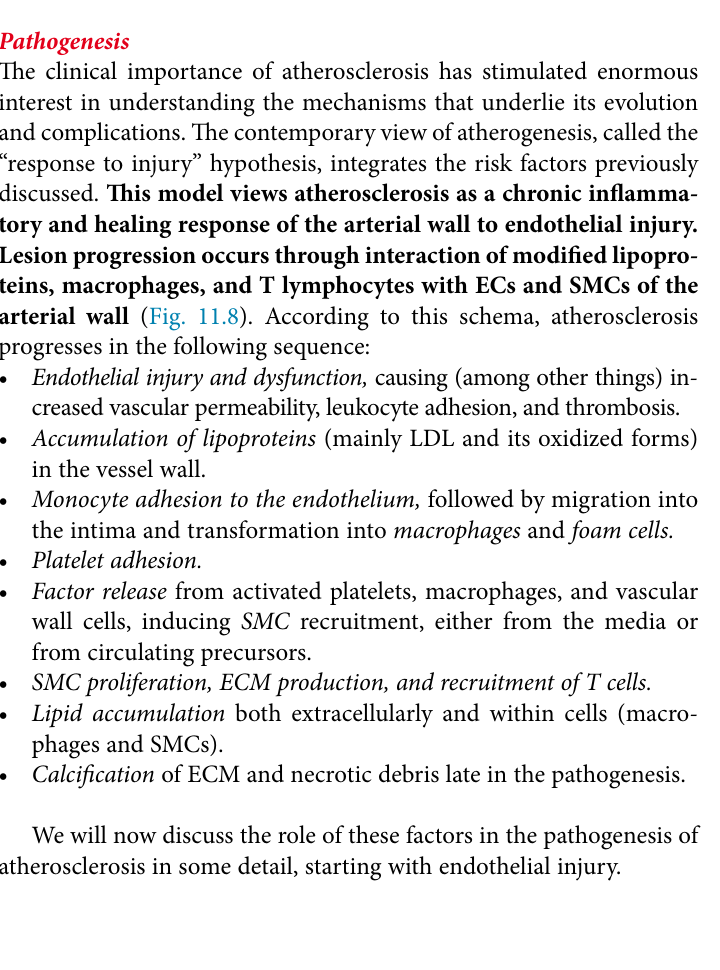
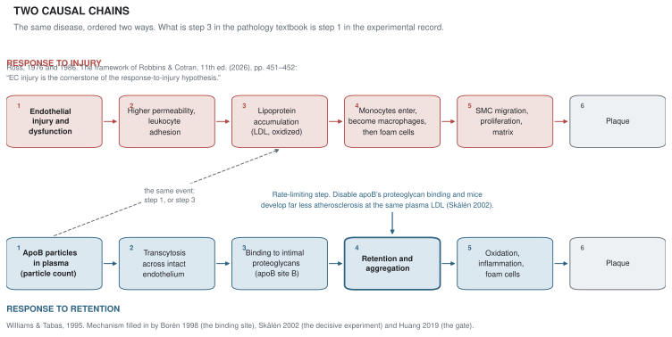
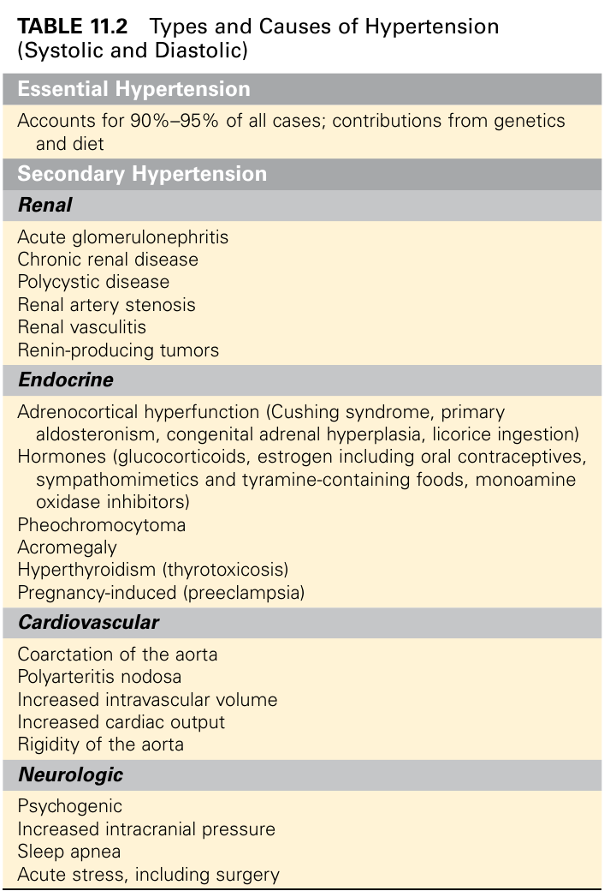
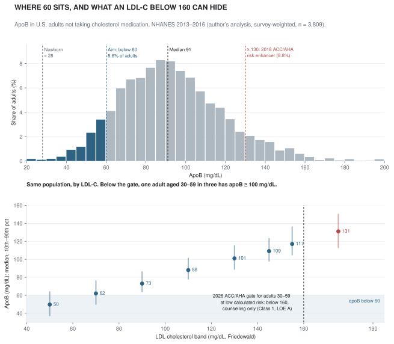
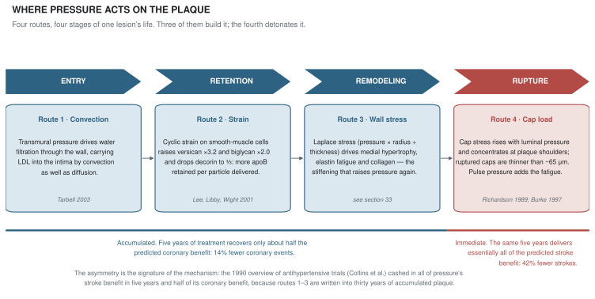
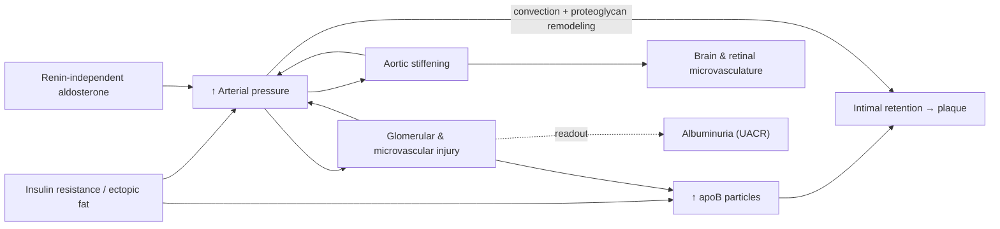
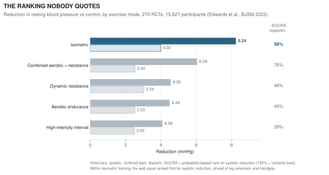
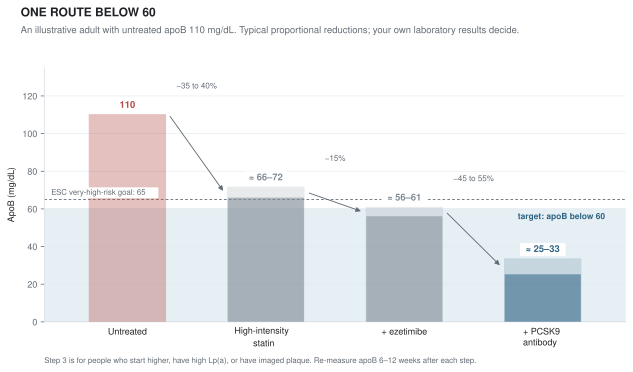

# The Particle Builds It. The Pressure Detonates It.

*ApoB, blood pressure, and how to prevent the thirty-year disease that medicine still meets in its last minute*

---

## Author's Note

I started learning lipidology from scratch in January 2026. This essay is what ten months of reading the primary literature produced. It makes two arguments.

The first is about institutions. The institutions that teach and practise cardiovascular medicine are running a version that the experimental record superseded decades ago. *Robbins & Cotran Pathologic Basis of Disease* (11th edition, 2026) is the best-known pathology textbook in American medical education. It still opens atherosclerosis with endothelial injury, a framework from 1976. The internal-medicine and cardiology references do not: *Harrison's Principles of Internal Medicine* has described particles held in the arterial matrix, rather than leaking through an injured endothelium, since at least its 15th edition in 2001, and *Braunwald's Heart Disease* (13th edition) organizes its chapter around lipoprotein entry and retention. Both chapters are written by Peter Libby. Among the major references, then, it is the pathology textbook that is the outlier. I checked textbooks, not examinations: what students are tested on is a separate question this essay does not answer. The ACC/AHA guidelines are followed by most of the world's cardiologists. Their first recommendation to measure apoB, the causal particle count, came in March 2026, forty-six years after apoB was shown to identify coronary patients whom cholesterol misses. Even now it is a Class 2a add-on, to be checked after the cholesterol goals have been met. Part I documents this lag textbook by textbook and guideline by guideline, against the actual testing rates in clinics. It argues that the lag is structural rather than a failure of intelligence. That makes it more serious, not less, because structures do not correct themselves.

The second argument is about prevention. Atherosclerotic disease has two *leading causal indicators*, in the economist's sense of variables that move years before the outcome does. One is the number of apoB particles available to enter the artery wall. The other is the pressure that drives them in, makes the wall hold on to them, and finally ruptures the plaque they build. Parts II and III rebuild both systems from first principles to the 2026 frontier and show that the two multiply rather than add: risk scales with *particle × pressure × time*. Part IV turns this into a protocol built on two interventions. I call them radical only relative to current practice.

1. **Lower apoB below about 60 mg/dL, and do it early**: in the thirties rather than after the first event, and usually with drugs, because diet rarely gets there alone (sections 25 and 45).
2. **Take isometric exercise training as an antihypertensive drug, even with normal blood pressure** (sections 41–43). It has no cardiovascular outcome trial and probably never will. But blood pressure is a surrogate hard enough not to need one, and the measured effect is the size of a new drug class.

The second intervention is the one nobody prescribes. Mainstream medicine now mentions isometric training, as an adjunct for people who already have raised pressure in the 2025 AHA/ACC guideline and as a wellness tip in consumer health pieces. Nowhere does it appear as a dosed, measured prescription for people whose pressure is normal. The longevity movement, orthodox or otherwise, has barely mentioned it at all. Across 5,638 episodes of ten leading prevention and longevity podcasts, the show notes never once mention it as a way to lower blood pressure (Prologue).

Cardiovascular disease remains the leading cause of death in the world, with cancer second.[^who] On 31 October 2026, the actor Hu Ge said in a broadcast interview that two of his friends had died of myocardial infarction within two months of each other, one in his fifties and one his own age. He added that, after heart symptoms of his own, he now carries Suxiao Jiuxin pills.[^huge2026]

That detail captures the problem. Suxiao Jiuxin is a traditional Chinese preparation used for angina attacks. It is not shown to prevent or treat infarction, and a suspected heart attack calls for emergency services, not a pocket remedy. More fundamentally, a rescue pill addresses the last minute of a disease that has been accumulating for thirty years. This essay is about the thirty years.

The title of Part IV promises prevention "thoroughly," and I mean the word literally, in a specific and checkable sense. ApoB particles are a *necessary* cause of atherosclerosis: without particles retained in the artery wall there is no plaque, and in familial hypercholesterolemia, particles alone are sufficient (sections 13 and 15). Human genetics shows what happens when that cause is reduced from birth. Carriers of *PCSK9* nonsense mutations had 28% lower LDL cholesterol and 88% fewer coronary events (section 15). Children with familial hypercholesterolemia treated from adolescence had a 1% cumulative incidence of cardiovascular events by age 39, against 26% in their parents (section 15). Genetic scores combining a moderately lower LDL-C and a 10 mmHg lower systolic pressure cut the odds of major coronary events by 78% (section 34). Seventeen leading investigators, Williams, Tabas, Borén and Sniderman among them, titled their 2018 review of this evidence "Eradicating the burden of atherosclerotic cardiovascular disease by lowering apolipoprotein B lipoproteins earlier in life."[^robinson2018] Removing the necessary cause early enough is a different kind of goal from shaving a few points off a ten-year probability.

The claim has limits, and I state them. It concerns *atherosclerotic* disease. It does not cover cardiomyopathies, inherited arrhythmias, valve disease or spontaneous coronary dissection, or exposure that has already accumulated by the time one starts. No randomized trial has tested lifelong lowering from youth, so the size of the benefit beyond the genetic evidence is inference, and I mark it as such wherever it appears.

---

In October 2024, a randomized crossover trial showed that letting a patient's arm hang unsupported during an automated reading raises the measured systolic pressure by 6.5 mmHg.[^liu2024] In May 2026, the FDA approved the first aldosterone-synthase inhibitor on the strength of a placebo-adjusted systolic reduction of 8.7–9.8 mmHg.[^baxhtn] In 2023, a network meta-analysis of 270 randomized trials estimated that isometric exercise training lowers resting systolic pressure by about 8.2 mmHg.[^edwards2023] Three numbers of the same size. The middle one got a press release and a new drug class. The first is a routine, uncorrected error in clinical measurement. Almost nobody in the prevention-minded public does the third.

This essay explains why that pattern is not an accident, and why it matters more than almost anything else in cardiovascular prevention.

<figure class="column-figure">
  
  <figcaption><strong>Figure 1. Five numbers of the same size.</strong> The three effects above, plus two more that belong beside them: the smaller arm-position error from the same trial (3.9 mmHg for an arm resting on the lap rather than on a desk) and the 7.1 mmHg achieved by a potassium-enriched salt substitute in DECIDE-Salt (section 39). The dashed line is the exchange rate between millimetres and outcomes: in the Blood Pressure Lowering Treatment Trialists' pooled analysis of 48 trials and 344,716 participants, each 5 mmHg of systolic reduction lowered major cardiovascular events by about 10%, with no reliable heterogeneity by baseline pressure (section 32). Every bar here clears that line. One of them is an error nobody corrects; one got a new drug class; two cost nothing.</figcaption>
</figure>

---

## Abstract

Atherosclerotic cardiovascular disease has two causal exposures that no serious investigator disputes: the plasma concentration of apolipoprotein B–containing lipoproteins, and arterial pressure. Part I shows how far the institutions that teach and practise cardiovascular medicine lag behind that evidence. It covers the 2026 pathology textbook that still begins atherosclerosis with endothelial injury and files 90–95% of hypertension under "cause unknown". It covers the 2026 ACC/AHA guideline that admits apoB only as a Class 2a add-on after cholesterol goals are met, and that gives its strongest evidence grade to counselling rather than treating 30-to-59-year-olds whose LDL-C is anywhere below 160 mg/dL. And it covers clinics in which apoB is measured in about one adult in five hundred. Part I then argues that the lag is structural. The rest of the essay rebuilds both systems from first principles (the lipoprotein pathways, their genetics and disorders; the hemodynamic, hormonal and renal control of pressure, its Mendelian genetics and its target organs) before reaching the frontier. Over three decades, preventive lipidology turned the first into one of the best-adjudicated causal claims in medicine, and in doing so it set the epistemic standard for the whole field. Part II reconstructs that achievement at the level a biochemist or lipidologist would recognize. The topics are the receptor-mediated transcytosis and proteoglycan retention of apoB particles; the human loss-of-function experiments in *PCSK9*, *ANGPTL3*, *APOC3* and *SCARB1*; the per-particle equivalence of triglyceride-lowering and LDL-lowering variants; the hepatic and muscular biochemistry that makes the lipoprotein profile a decade-leading readout of insulin resistance; and the time-integral structure of risk. It also covers developments through late 2026. VESALIUS-CV extended PCSK9 benefit to people with no prior infarction or stroke. Lp(a)HORIZON failed. The 2026 ACC/AHA dyslipidemia guideline restored absolute targets.

Part III argues that pressure satisfies every criterion that made apoB a hard cause, and several of them more strongly. Yet both clinical practice and the longevity-medicine movement treat it with the threshold logic that lipidology abandoned. Six findings, each of which sits outside the working knowledge of most specialists in the other half of the field, carry the argument:

1. Aortic stiffening *precedes* and predicts hypertension, rather than merely following it.
2. Cyclic mechanical strain upregulates the very proteoglycans that retain apoB, so pressure makes the arterial wall stickier for particles.
3. Primary aldosteronism is present in about one in nine normotensive adults and is screened for in about 2% of the resistant hypertensives who should be screened.
4. Albuminuria goes unmeasured in about 96% of hypertensive patients.
5. Positioning errors in routine measurement are as large as the effect of a new drug class.
6. The largest dietary trial with hard cardiovascular outcomes is a salt-substitute trial from rural China, not a lipid trial.

Part IV closes with an evidence-graded protocol for lowering both. It has two radical elements. The first is an apoB below 60 mg/dL, reached in early adulthood, a level that only 8.6% of untreated American adults have, about twice the newborn level, and a level that the active arms of modern outcome trials already went beyond. The second, its central claim, is the practical consequence of Part III. Pressure is a drug-agnostic, baseline-agnostic surrogate, so a cheap, safe intervention that reliably lowers it does not need its own outcome trial. Isometric training, now in the 2025 AHA/ACC guideline, is such an intervention, and the case for normotensive adults adopting it now is stronger than the case for most of what the longevity movement currently recommends. The argument has one condition, which I make explicit: the reduction must be real in the individual. That is a measurement problem, not an outcome-trial problem.

---

## Prologue: Where the Light Fell

The intellectual history of cardiovascular prevention over the past thirty years is, to a first approximation, the history of lipidology winning an argument. In the 1990s, "cholesterol" was a contested risk factor with a dietary folklore. By the mid-2020s it had become a causal particle with a molecular address, a mechanism of entry, a human genetic proof and five pharmacological classes that lower events in proportion to the particle reduction they achieve. The European Atherosclerosis Society's consensus panels could write, without hedging, that LDL *causes* atherosclerotic cardiovascular disease, and that its effect is set by both concentration and the duration of exposure.[^ference2017] [^boren2020]

That victory had a cultural consequence. The prevention movement that grew around it, rebranded in the 2020s as "Medicine 3.0" in Peter Attia's formulation,[^attia2023] took lipidology as its template. ApoB, Lp(a), coronary calcium and CT angiography became household words among the educated, prevention-minded public. Pressure did not receive the same treatment, and isometric training as a way of lowering it received almost none. I audited the public record of the movement in three ways.[^audit]

- **Show notes of ten podcasts.** These are the RSS feeds of *The Peter Attia Drive*, *Huberman Lab*, *FoundMyFitness* (Rhonda Patrick), the *Bryan Johnson Podcast*, *The Dr. Hyman Show*, *The Proof* (Simon Hill), *ZOE Science & Nutrition*, *The Model Health Show*, the *Rich Roll Podcast* and the *Dhru Purohit Show*: 5,638 episodes from 2012 to November 2026. Lipid terms (apoB, LDL, Lp(a), lipoprotein, cholesterol) appear in the notes of 375 episodes, blood pressure or hypertension in 157. Isometric training, wall sits or handgrip appear in 10, every one of them about strength, athletic training or injury, and none within reach of a blood-pressure term. In Attia's own feed, which has 463 episodes, the counts are 43 for lipids, 21 for blood pressure, and 0 for isometric training as an antihypertensive.
- **Full transcripts of *Huberman Lab*.** I searched the transcripts of all 443 episode pages on the podcast's website, not just its notes. 160 episodes discuss blood pressure, and 24 mention isometric work, wall sits or handgrip. Not one of those mentions falls within about a hundred words of blood pressure. Wall sits appear as a test of leg strength, for example in Attia's own appearance on the show, not as a treatment.
- **Bryan Johnson's Blueprint.** None of the 101 articles published on the Blueprint site mentions isometric training. Its blood-pressure levers are a dry-sauna protocol and candesartan 8 mg daily, an angiotensin-receptor blocker taken at a reported brachial pressure of 107/75 mmHg.[^blueprint] The most aggressive protocol in the movement already treats normal pressure as worth lowering with a drug, and it still contains no isometric training.

These are the public records, not private practice. Show notes are summaries, and a clinician in this movement may well prescribe wall sits without saying so on air. But a movement that has made apoB a household word has, on the evidence of its own published record, said almost nothing about the cheapest intervention against the larger killer.

Meanwhile the mortality ledger runs the other way. The Global Burden of Disease study ranks high systolic pressure as the leading risk factor for death worldwide: 10.8 million deaths in 2019, about one in five of all deaths.[^gbd2019] In China, stroke rather than myocardial infarction was the leading cause of death, and high systolic pressure the leading risk factor.[^zhou2019] Only 12% of Chinese adults with hypertension had it controlled in the most recent national surveillance round.[^zhang2023] The template built around the American coronary patient and the particle carries a blind spot, and the blind spot is largest exactly where pressure does the most damage.

The essay is built in four parts. Part I is the indictment. It sets what the textbooks, guidelines and clinics of 2026 actually say and do against what the evidence established. Parts II and III are the evidence, in two halves of equal weight. Part II reconstructs what lipidology settled, at the depth required to appreciate *why* its causal claims are so secure, and those reasons become the standards Part III applies to pressure. Part III argues that pressure meets those standards, and that it interacts with the particle mechanistically in the arterial wall rather than merely adding to it statistically. Part IV is the prescription: how to lower both, how early, how far, and how to know it worked.

On evidence: I distinguish what is established (with primary sources), what I infer from established findings, and what remains open. Where a figure comes from a press release or secondary report rather than a peer-reviewed paper, the note says so.

---

# Part I — The Lag: Why the Best Institutions Run a Version Behind

Software has versions, and so does medical knowledge. This part argues that the institutions most people trust to hold the current version are running one that the experimental record replaced years ago, in places decades ago. Those institutions are the pathology textbook every American medical student buys, the guideline system most of the world's cardiologists follow, and the clinics of the academic departments that write both. I make the case with documents rather than adjectives: the textbook pages themselves, the guideline recommendations with their class and level of evidence, and the measured rates at which the right tests are actually ordered. Parts II and III supply the science that shows why each of these positions is wrong. A reader who wants the biology first can read those parts first and come back.

## 1. The Charge Sheet

Put the two clocks side by side.

| Year | What the evidence established | What the institutions did |
|---|---|---|
| 1976 | Ross and Glomset propose that atherosclerosis is a healing response to endothelial injury[^ross1976] | |
| 1980 | Sniderman and colleagues describe coronary patients whose LDL cholesterol is normal but whose apoB is high[^sniderman1980] | |
| 1995 | Williams and Tabas propose that the initiating event is the *retention* of apoB particles[^williams1995] | |
| 2002 | Skålén and colleagues show that disabling apoB's proteoglycan binding prevents disease at unchanged plasma LDL[^skalen2002] | |
| 2006 | Carriers of *PCSK9* nonsense mutations: 28% lower LDL-C, 88% fewer coronary events[^cohen2006] | |
| 2017 | European Atherosclerosis Society consensus: LDL causes atherosclerotic disease, in proportion to concentration × time[^ference2017] | |
| 2018 | | ACC/AHA abandons LDL-C treatment targets; apoB appears only as a "risk-enhancing factor" at ≥ 130 mg/dL[^grundy2018] |
| 2020 | Multivariable Mendelian randomization: apoB is the lipid trait that carries the coronary risk[^richardson2020] | |
| 2021 | 48 trials, 344,716 people: pressure-lowering benefit is proportional to the reduction, with no threshold down to below 120 mmHg[^bpltt2021] | |
| 2023 | 270 trials: isometric training lowers systolic pressure by about 8 mmHg[^edwards2023] | |
| 2025 | | AHA/ACC lists isometric handgrip, as an adjunct for people who already have raised pressure[^aha2025summary] |
| 2026 | | *Robbins & Cotran*, 11th edition, still makes endothelial injury step 1; the word *retention* does not appear in its atherosclerosis section[^robbins] |
| 2026 | | ACC/AHA recommends measuring apoB for the first time, as Class 2a, and only after cholesterol goals have been met[^acc2026] |

<figure class="wide-figure">
  
  <figcaption><strong>Figure 2. Two clocks.</strong> The events of the table above on one time axis. The upper row is what the evidence established; the lower row is what the institutions did about it. The brackets measure three lags: forty-six years from the first clinical demonstration of apoB–cholesterol discordance (Sniderman 1980) to the first ACC/AHA recommendation to measure apoB (2026); thirty-one years from the response-to-retention hypothesis (Williams and Tabas 1995) to a 2026 pathology textbook in which the word <em>retention</em> does not occur in the atherosclerosis section; and fifty years over which Ross and Glomset’s 1976 response-to-injury frame has remained the one taught. For scale, the shaded bar shows the seventeen-year average lag from research to practice estimated by Morris and colleagues (2011).</figcaption>
</figure>

Three intervals summarize the table. It took forty-six years to get from the first clinical demonstration that apoB identifies coronary patients whom cholesterol misses (1980) to the first ACC/AHA recommendation to measure it (2026). Thirty-one years after the response-to-retention hypothesis, the standard pathology textbook does not contain the word. And fifty years after Ross and Glomset, theirs is still the framework the textbook prints. For comparison, the most cited estimate of the time it takes medical research to reach practice is seventeen years.[^morris2011] On its two central facts, preventive cardiology is running two to three times slower than medicine's own slow average.

The lag is not academic, and it has a cost that can be counted in individual patients. Take a 35-year-old with an LDL cholesterol of 155 mg/dL and an apoB of about 117 mg/dL, which is the median apoB at that LDL-C among untreated American adults (section 4). If that person's PREVENT estimates fall below 3% at ten years and 10% at thirty, the 2026 guideline gives them a Class 1 recommendation, at Level A evidence, for counselling on health behaviours, and nothing else. Under the integral model of sections 20 and 34, those are the decades that build the plaque. The only measurement that would have shown the problem clearly is ordered for about one insured American adult in five hundred (section 5).

The rest of this part documents the lag in three places, the textbook (sections 2–3), the guideline (section 4) and the clinic (section 5). It then sets out how the mainstream framework actually reasons (section 6) and why the best institutions are behind rather than ahead (section 7).

## 2. The Textbook, Part One: Atherosclerosis as Injury

The best-known pathology textbook in American medical education is *Robbins & Cotran Pathologic Basis of Disease*, whose 11th edition appeared in 2026. I checked it against the book rather than against its reputation. I did not check examinations or curricula. What a student is tested on, and which review books they actually study from, is a separate question that this section does not answer.

In the 11th edition, the "Pathogenesis" section of the Blood Vessels chapter opens by naming the framework: the "response to injury" hypothesis, which "views atherosclerosis as a chronic inflammatory and healing response of the arterial wall to endothelial injury." An eight-step sequence follows. Endothelial injury and dysfunction is step 1. Accumulation of lipoproteins in the vessel wall is step 2, framed as a consequence. The text then says it will take the factors in order, "starting with endothelial injury," and the following page opens: "EC injury is the cornerstone of the response-to-injury hypothesis."[^robbins]

<figure>
  
  <figcaption><strong>Figure 3. The sequence, as printed.</strong> The "Pathogenesis" subsection in full. Step 1 is endothelial injury and dysfunction. Step 2 is accumulation of lipoproteins, "mainly LDL and its oxidized forms," in the vessel wall. The closing line commits the rest of the section to that order: the factors will be discussed "starting with endothelial injury." Nothing in the eight steps names the binding of apoB to the intimal matrix, which the experiments of section 13 identify as the rate-limiting event. Source: Mitchell RN, Halushka MK. Blood Vessels. In: Kumar V, Abbas AK, Aster JC, eds. <em>Robbins &amp; Cotran Pathologic Basis of Disease</em>, 11th ed. Elsevier; 2026. Page 451. Reproduced here as a short excerpt for criticism and comment.</figcaption>
</figure>

Two details make the gap measurable rather than rhetorical.

The first is that the vocabulary of the mechanism is simply absent. Across the whole atherosclerosis section, the word *retention* does not occur once. *Proteoglycan* occurs three times, always as a structural component of the fibrous cap or the extracellular matrix, never as the binding partner of apoB. *Transcytosis* does not occur. ApoB appears exactly once in the chapter, inside the definition of Lp(a), where it is described as the apoB-100 portion of LDL "linked to apolipoprotein A (apo A)" — a slip for apo(a), which is a different protein from apoA-I.[^robbins] A student can finish the chapter without encountering the quantity that the rest of this essay is about.

The second is harder to explain away, because the chapter states the fact that undermines its own frame and does not appear to notice. One page after calling injury the cornerstone, it concedes that "early atherosclerosis lesions begin at sites of morphologically intact endothelium" that nonetheless show increased permeability and leukocyte adhesion.[^robbins] An intact endothelium is not an injured one. What the model calls injury turns out to be a change in endothelial *phenotype*, not a breach — a functional state that permits entry. Once "injury" has been redefined that way, the model has quietly conceded that the initiating event is the entry and retention of particles, and is arguing only about what licenses them.

<figure>
  
  <figcaption><strong>Figure 4. The picture a medical student learns from.</strong> The textbook's own diagram of the sequence in Figure 3. Read the pink box at the top left: hyperlipidemia is the first of eight interchangeable items on a list of "chronic endothelial injuries," alongside viruses and toxins. That is the pedagogical consequence of the ordering. The particle is not the cause of the disease here; it is one of the things that can irritate the vessel into causing it. The panels themselves are an accurate drawing of what a developing lesion contains — the disagreement is entirely about which arrow comes first. Source: Mitchell RN, Halushka MK. Blood Vessels. In: Kumar V, Abbas AK, Aster JC, eds. <em>Robbins &amp; Cotran Pathologic Basis of Disease</em>, 11th ed. Elsevier; 2026. Fig. 11.8, p. 452. Reproduced here as a short excerpt for criticism and comment.</figcaption>
</figure>

The framework is not merely old-fashioned. It has an author and a date. It is Russell Ross's response-to-injury hypothesis, set out with John Glomset in the *New England Journal of Medicine* in 1976. In that model the initiating event is injury to the endothelium, and the lesion is a proliferative healing response by smooth muscle.[^ross1976] Ross spent the next quarter-century revising it. By 1999 the disease had become "an inflammatory disease," and the injury had softened into endothelial *dysfunction*.[^ross1999] Williams and Tabas wrote their 1995 paper as an explicit alternative, and the experimental record of section 13 has been accumulating on their side for thirty years. That record includes Borén's binding site, Skålén's knock-in and the transcytosis receptors. A textbook revised in 2026 prints the 1976 frame in the 1999 vocabulary.

<figure class="wide-figure">
  
  <figcaption><strong>Figure 5. Two causal chains.</strong> Both end at the same plaque. They disagree about what starts it. The upper chain is the response-to-injury hypothesis as the pathology textbook presents it (Robbins &amp; Cotran, 11th ed., 2026, pp. 451–452). The lower is the response-to-retention hypothesis of Williams and Tabas (1995), with the mechanism since filled in: Borén's identification of apoB site B as the proteoglycan-binding address (1998), Skålén's demonstration that disabling it prevents disease at unchanged plasma LDL (2002), and Huang's identification of the SR-B1/DOCK4 transcytosis gate (2019). The dashed connector marks the hinge: the arrival of lipoproteins in the wall is step 3 and a consequence in the upper chain, step 1 and the cause in the lower one. Everything downstream of the hinge is identical in both; only the direction of causation differs.</figcaption>
</figure>

This is not a quibble about emphasis. A student taught that atherosclerosis begins with endothelial injury learns that risk factors are interchangeable "injuries," and that lipids are one item on a list. A student taught retention learns that apoB particle number is the necessary condition, that time integrates it, and that the other risk factors (pressure above all, section 34) modulate entry, retention and rupture.

Robbins is not representative of the major references. It is the outlier among them.

*Harrison's Principles of Internal Medicine* is the best-known internal-medicine text, and for a quarter of a century it has carried a chapter by Peter Libby on the pathogenesis of atherosclerosis. Its account of initiation does not begin with injury. "An integrated view of experimental results in animals and studies of human atherosclerosis suggests that the 'fatty streak' represents the initial lesion of atherosclerosis," it says, and it explains how that lesion forms:

> "This accumulation of lipoprotein particles may not result simply from an increased permeability, or 'leakiness,' of the overlying endothelium. Rather, these lipoproteins may collect in the intima of arteries because they bind to constituents of the extracellular matrix, increasing the residence time of the lipid-rich particles within the arterial wall."

That is the response-to-retention model in all but name, and it explicitly demotes the leaky-endothelium account on which Robbins's step 1 rests. I verified the wording in library scans of three editions. The block quotation appears in the 15th edition (2001) and the 17th (2008), and in the 18th (2012) with trivial changes ("from increased permeability"; "Rather, the lipoproteins"). The opening sentence appears in the 17th and 18th.[^harrison] I have not been able to read the 21st (2022) or 22nd (2025) editions. The chapter's author is unchanged, so I would expect the passage to survive, but that is an expectation, not a check.

*Braunwald's Heart Disease* points the same way. In its 13th edition (Elsevier; published December 2025), the atherosclerosis chapter is written by Libby, who is also one of the book's editors. It is chapter 22, "The Vascular Biology of Atherosclerosis," and Libby co-authors the chapters on primary prevention and on lipoprotein disorders as well.[^braunwald13] His treatment is organized around lipoprotein entry, retention and modification. I have not read the 13th-edition chapter itself. For the sequence I rely on the official self-assessment companion, which answers on the corresponding chapter of the 12th edition: "The initial stages of atherogenesis include extracellular lipid accumulation and leukocyte recruitment."[^braunwaldreview] Lipid comes first and cells second, and there is no injury in the sentence.

So the internal-medicine text has described particles retained in the arterial matrix since at least 2001, and the cardiology reference at least since its 12th edition. The 2026 pathology textbook still describes an injury to which hyperlipidemia is one of eight contributors. All three are standard references in American medical education. The gap is therefore not between medicine and the evidence in general. It is between the discipline that teaches the lesion and the disciplines that treat the patient, and it has persisted for at least twenty-five years.

What each book trains matters more than which book is right. The student taught from Robbins learns an aetiology of many interchangeable injuries. Cholesterol is one item on that list, and the cholesterol number on a laboratory report is "normal" or "high" against a population reference interval. That student becomes the clinician who treats LDL-C as one risk factor among several, reaches for a ten-year probability to decide whether any of them matters, and reads an apoB of 117 mg/dL as unremarkable because the report says so. Every clinical habit documented in sections 4–6 follows from that first page. None of them requires a lack of intelligence, only a faithful reading of the textbook.

## 3. The Textbook, Part Two: Hypertension as "Cause Unknown"

Textbook, guideline and evidence give three different answers to the same question. Here the textbook is better than its reputation in one respect and worse in another, and the two sit three paragraphs apart. *Robbins & Cotran*, 11th edition, states the exposure model correctly and without hedging: blood pressure is "a continuously distributed variable," its harms "increase continuously as the pressure rises," and "no rigidly defined threshold level of blood pressure identifies those who have an increased risk."[^robbinshtn] That is the right answer, in the pathology textbook, in print.

It is abandoned in the same section. Overt hypertension is then defined as a measurement of ≥ 90 mmHg diastolic or ≥ 130 mmHg systolic — a hybrid that takes the systolic threshold from the 2017 ACC/AHA guideline and the diastolic threshold from the system that guideline replaced, in which the figure matching a systolic 130 is 80, not 90. And the causal account is the one from the 1970s: secondary hypertension accounts for 5–10% of cases, "the remaining 90% to 95% of hypertension is idiopathic—so-called essential hypertension," and "the causes of hypertension in most individuals remain largely unknown."[^robbinshtn]

<figure>
  
  <figcaption><strong>Figure 6. Where the causes of hypertension are filed.</strong> Nineteen named secondary causes, and one line for the other 90–95%. Note where primary aldosteronism sits: inside the endocrine group, among the rarities, as a form of "adrenocortical hyperfunction." The screening data in section 31 put renin-independent aldosterone excess well inside the top row instead — which is to say that the top row is not a cause at all, but the place where the unmeasured goes. Source: Mitchell RN, Halushka MK. Blood Vessels. In: Kumar V, Abbas AK, Aster JC, eds. <em>Robbins &amp; Cotran Pathologic Basis of Disease</em>, 11th ed. Elsevier; 2026. Table 11.2, p. 445. Reproduced here as a short excerpt for criticism and comment.</figcaption>
</figure>

Each part of that teaching has been overtaken:

Take "unknown cause" first. The genetics of section 30 identifies the renal sodium architecture that sets the level. The aldosterone data of section 31 show that a substantial part of "essential" hypertension contains an unrecognized, renin-independent mineralocorticoid excess. "Idiopathic" is now a statement about what is not measured, not about what is not known.
The threshold fares no better. The guideline systems disagree with each other: ACC/AHA diagnoses hypertension from 130/80, while ESC 2024 and many national guidelines retain 140/90 but add an "elevated" category from 120/70. The textbook's hybrid 130/90 matches neither, and sits in a section that has just denied that any threshold identifies risk.
And the evidence has no threshold in it at all. The Lewington curve rises from 115/75, and BPLTTC shows proportional benefit from treatment below 120 mmHg.

A student, a guideline committee and a meta-analysis would therefore give three different answers to whether a person at 132/84 has a disease that warrants action. Lipidology had the same three-way split over LDL-C and resolved it toward the evidence over twenty years. For pressure, the resolution has barely begun.

## 4. The Guidelines: ApoB as an Afterthought, Pressure as a Threshold

Guidelines are the codified judgment of the academic departments that write them. The ACC/AHA writing committees are drawn largely from the leading American cardiology programmes. A guideline is therefore the best available proxy for what the best departments believe, and it deserves to be read as closely as the textbook.

The 2018 ACC/AHA cholesterol guideline abandoned treatment targets in favour of percentage reductions in LDL-C. It admitted apoB only as a "risk-enhancing factor," at 130 mg/dL or more, a level reached by only about the top tenth of untreated American adults.[^grundy2018] Sniderman's published critique asked, in its title, whether the guideline "got apoB right."[^sniderman2019ed] It did not.

The 2026 guideline, published in March, is better. Its improvements show exactly where the old frame still holds, so it is worth quoting at the level of individual recommendations. COR is the class of recommendation: 1 means "is recommended," 2a "is reasonable," 2b "may be reasonable." LOE is the level of evidence.

| Section | COR | LOE | Recommendation |
|---|---|---|---|
| 3.3, rec. 1 | 2a | B-NR | In adults on lipid-lowering therapy, particularly with ASCVD, cardiovascular-kidney-metabolic syndrome, type 2 diabetes or elevated triglycerides, "measurement of apoB is reasonable to guide decisions regarding further therapeutic intensification" once LDL-C and/or non-HDL-C goals have been achieved |
| 3.3, rec. 2 | 2b | B-NR | "In adults not on LLT [lipid-lowering therapy], measurement of apoB may be reasonable to enhance ASCVD risk assessment" |
| 4.2.9, rec. 7 | 2a | B-NR | In adults with triglycerides ≥ 150 mg/dL, "measurement of non–HDL-C or apoB is preferred over LDL-C" |
| 3.4, rec. 1 | 1 | B-NR | "In all adults, measurement of Lp(a) concentration is recommended at least once for ASCVD risk assessment" |
| 4.2.3.7, rec. 2 | 1 | A | Adults aged 30–59 at low (< 3%) ten-year risk, with LDL-C < 160 mg/dL and thirty-year risk < 10%: counselling on health behaviours |
| 4.2.3.7, rec. 3 | 2a | C-LD | The same group with LDL-C 160–189 mg/dL or thirty-year risk ≥ 10%: a moderate-intensity statin is reasonable, with reduction of cumulative exposure to atherogenic lipoproteins as the rationale |

The guideline's goal table adds numeric apoB goals of < 90, < 70 and < 55 mg/dL. In primary prevention it applies them only in particular groups, for example when triglycerides are 150–499 mg/dL.[^acc2026]

<figure class="column-figure">
  
  <figcaption><strong>Figure 7. The 2026 ACC/AHA recommendations on apoB, Lp(a) and young adults, as written.</strong> Colours follow the ACC/AHA convention (green, Class 1, “is recommended”; yellow, 2a, “is reasonable”; orange, 2b, “may be reasonable”). Read the column of classes from the top. The particle count is “reasonable” only after the cholesterol goal is met, and only “may be reasonable” before any treatment. Lp(a), the particle whose first outcome trial has just failed, is the only lipoprotein measurement that is Class 1 for everyone. The strongest evidence grade in the table, Class 1 at Level A, is attached to the recommendation to counsel rather than treat a 30-to-59-year-old whose LDL-C is anywhere below 160 mg/dL. Source: 2026 ACC/AHA/AACVPR/ABC/ACPM/ADA/AGS/APhA/ASPC/NLA/PCNA Guideline on the Management of Dyslipidemia, <em>J Am Coll Cardiol</em> 2026, doi:10.1016/j.jacc.2025.11.016, sections 3.3, 3.4, 4.2.3.7 and 4.2.9. Transcribed, not a screenshot, from the recommendation text as reproduced by Guideline Central; quotation marks indicate the guideline’s wording, the rest is condensed.</figcaption>
</figure>

Read as a whole, the document makes five choices, and each of them runs against the evidence of Part II.

1. ApoB comes *after* cholesterol. The Class 2a recommendation applies once cholesterol goals are met, so discordance between particle count and cholesterol mass can be discovered only in people already being treated. Section 14 shows that when the two measures disagree, risk follows apoB. The people in whom they disagree are the insulin-resistant, hypertriglyceridemic and diabetic, exactly the patients prevention most needs to reach.
2. The untreated get the weakest class. For adults not on therapy, who make up the primary-prevention population where the time leverage of section 20 is greatest, apoB is Class 2b, the weakest positive class the system has.
3. Lp(a) was promoted and apoB was not. Measuring Lp(a) once in every adult is now Class 1, which is genuine progress. Yet apoB counts every atherogenic particle, Lp(a) particles included. The guideline now makes universal the measurement of the particle whose first lowering trial has just failed (section 19). It leaves optional the count of the particles whose lowering has passed every outcome trial it has faced (section 23).
4. The integral is named, then gated. The 2026 guideline adds a thirty-year horizon for adults aged 30–59, and it justifies statin treatment for that group by cumulative exposure. That is the integral logic of section 20, written into an American guideline for the first time. The gate, however, is an LDL-C of 160 mg/dL. In my analysis of NHANES, among untreated American adults aged 30–59 whose LDL-C is *below* that gate, one in three has an apoB of 100 mg/dL or more. At an LDL-C of 150–159 mg/dL the median apoB is 117 (Figure 8).[^nhanes] The Class 1, Level A recommendation for counselling therefore applies to a large population whose particle count is high by any standard.
5. Sixty is not on the map. No primary-prevention goal in the document reaches apoB 60 mg/dL. The lowest LDL-C goal for people without disease or diabetes is < 70 mg/dL, and it applies only at a ten-year risk of 10% or more.

<figure class="column-figure">
  
  <figcaption><strong>Figure 8. Where 60 sits, and what an LDL-C below 160 can hide.</strong> Upper panel: the distribution of apoB in American adults aged 20 and over who were not taking cholesterol medication (NHANES 2013–2016, survey-weighted, n = 3,809). The median is 91 mg/dL; 8.6% are below 60. The newborn level (about 28 mg/dL) is shown for scale. Lower panel: median apoB, with 10th–90th percentile bars, across bands of LDL-C in the same population. Everyone to the left of the dashed line is below the 2026 guideline’s LDL-C gate of 160 mg/dL for adults aged 30–59 at low calculated risk. At an LDL-C of 150–159 the median apoB is already 117 mg/dL, and among adults aged 30–59 below the gate, one in three has an apoB of 100 or more. Source: author’s analysis of the U.S. National Health and Nutrition Examination Survey, 2013–2014 and 2015–2016 fasting subsamples (files APOB_H/I, TRIGLY_H/I, DEMO_H/I, BPQ_H/I), weighted with WTSAF2YR. LDL-C is the Friedewald value reported by NHANES. Newborn value: Donegá et al. 2006.</figcaption>
</figure>

The European system is about one version ahead on apoB, and no further. The 2019 ESC/EAS guideline states that "apoB analysis is recommended for risk assessment, particularly in people with high TG, DM, obesity or metabolic syndrome, or very low LDL-C." It lists apoB goals of < 65, < 80 and < 100 mg/dL as secondary targets, and the 2025 focused update left them unchanged.[^esc2019] [^esc2025] The National Lipid Association's 2024 consensus endorses apoB as a clinical measure of atherogenic particle burden.[^soffer2024]

| Guideline | Position on apoB | Primary target |
|---|---|---|
| ACC/AHA, 2018[^grundy2018] | Risk-enhancing factor at ≥ 130 mg/dL | Percent LDL-C reduction |
| ACC/AHA, 2026[^acc2026] | Class 2a after LDL-C goals are met; 2b before treatment; preferred when TG ≥ 150 mg/dL | LDL-C and non-HDL-C |
| ESC/EAS, 2019 and 2025[^esc2019] [^esc2025] | Recommended for risk assessment; goals as secondary targets (< 65 / < 80 / < 100) | LDL-C |
| National Lipid Association, 2024[^soffer2024] | Endorsed as a clinical measure of particle burden | LDL-C and non-HDL-C |

In both of the large systems, the primary target is still a measure of cholesterol mass.

The pressure guidelines repeat the pattern in a different key. Both the 2024 ESC and the 2025 AHA/ACC documents are built on threshold-then-treat: a category is defined by an office reading, and drug treatment for the milder categories is triggered by a ten-year risk estimate (section 32). The AHA/ACC guideline does list isometric handgrip training. It lists it as an adjunct for people whose pressure is already elevated, not as a means of lowering the lifetime exposure of people whose pressure is normal.[^aha2025summary] Nothing in either document asks the question section 42 asks.

## 5. The Clinic: What Actually Gets Measured

A guideline can be ahead of practice, and on most of the measures that matter here, practice is further behind still.

| Measure | What happens in practice |
|---|---|
| ApoB | Measured in 0.21% of insured American adults in 2019. Among the 38% who had any lipid test, 0.55% had apoB measured[^murdock2024] |
| Lp(a) | Measured in 0.14% of insured American adults in 2019[^murdock2024] |
| LDL-C in established disease | In GOULD, two years after enrolment, two-thirds of 5,006 American patients with atherosclerotic disease still had LDL-C above 70 mg/dL, and only 17% had had their therapy intensified[^gould2021] |
| Albuminuria in hypertension | Measured in 4.1% of hypertensive adults over two years; undetected cases outnumber detected ones about twenty to one (section 37)[^shin2021] |
| Primary aldosteronism | Screened for in 2.1% of patients with resistant hypertension (section 31)[^jaffe2020] |
| Hypertension control in China | 12.0% of hypertensive adults controlled in the 2018 national survey (section 27)[^zhang2023] |
| Arm position during measurement | An error of 3.9–6.5 mmHg systolic, routinely uncorrected (section 38)[^liu2024] |

These are not the rates of an under-resourced system that does not know better. They are the rates of the system whose norms the leading academic departments set, measured in the country that spends the most on it. In all of them, the measurement that would reveal the exposure is either never made, or made after the decision it should have informed.

## 6. How the Mainstream Framework Thinks

The clinical framework is coherent once its premises are accepted. It is easiest to see as the sequence a clinician following the 2026 guidelines would apply to a healthy 35-year-old.

1. Order a standard lipid panel, in which LDL-C is often calculated rather than measured (section 14).
2. Enter age, sex, cholesterol, blood pressure, smoking, diabetes and kidney function into the PREVENT equations to obtain a ten-year and a thirty-year probability.
3. If the ten-year risk is below 3%, LDL-C below 160 mg/dL and the thirty-year risk below 10%, counsel on health behaviours and repeat in some years.
4. Otherwise, consider a moderate-intensity statin with an LDL-C goal below 100 mg/dL.
5. Measure apoB later, if at all: once the person is on therapy and has reached the LDL-C goal.
6. Measure Lp(a) once.
7. For pressure, take an office reading. Diagnose hypertension at 130/80 mmHg, and start drugs for stage 1 only if the ten-year risk is 7.5% or more.

Each step is defensible in isolation. Together they produce the outcome of section 1. The framework is built to answer "how likely is an event in the next ten years?", and the cause of the disease never enters it as a quantity to be minimized.

The same questions get different answers from the two frameworks.

| Question | The clinical framework (textbook and guideline) | The exposure framework (this essay) |
|---|---|---|
| What starts atherosclerosis? | Endothelial injury, to which hyperlipidemia is one of eight contributors | Retention of apoB particles in the intima. No injury is required (section 13) |
| What is measured? | Cholesterol mass (LDL-C, often calculated) | Particle number (apoB), plus Lp(a) once |
| What is risk? | A ten-year (now also thirty-year) probability | The area under two curves, apoB and pressure, from adolescence on (section 34) |
| When to act? | When the probability crosses a threshold | As soon as the exposure is above the range in which the disease does not form |
| What is "normal"? | The laboratory reference interval | The physiological range. Newborn apoB is about 25–30 mg/dL (section 25) |
| What is the target? | LDL-C < 100 mg/dL at low risk, down to < 55 at very high risk | ApoB < 60 mg/dL for aggressive primary prevention (section 25) |
| What is imaging for? | Deciding whether to treat | Escalating once disease is found, never permission to wait (section 22) |
| What is blood pressure? | A diagnosis at 130/80 or 140/90 mmHg | A continuous exposure whose lowering helps from below 120 mmHg (section 32) |
| What causes hypertension? | In 90–95% of cases, "essential," which is to say unknown | The kidney's sodium handling, with renin-independent aldosterone excess common and rarely sought (sections 30–31) |
| What is lifestyle advice? | "Diet and exercise" | Prescriptions with doses: a potassium-enriched salt substitute; four two-minute isometric holds three times a week (sections 39 and 41) |
| What evidence is needed to act? | An outcome trial for each intervention | For a hard surrogate, the dose–response already measured, followed by confirmation of the effect in the individual (section 42) |

## 7. Why the Best Are Behind

It would be comforting to blame ignorance, and it would be wrong. Every cardiologist knows SPRINT, every guideline committee has read the Mendelian randomization, and the leading cardiology reference describes the biology largely correctly (section 2). The failure is worse than ignorance. The system knows, and it is built not to act on what it knows. Eight features of that build explain most of the lag.

The trials set the currency. The Friedewald equation of 1972 made LDL-C cheap to calculate from a standard panel,[^friedewald1972] so every statin trial for forty years titrated to it. Guideline committees are bound by rules of evidence to recommend what trials measured. The field's biology is therefore denominated in particles, and its rules in cholesterol. A reasonable procedural rule produces an unreasonable result: the evidence hierarchy rewards the variable that happened to be measured over the variable that does the damage.

The calculator gate excludes the young by construction. Ten-year risk is dominated by age, so it defers prevention until disease is under way (section 20). The 2026 lipid guideline's thirty-year horizon is real progress, but it is still a probability with a threshold attached. The horizon of the pressure guideline is still ten years.

Diagnoses are binary, and the system runs on diagnoses. Codes, visits, quality metrics and reimbursement attach to "hyperlipidemia" and "hypertension," not to an exposure. A 35-year-old with an apoB of 117 mg/dL and a pressure of 128/82 carries neither diagnosis, and so generates no code, no follow-up visit and no metric that anyone is measured against. This is my inference about incentives, not a finding from a study, but it predicts the testing rates of section 5 well.

The burden of proof is asymmetric. A new intervention must show an outcome trial before it is recommended, while inaction needs no trial at all. But leaving a young adult's apoB at 117 mg/dL for twenty-five years is also an intervention, an intervention on the integral, and no randomized trial supports its safety either. The closest thing to such a trial is the human genetics of section 15, and it says the exposure is harmful.

No specialty owns the arterial wall. Lipids belong to cardiology and endocrinology, pressure to primary care, albuminuria to nephrology, the aldosterone continuum to endocrinology, and the white-matter consequences to neurology. Each specialty sees the part of the disease that reaches its clinic. The longevity movement, which defined itself against the system, inherited the silo: it copied the lipid half of preventive cardiology and left pressure where it found it (Prologue).

Textbooks change by generation, and by discipline. A chapter passes from author to successor, and pathology organizes disease by visible lesion. The first event, retention of particles in a matrix, cannot be seen on a stained section, while injury, inflammation and foam cells can. This is an inference about why the injury frame persists in pathology. It fits the split between Robbins on one side and Harrison's and Braunwald on the other, which is a split between pathology and internal medicine that is at least twenty-five years old (section 2).

The money is at the last minute. The prestige, the revenue and the visible rescues of cardiology are concentrated where the disease ends: the catheterization laboratory, the stent, the emergency department. Trials of invasive treatment for stable coronary disease, ISCHEMIA and ORBITA, found that the procedure did not reduce death or infarction and did not beat a sham for symptoms, respectively (section 22). Prevention thirty years earlier has no procedure attached to it.

The frameworks are exported without reweighting. The coronary-and-cholesterol template was built around the American patient and transplanted into East Asia, where stroke and pressure dominate the mortality ledger (section 27).

Taken together, these features produce a system in which a motivated layperson with an apoB result and a validated home cuff can be a version ahead of the cardiology department that will eventually treat them. That should embarrass the institutions involved. A pocket pill for the last minute of a thirty-year disease, of the kind Hu Ge now carries, is the logical product of a medicine organized around the last minute.

The last failure is the one most easily fixed. "Exercise more" and "reduce salt" are not prescriptions. "Four two-minute isometric holds, three times a week" and "replace household salt with a potassium-enriched substitute" are.

---

# Part II — The Particle: ApoB from First Principles

## 8. Why Fat Needs a Vehicle

Every account of atherosclerosis begins, whether it says so or not, with a problem in physical chemistry. Triglycerides and cholesteryl esters are almost insoluble in water, yet they must travel between the intestine, the liver, muscle, adipose tissue and every cell that needs cholesterol for its membranes. Evolution solved this with the *lipoprotein*: a spherical particle with a hydrophobic core of triglyceride and cholesteryl ester, wrapped in an amphipathic monolayer of phospholipid and free cholesterol, and organized by one or more *apolipoproteins*. These proteins give the particle its structure, its solubility and its address.

The apolipoproteins do three distinct jobs, and keeping them apart clarifies most of what follows. Some are structural scaffolds: they define the particle and stay with it for life, apoB-100 for VLDL, IDL, LDL and Lp(a), apoB-48 for chylomicrons, apoA-I for HDL. Others are enzyme cofactors and inhibitors that decide how fast a particle is processed, as apoC-II activates lipoprotein lipase (LPL) while apoC-III and the angiopoietin-like proteins ANGPTL3, 4 and 8 inhibit it. The third group are receptor ligands, which decide where a particle is removed: apoB-100 and apoE bind the LDL receptor, and apoE also binds LRP1. A lipoprotein's fate is written in the ligands it carries.

The classical ultracentrifugal classes:

| Class | Density (g/mL) | Diameter (nm) | Main core lipid | Principal apolipoproteins | Source | Enters the arterial intima? |
|---|---|---|---|---|---|---|
| Chylomicron | < 0.95 | 75–1,200 | Dietary triglyceride | B-48, C-II, C-III, E, A-I | Intestine | Too large when nascent; remnants yes |
| VLDL | 0.95–1.006 | 30–80 | Hepatic triglyceride | B-100, C-II, C-III, E | Liver | Smaller VLDL and remnants yes |
| IDL | 1.006–1.019 | 25–35 | Triglyceride + cholesteryl ester | B-100, E | Lipolysis of VLDL | Yes |
| LDL | 1.019–1.063 | 18–25 | Cholesteryl ester | B-100 | Lipolysis of IDL | Yes |
| Lp(a) | 1.05–1.12 | ~25–30 | Cholesteryl ester | B-100 + apo(a) | Liver | Yes |
| HDL | 1.063–1.21 | 5–12 | Cholesteryl ester | A-I, A-II | Liver, intestine, peripheral lipidation | Yes, but not retained as atherogenic |

The last column is the hinge of the whole field. Particles smaller than roughly 70 nm can cross the endothelium into the arterial intima. Every particle that can cross and that carries apoB can be retained there.[^boren2020] Large nascent chylomicrons and large VLDL are excluded by size, while their lipolytic remnants are not. Pancreatitis-causing chylomicronemia and atherosclerosis are therefore different diseases, even though both are labeled "high triglycerides."

## 9. ApoB: One Molecule, One Particle

ApoB is encoded by a single gene, *APOB*, on chromosome 2, and it exists in two forms. ApoB-100, made in the liver, is one of the largest monomeric proteins in the human body: 4,536 amino acids and about 512 kDa. ApoB-48, made in the intestine, is its N-terminal 48%, produced because the cytidine deaminase APOBEC1 edits a single cytidine in the *APOB* mRNA of enterocytes to uridine, converting codon 2153 into a stop codon.[^powell1987] The truncated protein lacks the C-terminal region that binds the LDL receptor, which is why chylomicron remnants depend on apoE for hepatic clearance.

Three properties make apoB the natural unit of atherogenic exposure.

The first is that the cell builds it and then decides whether to keep it. Microsomal triglyceride transfer protein (MTTP) lipidates apoB as it is translated into the endoplasmic reticulum, and without enough lipid the nascent protein is ubiquitinated and degraded. Hepatic apoB secretion is therefore set largely by lipid availability, not by *APOB* transcription. Loss of MTTP causes abetalipoproteinemia, an almost complete absence of apoB-containing lipoproteins.[^wetterau1992] The MTTP inhibitor lomitapide exploits this in homozygous FH, at the cost of hepatic fat accumulation.

Second, apoB never leaves its particle. ApoE and the C-apolipoproteins shuttle between lipoproteins; apoB is non-exchangeable. Each VLDL, IDL, LDL and Lp(a) particle carries exactly one molecule from secretion to clearance, so a plasma apoB concentration is a direct particle count. In a typical fasting adult, LDL accounts for about 90% of those particles.

Third, and most consequentially, the stretch of the molecule that gets a particle cleared is the same stretch that gets it caught. The LDL-receptor binding domain of apoB-100 lies near residues 3359–3369, known as site B, and that same basic region forms the principal binding site for arterial proteoglycans (section 13). A single substitution, R3527Q, causes familial defective apoB-100, a phenocopy of FH in which LDL cannot be cleared normally. One stretch of one protein thus decides both whether an LDL particle is removed by the liver and whether it is held by the artery.

## 10. Three Routes: Dietary Fat, Hepatic Fat, and the Way Back

Lipoprotein metabolism resolves into three pathways. Each has a characteristic failure that leads to disease.

The exogenous pathway carries dietary fat. Enterocytes package dietary triglyceride and cholesterol into apoB-48 chylomicrons, which enter the circulation through the lymph. In the capillaries of muscle, heart and adipose tissue, LPL hydrolyzes chylomicron triglyceride. LPL is carried to the endothelial surface and anchored there by GPIHBP1,[^beigneux2007] activated by apoC-II and restrained by apoC-III and the ANGPTL proteins. The released fatty acids are taken up for oxidation or storage. The shrunken, cholesterol-enriched remnant acquires apoE and is cleared by the liver through the LDL receptor, LRP1 and heparan sulfate proteoglycans. When this pathway fails completely, as in LPL, APOC2 or GPIHBP1 deficiency, the result is chylomicronemia and pancreatitis. When it is merely slow, as in insulin resistance, the result is an excess of atherogenic remnants.

The endogenous pathway carries the fat the liver handles itself. It secretes apoB-100 VLDL whose triglyceride comes from plasma fatty acids, *de novo* lipogenesis and hepatic stores. LPL converts VLDL to IDL, and hepatic lipase converts IDL to LDL. LDL, now mostly cholesteryl ester and apoB-100, circulates for roughly two to three days. About 70% of its clearance occurs in the liver through the LDL receptor. Brown and Goldstein's discovery of that receptor, and of its endocytic recycling roughly every ten minutes, defined modern lipid biology and earned the 1985 Nobel Prize.[^brown1986] Every major drug class in section 23 acts by changing how many LDL receptors the hepatocyte displays.

The third pathway runs the other way. Peripheral cells cannot degrade the sterol ring, so they must export cholesterol, which then returns to the liver for excretion in bile. The liver and intestine secrete lipid-poor apoA-I. ABCA1 transfers cellular phospholipid and cholesterol to it, forming nascent HDL. Loss of ABCA1 causes Tangier disease, with near-absent HDL.[^brookswilson1999] LCAT esterifies HDL cholesterol, trapping it in the particle core. The liver then takes up HDL cholesteryl ester selectively through SR-B1. In humans, but not in mice, CETP moves much of this ester onto apoB particles in exchange for triglyceride, so a large share of "reverse" transport actually returns to the liver *through LDL*. This one species difference explains why mouse HDL biology so often failed to predict human trials (section 16).

## 11. What Sets Plasma ApoB: The Liver's Clearance Machinery

Plasma apoB is the balance between particle production and particle clearance. In most adults, clearance is the variable that moves.

The hepatocyte measures its own cholesterol, and it does the measuring in the endoplasmic reticulum. When ER cholesterol falls, the escort protein SCAP carries the transcription factor SREBP-2 to the Golgi. There it is cleaved and released to the nucleus, where it activates the genes for cholesterol synthesis (including *HMGCR*) and uptake (*LDLR*). When ER cholesterol is replete, INSIG retains SCAP in the ER and the program shuts off.[^brown1997] Statins exploit this loop: by inhibiting HMG-CoA reductase they lower hepatocyte cholesterol, activate SREBP-2 and increase surface LDL receptors.

Two brakes act on the receptor, and both matter clinically. SREBP-2 also induces *PCSK9*. PCSK9 is a secreted protein that binds the EGF-A domain of the LDL receptor and diverts it to the lysosome instead of letting it recycle. Gain-of-function mutations in *PCSK9* were discovered in 2003 as a third cause of autosomal dominant hypercholesterolemia.[^abifadel2003] Because statins induce PCSK9, each doubling of statin dose lowers LDL-C by only about 6% more, the clinical "rule of six," and adding a PCSK9 inhibitor lowers it by roughly another 50–60%. A second brake operates through the nuclear receptor LXR. When cells are cholesterol-loaded, LXR induces IDOL, an E3 ubiquitin ligase that degrades the LDL receptor.[^zelcer2009]

This machinery is also what makes apoB a moving target over a life. ApoB and LDL-C are very low in children and rise throughout adult life in Western populations, and the rise reflects mainly a decline in hepatic receptor-mediated clearance, driven by several inputs at once:

- dietary saturated fat and cholesterol, which suppress LDL-receptor activity;
- weight gain and insulin resistance, which raise VLDL production (section 18);
- falling thyroid hormone action, which raises LDL (hypothyroidism is a classic secondary cause);
- the loss of estrogen at menopause. In the SWAN cohort, LDL-C and apoB rose sharply within the year around the final menstrual period, a change independent of chronological aging.[^matthews2009]

Production moves as well, in the direction that insulin resistance pushes it. Increased flux of fatty acids from adipose tissue, hepatic *de novo* lipogenesis and dietary fructose all increase hepatic triglyceride, which rescues more nascent apoB from degradation and secretes it as large VLDL. That is the production side of the metabolic connection developed in section 18.

The clinical implication is that "normal" adult apoB is not a physiological constant. It is the population distribution of a clearance system degraded by decades of exposure, which is why section 25 rejects laboratory reference intervals as treatment goals.

## 12. A Map of Lipoprotein Disorders

The Fredrickson phenotypes of 1967 still organize clinical teaching.[^fredrickson1967] Their main value today is as a bridge to the genes and pathways now known to underlie them.

| Phenotype | Particles increased | Main modern causes | Clinical meaning |
|---|---|---|---|
| I | Chylomicrons | Biallelic *LPL*, *APOC2*, *GPIHBP1*, *APOA5*, *LMF1* (familial chylomicronemia syndrome) | Pancreatitis; little atherosclerosis |
| IIa | LDL | FH (*LDLR*, *APOB*, *PCSK9*); polygenic hypercholesterolemia | Premature ASCVD |
| IIb | LDL + VLDL | Familial combined hyperlipidemia; polygenic; insulin resistance | High apoB; premature ASCVD |
| III | Remnants (β-VLDL) | *APOE* ε2/ε2 plus a metabolic second hit | Highly atherogenic; palmar xanthomas; missed without apoB (section 14) |
| IV | VLDL | Polygenic hypertriglyceridemia; insulin resistance, alcohol | Risk tracks apoB |
| V | VLDL + chylomicrons | Polygenic multifactorial chylomicronemia | Pancreatitis and ASCVD |

Several clinically important disorders fall outside the scheme altogether. Lp(a) hyperlipoproteinemia is the most common inherited dyslipidemia and is invisible on a standard panel (section 19). The hypobetalipoproteinemias — truncating *APOB* variants and loss of function in *PCSK9* or *ANGPTL3* — are the human knockouts of section 15, and some carry hepatic steatosis because the liver cannot export its fat. Sitosterolemia (*ABCG5/ABCG8*) is the extreme of sterol hyperabsorption, also section 15. Tangier disease (*ABCA1*) and LCAT deficiency produce near-absent HDL without a clearly proportional increase in atherosclerosis, which is where section 16 begins.

Secondary causes of high apoB are common and correctable. They include hypothyroidism, nephrotic syndrome, cholestatic liver disease, anorexia nervosa, pregnancy, and drugs such as glucocorticoids, retinoids, some antiretrovirals and calcineurin inhibitors.

One genetic finding refines how all of this should be read, and it is that FH is far rarer than severe hypercholesterolemia. Among 1,386 people with LDL-C of 190 mg/dL or more, only 1.7% carried a pathogenic FH variant. Yet at any given LDL-C, carriers had substantially higher coronary risk than non-carriers. Those with both LDL-C ≥ 190 mg/dL and an FH mutation had about 22 times the odds of coronary disease of people with LDL-C below 130 mg/dL and no mutation, compared with about 6 times for LDL-C ≥ 190 mg/dL without a mutation.[^khera2016] The most plausible explanation is the integral of section 20. A monogenic defect raises LDL from birth, so a carrier's cumulative exposure exceeds that of a non-carrier whose LDL rose only in adulthood, even when today's value is the same.

The newest therapies target the rarest disorders first. Olezarsen, an antisense oligonucleotide against *APOC3*, reduced triglycerides and pancreatitis events in familial chylomicronemia syndrome,[^stroes2024] and evinacumab, an ANGPTL3 antibody, lowers LDL-C in homozygous FH independently of LDL receptors. Both show how pathway knowledge becomes drug targets.

## 13. Atherosclerosis Is a Disease of Particle Trafficking, Not Injury

The working model of atherogenesis is the *response-to-retention* hypothesis, proposed by Williams and Tabas in 1995.[^williams1995] [^tabas2007] Its core claim is that the initiating event is not oxidation, not inflammation and not endothelial "injury". It is the retention of apoB-containing lipoproteins in the subendothelial matrix. Oxidation, inflammation, foam-cell formation, necrotic-core expansion and calcification follow from that retention, and none of them occurs without it.

Two discoveries since then have made the model mechanistically concrete. Most generalists, and many cardiologists, do not know them.

For decades, LDL entry into the intima was described as leakage through a damaged or permeable endothelium. The modern picture is close to the opposite: a substantial fraction of LDL crosses *intact* endothelium by receptor-mediated transcytosis, which is to say that the wall lets the particle in on purpose. A genome-wide RNAi screen identified ALK1 (activin receptor-like kinase 1) as an LDL-binding receptor that mediates LDL uptake and transcytosis in endothelial cells independently of the classical LDL receptor.[^kraehling2016] Huang and colleagues then showed in *Nature* that endothelial SR-B1 (scavenger receptor class B type 1) drives LDL transcytosis in vivo by coupling LDL binding to RAC1 activation through the guanine-nucleotide exchange factor DOCK4. SR-B1 and DOCK4 are expressed at higher levels in atherosclerosis-prone aortic regions, and endothelial SR-B1 deletion reduced LDL delivery into the artery wall and atherosclerosis in mice.[^huang2019]

Endothelium is therefore not a passive filter but a gate with receptors, and the gate is preferentially open where plaques form. Part III returns to this point, because it explains why low and oscillatory shear and high pressure both matter.

Borén and colleagues then gave retention a molecular address. They identified the principal proteoglycan-binding site of apoB-100, a cluster of basic residues (site B, residues 3359–3369) that binds the negatively charged glycosaminoglycan chains of arterial proteoglycans. A single substitution there severely impairs proteoglycan binding without affecting LDL-receptor binding.[^boren1998] In 2002, Skålén and colleagues used that mutation to perform the decisive experiment. Mice expressing proteoglycan-binding-defective human LDL developed markedly less atherosclerosis than mice expressing wild-type LDL *at the same plasma concentration*.[^skalen2002] Retention is not a correlate of atherosclerosis. In this model, it is the rate-limiting step.

Two consequences organize everything that follows.

The first is that the unit of causation is the particle. Every atherogenic lipoprotein, whether VLDL, IDL, LDL or Lp(a), carries exactly one molecule of apoB-100. Cholesterol is cargo. What crosses, binds and is retained is a particle, and the probability of entry and retention per unit time scales with the number of particles presented to the wall, which plasma apoB counts directly.[^sniderman2019]

The second is that the process is an integral. Retention is a flux and plaque is its accumulated product, so the disease begins early. In the PDAY autopsy study of young Americans who died of external causes, aortic fatty streaks were present in essentially all subjects aged 15–19, and coronary lesions in a substantial fraction.[^strong1999] Fetal aortas from hypercholesterolemic mothers already show increased fatty-streak formation.[^napoli1997] The infarcts of the sixth and seventh decades are laid down in the second and third.

The experimental record therefore fixes the order. Endothelial biology matters, because shear-dependent transcytosis machinery determines *where* particles enter and are retained. But retention of apoB particles is the necessary initiating event. Knocking out apoB's proteoglycan binding at an unchanged plasma LDL largely prevents disease, and in FH, LDL alone suffices, with no injury required. Section 2 sets this against what the standard pathology textbook still teaches, in which the order is reversed (Figure 5).

## 14. Count, Not Cargo

LDL cholesterol (LDL-C) measures the cholesterol mass carried in LDL particles. ApoB measures the number of atherogenic particles. The two are concordant in most people and discordant in exactly the people prevention most needs to catch. In insulin resistance, hypertriglyceridemia and type 2 diabetes, LDL particles are cholesterol-depleted and triglyceride-enriched, so particle number runs ahead of cholesterol mass.

Three independent lines of evidence say that when the measures disagree, risk follows the particle. The first is discordance analysis: across cohorts, individuals whose apoB runs higher than their LDL-C would predict carry the higher risk, and those whose apoB runs lower carry the lower one.[^sniderman2014] In statin-treated participants of the Copenhagen General Population Study, apoB and non-HDL cholesterol captured residual risk that LDL-C missed.[^johannesen2021] The second is multivariable Mendelian randomization, which uses genetic variants as natural randomization. When genetically instrumented apoB, LDL-C and triglycerides are modeled together, apoB is the lipid trait whose association with coronary disease survives; LDL-C and triglycerides lose most of their independent signal.[^richardson2020] The third is per-particle equivalence, which section 15 takes up below.

The standard panel then misleads in ways that are entirely predictable from arithmetic. Most laboratories still calculate LDL-C with the 1972 Friedewald equation, which assumes a fixed triglyceride-to-VLDL-cholesterol ratio of 5:1 — an assumption that fails exactly where precision matters most. Martin and colleagues showed in 1.3 million lipid profiles that Friedewald systematically underestimates LDL-C when LDL-C is low or triglycerides are high, and misclassifies a large fraction of patients near treatment thresholds.[^martin2013] The NIH (Sampson) equation, derived against β-quantification, reduces but does not remove the error.[^sampson2020]

A more consequential blind spot is *type III hyperlipoproteinemia* (dysbetalipoproteinemia), a remnant-dominant disorder usually linked to *APOE* ε2/ε2 homozygosity plus a metabolic second hit. It is highly atherogenic and highly treatable, yet invisible on a standard panel, where it looks like ordinary mixed hyperlipidemia. Sniderman and colleagues derived an apoB-based algorithm: total cholesterol/apoB above 6.2 (mmol/L to g/L) together with triglyceride/apoB below 10 identified ultracentrifugation-confirmed type III with an AUC of 0.99 in the derivation cohort.[^sniderman2007] In a later series of 1,351 hypertriglyceridemic patients, it identified 49 confirmed cases that would otherwise have been missed.[^sniderman2018] Independent groups have since found that simpler ratios (total cholesterol/apoB, non-HDL-C/apoB) perform as well or better.[^cclm2024] The conclusion stands either way: without apoB, the diagnosis is usually not made.

The obstacle to adopting apoB is now institutional rather than scientific. ApoB immunoassays are internationally standardized, inexpensive and do not require fasting. The 2026 ACC/AHA dyslipidemia guideline recommends apoB measurement in selected patients, notably those with triglycerides above 200 mg/dL, diabetes or LDL-C already below 70 mg/dL, while keeping LDL-C and non-HDL-C as primary targets.[^acc2026] Sniderman has argued for two decades that this is a historical artifact, not a biological judgment.[^sniderman2019]

## 15. Nature's Randomized Trials: The Human Knockouts

The causal case for apoB rests on something more powerful than trials: a set of natural human experiments in which a single gene variant shifts lipoprotein metabolism for an entire lifetime.

In 2006, Cohen, Boerwinkle, Mosley and Hobbs reported that among Black participants in the ARIC study, about 2.6% carried nonsense mutations in *PCSK9* (Y142X or C679X). Those carriers had about 28% lower LDL-C and an 88% lower incidence of coronary heart disease over fifteen years. In White participants, the milder R46L variant lowered LDL-C by about 15% and coronary risk by about 47%.[^cohen2006] No five-year drug trial has produced anything like an 88% reduction from a 28% LDL change. The difference between the genetic and pharmacological effect sizes is the first quantitative clue that *time* is the dominant variable (section 20). The finding also led directly to a drug class.

The oldest of these experiments is familial hypercholesterolemia, which in its heterozygous form affects roughly 1 in 250 people. A defect in a single gene (*LDLR*, *APOB* or *PCSK9*) does nothing except impair LDL clearance, and it produces coronary disease decades early in untreated carriers, regardless of their metabolic health.[^nordestgaard2013] FH is the strongest available refutation of the idea that high LDL is benign in an otherwise healthy metabolism (section 24).

Two further genes make the same point from the triglyceride side. Loss-of-function variants in *ANGPTL3*, an inhibitor of lipoprotein and endothelial lipase, lower triglycerides and LDL-C and are associated with about 40% lower odds of coronary disease.[^dewey2017] Loss-of-function variants in *APOC3*, which encodes apolipoprotein C-III, an inhibitor of lipoprotein lipase and of hepatic uptake of triglyceride-rich remnants, lower triglycerides by about 40% and coronary risk by a similar proportion.[^tghdl2014] [^jorgensen2014]

In each of these cases the genetics arrived before the drug. Mendelian randomization has since become a drug-target validation tool, and its record on the lipid side is strong. Inactivating mutations in *NPC1L1*, the intestinal sterol transporter that ezetimibe inhibits, were associated with lower LDL-C and about 50% lower coronary risk, matching the direction of IMPROVE-IT.[^stitziel2014] Variants in *HMGCR* and *NPC1L1* produced the same coronary benefit per unit LDL-C, so their effects were additive.[^ference2015] Variants in *ACLY*, which encodes ATP-citrate lyase, mimicked the effect of bempedoic acid on LDL-C and coronary risk before CLEAR Outcomes reported.[^ference2019acly]

When genetics, mechanism and trials agree this consistently, a target is close to proven before its outcome trial starts. Part III argues that pressure now has the same status.

The clearest human demonstration of the integral comes from FH treated early. In the Amsterdam cohort, 214 children with FH were randomized in the 1990s to pravastatin or placebo and then treated long-term. Twenty years later, the cumulative incidence of cardiovascular events at age 39 was 1%, compared with 26% in their affected parents, whose treatment began in adulthood. Cardiovascular death was 0% versus 7%. Carotid intima–media thickness progressed at the same rate in treated FH patients as in their unaffected siblings.[^luirink2019] The comparison with parents is historical, not randomized, and only 20% of the children reached their LDL target. That makes the result more striking: early, incomplete lowering still nearly abolished events in the fourth decade.

A puzzle sits behind all of this, which is why evolution tolerated high LDL at all. In a Dutch FH pedigree traced over two centuries, mortality among carriers was *not* elevated in the 19th century. It rose to a peak in the 1930s–1960s and differed threefold between branches of the family.[^sijbrands2001] One explanation is that LDL protects against infection. LDL-receptor–deficient mice survive endotoxin challenge far better than wild-type mice (an eightfold higher LD50) and have lower mortality after *Klebsiella* infection.[^netea1996] High LDL is consistent with a trade-off that favored survival when infection killed young people and penalizes it when atherosclerosis kills old ones. The "physiological" LDL of the ancestral environment is therefore not necessarily the *optimal* LDL for a modern lifespan.

These variants raise an obvious question: is triglyceride-rich lipoprotein risk separate from LDL risk, or is it the same particle risk expressed through a different pool? Ference and colleagues answered it with a 2×2 factorial Mendelian randomization. Triglyceride-lowering variants in *LPL* and LDL-lowering variants in *LDLR* produced *the same reduction in coronary risk per 10 mg/dL lower apoB*, even though their effects on triglycerides and LDL-C differed greatly.[^ference2019tg] The atherogenic quantity is the particle count, whichever lipid it carries.

One exception sharpens the rule, and it concerns what the particles absorb. Not all sterol cargo is equivalent. ABCG5/ABCG8 is the heterodimeric transporter that pumps cholesterol and plant sterols back into the intestinal lumen and into bile. Helgadottir and colleagues studied *ABCG5/8* variants in up to 610,532 people from Iceland, Denmark and UK Biobank. Variants that increased sterol absorption raised plasma phytosterols and coronary risk. The risk per unit of predicted non-HDL cholesterol was larger than for other non-HDL-raising variants: an odds ratio of 2.01 per 1 mmol/L.[^helgadottir2020] The authors' interpretation is that absorbed dietary cholesterol and phytosterols contribute to atherogenesis beyond what particle number alone predicts. They acknowledge this is not proof of a causal role for phytosterols.

This has a practical correlate that lipidologists use and most cardiologists do not: measuring noncholesterol sterols to separate *hyperabsorbers* (high sitosterol and campesterol) from *hypersynthesizers* (high lathosterol and desmosterol). In a clinical laboratory database of 667,718 patients, Dayspring and colleagues reported wide variation in these phenotypes.[^dayspring2015] The phenotype bears on drug choice. Statins upregulate absorption as they suppress synthesis, while ezetimibe targets absorption directly. Outcome-trial evidence for sterol-guided therapy does not yet exist, and I present it here as a frontier practice, not a standard.

## 16. HDL: The Most Thoroughly Falsified Hypothesis in Cardiology

The inverse association between HDL cholesterol and coronary disease is one of the most reproducible findings in epidemiology. The causal hypothesis built on it has failed every test.

The genetics came first. The endothelial-lipase variant LIPG Asn396Ser raises HDL-C without changing other lipoproteins and confers no protection against myocardial infarction.[^voight2012] It runs in both directions: loss-of-function mutations in *ABCA1* substantially lower HDL-C in Copenhagen heterozygotes without raising ischemic heart disease risk,[^frikkeschmidt2008] and at the other extreme, extremely high HDL-C is associated with higher all-cause mortality in Danish population cohorts, a U-shaped curve.[^madsen2017]

Then came the paradox that should have settled it. In 2016, Zanoni and colleagues identified a loss-of-function variant in *SCARB1*, the gene for SR-B1, the hepatic receptor that takes cholesteryl ester selectively out of HDL. P376L impairs SR-B1 processing and abolishes that uptake, and carriers have markedly higher HDL-C together with markedly higher coronary risk, an odds ratio of about 1.79.[^zanoni2016] SR-B1-knockout mice show the same pattern. HDL-C raised by blocking HDL's exit route is not protective and may be harmful, which means the measured quantity reflects flux through a pathway rather than the benefit of that pathway.

The drugs then failed in the way the genetics predicted. Torcetrapib raised HDL-C by more than 70% and increased mortality, a harm attributed partly to off-target aldosterone and blood-pressure effects.[^barter2007] Dalcetrapib and evacetrapib were neutral despite large HDL-C increases. Anacetrapib reduced major coronary events by 9% in REVEAL, but in proportion to its reduction in non-HDL cholesterol and apoB rather than to its doubling of HDL-C.[^reveal2017] Niacin added nothing on top of statins in AIM-HIGH or HPS2-THRIVE, and HPS2-THRIVE produced an instructive ethnic signal along the way: myopathy rates were several-fold higher in its Chinese participants than in its European ones.[^hps2thrive]

Rader and Hovingh's synthesis is the field's settled position. HDL-C is a biomarker of triglyceride metabolism and insulin sensitivity. HDL *function*, in particular macrophage cholesterol-efflux capacity, may still be biologically important, but raising HDL-C is not a therapeutic goal.[^rader2014]

If HDL cholesterol is the wrong measure, perhaps HDL *function* is the right one. Cholesterol-efflux capacity is the ability of a patient's apoB-depleted serum to accept cholesterol from macrophages. In 2011 it was shown to correlate inversely with carotid intima–media thickness and angiographic coronary disease independently of HDL-C.[^khera2011] In the Dallas Heart Study it predicted incident cardiovascular events while HDL-C did not.[^rohatgi2014] That made it the strongest remaining version of the HDL hypothesis.

AEGIS-II tested it directly. More than 18,000 patients after acute myocardial infarction received four weekly infusions of CSL112, a plasma-derived apoA-I formulation that acutely increases efflux capacity several-fold. The primary endpoint at 90 days was not met (4.8% vs 5.2%; HR 0.93).[^gibson2024] Exploratory later time points showed apparent reductions, which have kept the question formally open. Read alongside the genetics, the result is the closest the field has come to a direct falsification of the HDL-function hypothesis as a therapeutic strategy after an acute event.

CETP has a coda that matters for the frontier, because the class is being re-evaluated on different grounds. Mendelian randomization of *CETP* variants showed that their coronary benefit is proportional to the accompanying reduction in apoB, not to the HDL-C rise.[^ference2017cetp] That is the genetic version of the REVEAL result.

Three further observations reframe the class. First, a meta-analysis of the CETP-inhibitor trials found a significant reduction in new-onset diabetes.[^dangas2022] That is the opposite of the modest diabetogenic effect of statins. Second, in kinetic studies anacetrapib *decreased the production rate* of Lp(a).[^thomas2017] Third, dal-GenE tested dalcetrapib only in patients carrying an *ADCY9* genotype predicted to respond. It narrowly missed its primary endpoint (HR 0.88), a failed but instructive attempt at genotype-guided cardiovascular pharmacology.[^tardif2022]

Obicetrapib, a next-generation CETP inhibitor, lowers LDL-C by about a third and apoB substantially on top of high-intensity statins (ROSE and BROADWAY).[^nicholls2022] Its outcome trial, PREVAIL, had not reported at the time of writing.[^prevail] If it succeeds, it will be as an apoB-lowering drug that happens to raise HDL-C, and possibly lowers diabetes risk and Lp(a). It will not succeed as an HDL drug.

## 17. Triglycerides: Real Risk, Wrong Target

Remnant cholesterol, the cholesterol carried in partially lipolyzed VLDL and chylomicron remnants, is causally associated with coronary disease in Mendelian randomization.[^varbo2013] This does not make triglycerides a target in their own right, as PROMINENT demonstrated.

In 10,497 patients with type 2 diabetes, triglycerides of 200–499 mg/dL and low HDL-C, the selective PPARα modulator pemafibrate lowered triglycerides by 26%, with parallel falls in VLDL and remnant cholesterol. Cardiovascular events did not fall (HR 1.03; 95% CI 0.91–1.15). ApoB rose by about 5%.[^prominent] The investigators' own interpretation is that the rise in apoB and LDL-C may have offset any benefit from lower triglycerides.

PROMINENT is the cleanest clinical illustration of the per-particle principle in section 15. The drug moved the metabolic marker a great deal, left the particle count unchanged or slightly higher, and the outcome followed the particle count. Pemafibrate converted large VLDL into a larger number of smaller apoB particles: it changed the cargo without reducing the count.

## 18. Where Lipids Meet Metabolism: Liver, Muscle and Insulin

This is the point at which cardiovascular and metabolic physiology turn out to be one system, and the mechanism is more specific than "metabolic syndrome."

Start in the liver, where intracellular diacylglycerol accumulates under lipid oversupply and activates PKCε, which phosphorylates the insulin receptor kinase at Thr1160 and impairs insulin signaling to glycogen synthesis and to suppression of gluconeogenesis.[^petersen2018] The result is the paradox Brown and Goldstein named *selective insulin resistance*. Insulin fails to suppress hepatic glucose production, yet hepatic lipogenesis continues and even accelerates.[^brown2008]

Two explanations compete, and the difference matters for intervention. Brown and Goldstein proposed a bifurcation in the insulin signaling pathway, with the lipogenic SREBP-1c branch staying sensitive while the gluconeogenic FOXO1 branch becomes resistant.[^brown2008] Shulman's group argued for a substrate-push model. Adipose-tissue insulin resistance and inflammation increase lipolysis, delivering fatty acids and glycerol to the liver. Hepatic acetyl-CoA rises and allosterically activates pyruvate carboxylase, which drives gluconeogenesis without any change in hepatic insulin signaling. Meanwhile, hyperinsulinemia and the oversupply of lipogenic substrate drive triglyceride synthesis.[^perry2015]

The less familiar part of the story is muscle, which reroutes carbohydrate to the liver before the liver ever sees a problem. Petersen and colleagues used magnetic resonance spectroscopy in lean, young, insulin-resistant adults to show that skeletal-muscle insulin resistance diverts ingested carbohydrate away from muscle glycogen synthesis and toward hepatic *de novo* lipogenesis. Postprandial hepatic triglyceride synthesis rose, and plasma triglycerides rose, *before* any change in body weight or hepatic insulin signaling.[^petersen2007] Rabøl and colleagues then showed that a single bout of exercise reversed the muscle defect and reduced postprandial hepatic *de novo* lipogenesis.[^rabol2011]

Skeletal muscle is therefore a lipid organ by proxy. Muscle insulin sensitivity is upstream of hepatic VLDL output. This explains why exercise moves the lipoprotein profile through a route entirely separate from LDL-receptor biology.

From there the disorder reaches the lipoprotein profile. The insulin-resistant liver secretes more and larger triglyceride-rich VLDL, with excess apoC-III that slows their lipolytic clearance. CETP exchanges VLDL triglyceride for LDL and HDL cholesteryl ester. Hepatic lipase then hydrolyzes the triglyceride in the enriched particles. The products are small, cholesterol-depleted LDL particles, more of them per milligram of LDL-C, and small HDL that is rapidly catabolized.

Garvey and colleagues characterized this signature by NMR lipoprotein profiling against euglycemic clamps: larger VLDL, smaller LDL, higher LDL particle number and depletion of large HDL, graded with insulin resistance.[^garvey2003] Because euglycemia is defended for years by compensatory hyperinsulinemia, glucose is a *lagging* indicator, and it moves only when β-cell compensation fails. In the Whitehall II cohort, insulin sensitivity began declining years before diabetes was diagnosed, while fasting glucose rose steeply only in the final few years.[^tabak2009] The lipoprotein profile changes during the compensated phase, which makes it one of the earliest routinely measurable readouts of the metabolic disorder.

That signature can be condensed into a single number, the *lipoprotein insulin-resistance index* (LP-IR). It is a weighted score of VLDL, LDL and HDL particle sizes and large-VLDL, small-LDL and large-HDL concentrations, calibrated against HOMA-IR and glucose-clamp measures.[^shalaurova2014] In the Multi-Ethnic Study of Atherosclerosis (MESA), LP-IR predicted incident type 2 diabetes independently of glucose, insulin and conventional lipids.[^mackey2015] Glucose tolerance offers a complementary early readout. DeFronzo's group found that a one-hour post-load glucose of 155 mg/dL or more identifies people at high risk of future diabetes among those whose fasting and two-hour values are normal.[^abdulghani2008] The leading indicators of metabolic failure are measurable now, and they are lipoprotein and dynamic-glucose measures, not fasting glucose.

Whether insulin resistance is a target or a defense is the one genuinely unsettled question here, and two findings complicate any simple view. Hoehn and colleagues proposed that insulin resistance is partly a *cellular antioxidant defense*: mitochondrial superoxide induces insulin resistance in multiple models, and antioxidant interventions reverse it.[^hoehn2009] Against that, the IRIS trial randomized 3,876 non-diabetic, insulin-resistant patients with recent ischemic stroke or TIA to pioglitazone or placebo. Pioglitazone reduced recurrent stroke or myocardial infarction by about 24% (HR 0.76), at the cost of weight gain, edema and fractures.[^kernan2016] Correcting insulin resistance pharmacologically lowers vascular events. Whatever its proximate cellular logic, insulin resistance behaves clinically like a cause, and specifically, as the next paragraph argues, like a cause of both hard causes.

Two accounts of causation have to be kept apart at this point. The lipoprotein signature is a readout of hepatic and muscular insulin resistance. It is not an independent cardiovascular cause once apoB is known. Small dense LDL adds little to risk prediction after particle number is accounted for. Insulin resistance, however, also feeds the second hard cause. Insulin normally stimulates endothelial nitric oxide production through PI3K–Akt–eNOS, and in insulin resistance that branch is impaired while the MAPK–endothelin branch is preserved.[^muniyappa2007] Insulin is antinatriuretic at the renal tubule, an effect that persists in insulin-resistant states.[^defronzo1975] Hyperinsulinemia activates the sympathetic nervous system. The same upstream disorder therefore raises *both* apoB and pressure (section 31).

## 19. Lp(a): The Inherited Particle, and the Trial That Failed

Lipoprotein(a) is an LDL-like particle whose apoB-100 is disulfide-linked to apolipoprotein(a), a plasminogen-homologous glycoprotein with a variable number of kringle IV type 2 repeats. Plasma Lp(a) concentration is about 90% heritable and set largely by *LPA* copy-number and isoform structure, with smaller isoforms associated with higher concentrations.

Its pathobiology is threefold. The particle itself is unusually atherogenic: Björnson and colleagues exploited the fact that both Lp(a) and LDL carry one apoB apiece, and estimated from UK Biobank genetics that Lp(a) is about 6.6 times as atherogenic as LDL per particle, with a confidence interval from 5.1 to 8.8.[^bjornson2024] It is also the principal plasma carrier of oxidized phospholipids, and in humans those OxPL drive arterial-wall inflammation measurable by FDG-PET together with a pro-inflammatory monocyte phenotype, effects that disappear when the OxPL are inactivated.[^vandervalk2016] And it calcifies valves: a common *LPA* variant is associated with aortic-valve calcification and incident aortic stenosis independently of its coronary effect.[^thanassoulis2013]

Two pieces of arithmetic govern the clinical implications. First, because Lp(a) particles usually make up a small fraction of total apoB, the per-particle multiplier does not translate into a proportional population burden. Second, Burgess and colleagues estimated from Mendelian randomization that lowering Lp(a) by roughly 100 mg/dL would be needed to match the coronary benefit of lowering LDL-C by 1 mmol/L.[^burgess2018]

What existing drugs happen to do to Lp(a) turned out to be informative in its own right. Several findings from the past decade changed how lipidologists read the problem.

PCSK9 inhibition lowers Lp(a), partly through LDL-receptor–mediated catabolism, a pathway once thought irrelevant to it.[^romagnuolo2015] In FOURIER, evolocumab reduced Lp(a) by a median of 27%. The coronary benefit was numerically larger in patients with Lp(a) above the median (HR 0.77) than below it (HR 0.93), although the interaction was not significant (P = 0.07).[^odonoghue2019]
Statins, by contrast, raise it. In an individual-participant meta-analysis of six trials, statins increased Lp(a) by about 9–11% relative to placebo, and atorvastatin increased *LPA* mRNA and apo(a) expression in hepatocytes.[^tsimikas2020] An earlier pooled analysis found no significant mean change, so the size of the effect is debated.[^willeit2018] In the ASTRONOMER aortic-stenosis trial, rosuvastatin raised Lp(a) and its oxidized phospholipids by about 20%.[^capoulade2015]
Lowering LDL did not quiet the Lp(a)-inflamed artery. In the ANITSCHKOW trial, 129 patients with elevated Lp(a) and arterial-wall inflammation on FDG-PET received evolocumab or placebo for 16 weeks. Evolocumab lowered LDL-C by 61% and Lp(a) by only 14%, and arterial-wall inflammation did not change.[^stiekema2019] By contrast, potent apo(a)-antisense lowering reduced the pro-inflammatory activation of circulating monocytes.[^stiekema2020] The inflammatory signature of Lp(a) appeared to respond to Lp(a) lowering, not to LDL lowering.
The particle also carries other passengers. Lp(a) particles bearing apoC-III, together with OxPL on Lp(a), predicted rapid progression of aortic stenosis.[^capoulade2020] Lp(a) also binds autotaxin, an enzyme that produces lysophosphatidic acid, a mediator of valve calcification.[^nsaibia2017]
Very low Lp(a) may carry a cost of its own, or may not. Low Lp(a) concentrations are consistently associated with a higher risk of type 2 diabetes in observational data, for example in about 78,000 Copenhagen participants.[^kamstrup2013] The genetic evidence is split. Icelandic data linked very low genetically imputed Lp(a) to higher diabetes risk.[^gudbjartsson2019] A Danish analysis separating Lp(a) concentration from kringle IV-2 repeat number, and a 2024 two-sample Mendelian randomization in UK Biobank, did not support a causal effect of low Lp(a) itself.[^mack2017] [^ukb2024lpa] The siRNA agents lower Lp(a) by 90% or more, and long-term follow-up will have to settle the question.

The National Lipid Association's 2024 focused update now recommends measuring Lp(a) at least once in every adult.[^koschinsky2024]

That arithmetic now has a clinical test. In September 2026, Novartis announced that Lp(a)HORIZON, the phase 3 trial of the antisense oligonucleotide pelacarsen in 8,323 patients with established cardiovascular disease and elevated Lp(a), did not meet its primary endpoint.[^horizon] Full data had not been presented at the time of writing, so interpretation is provisional. Background therapy was intensive, with mean LDL-C around 66 mg/dL.

The failure is more puzzling than it first looks. The particle accounting of sections 9–10, applied with Björnson's per-particle weighting, makes the null result *harder* to explain, not easier. It is worth doing explicitly, with illustrative numbers, because the full baseline distribution has not yet been published.

1. Lp(a) is a small share of the particles. ApoB-100 has a molecular mass of about 512 kDa, so 1 mg/dL of apoB is about 19.5 nmol/L of particles. A patient on intensive therapy with LDL-C near 66 mg/dL might have a total apoB of about 60 mg/dL, roughly 1,170 nmol/L of particles. Trial entry required Lp(a) ≥ 70 mg/dL, roughly 150 nmol/L or more depending on isoform. Take an illustrative 190 nmol/L. Lp(a) is then about 15% of circulating apoB particles. In untreated people with ordinary LDL, the same Lp(a) concentration would be closer to 5–10%.
2. It is nonetheless a large share of the risk. If each Lp(a) particle carries about 6.6 times the atherogenic weight of an LDL particle,[^bjornson2024] then 190 nmol/L of Lp(a) is "worth" about 1,250 nmol/L of LDL-equivalent particles. That is more than the patient's entire remaining non-Lp(a) apoB, about 980 nmol/L. On this accounting, Lp(a) carries roughly half of the residual particle-weighted risk in exactly the population the trial enrolled. Using the lower replication estimate of about fourfold, it still carries over 40%. Intensive LDL lowering does not dilute the Lp(a) problem. It *concentrates* it.
3. And the expected effect was not trivial. In the phase 2 dose-ranging trial, the highest pelacarsen doses lowered Lp(a) by about 70–80%.[^tsimikas2020nejm] An 80% reduction from 90 mg/dL is about 72 mg/dL. Burgess's estimate (about 100 mg/dL of Lp(a) lowering per 1 mmol/L LDL-C equivalent)[^burgess2018] then implies an LDL-C-equivalent reduction of about 0.7 mmol/L. Applied to the CTT relationship, that predicts a relative risk reduction in the mid-teens over five years. Björnson's per-particle figure, translated from lifelong genetic effects to a trial window, points somewhat higher.

The magnitude explanation alone therefore does not close the gap, and the remaining candidates are more interesting than magnitude would have been.

The most plausible concerns kinetics and the stage of the plaque. Even for LDL lowering, the relative benefit in the first year of treatment is smaller than in later years.[^ctt2010] Lp(a)HORIZON enrolled people with *established* disease, whose culprit lesions are often already fibrotic and calcified, and the two kinds of plaque do not respond alike. A lipid-rich early lesion can delipidate and stabilize when particle influx falls; a fibrocalcific one has much less to give back. If a large part of Lp(a)'s lifetime harm is pro-calcific, in the valve and in the intima both, then the plaque it leaves behind may be precisely the part least responsive to five years of reduced influx.

A second possibility is absolute event compression, and it is weaker than it looks. Intensive background therapy lowers the absolute event rate and therefore the statistical power of the trial, but in a log-additive model it should not shrink the *relative* effect of lowering Lp(a). If the relative effect did shrink at low LDL-C, that would itself be evidence against simple additivity rather than an excuse for the null.

A third is that the particle count does not capture everything Lp(a) does. The usual candidates are apo(a)'s homology to plasminogen, with its possible antifibrinolytic effects, and the OxPL-driven monocyte activation described above, either of which might behave differently from ordinary particle retention — though antisense therapy lowers apo(a) and OxPL along with the particle, which weakens the argument considerably.

The last candidate is the trial itself. Endpoint composition, and in particular the inclusion of urgent revascularization, along with adherence and event accrual, will all matter once the full data appear.

Until then, the honest reading is that the per-particle model predicted a modest but real benefit and did not get it. That is the most important unresolved fact in lipidology in 2026.

The siRNA agents (olpasiran, lepodisiran, zerlasiran), which lower Lp(a) more deeply, still have outcome trials pending. The general lesson is the one Part III depends on: *a causal exposure is not automatically a target whose short-term manipulation reverses risk.* Whether a surrogate can be acted on without its own outcome trial depends on whether *manipulating* it, by any mechanism, reliably moves outcomes. ApoB, so far, meets that test. Lp(a) has just failed its first attempt.

One practical point is often mishandled: Lp(a) is reported in mg/dL (mass) or nmol/L (particle number). Because particle mass varies with isoform size, no single conversion factor is valid. The 2025 ESC/EAS focused update treats values above about 50 mg/dL (105 nmol/L) as a risk modifier.[^esc2025]

## 20. Time Is the Hidden Variable

The deepest contribution of preventive lipidology may not be any biomarker. It may be the recognition that risk is an *integral*.

The quantitative core is a comparison of two kinds of evidence. In five-year statin trials, each 1 mmol/L reduction in LDL-C lowers major vascular events by about 22%.[^ctt2010] In Mendelian randomization, a lifelong 1 mmol/L lower LDL-C, conferred by inherited variants, is associated with about 54% lower coronary risk.[^ference2012] The *PCSK9* nonsense-mutation carriers in section 15 are the extreme case. The same reduction in concentration buys two to three times the relative benefit when applied for a lifetime rather than for five years.

<figure class="column-figure">
  
  <figcaption><strong>Figure 9. The same exposure, three lengths of time.</strong> Three bodies of evidence on one pair of axes, each plotting the proportional reduction in coronary risk against the magnitude of the reduction in LDL cholesterol. The lines differ only in how long the exposure lasted: five years in the randomized trials, twelve in the prospective cohorts, fifty-two in the Mendelian randomization studies. At 1 mmol/L the figure draws its own guide lines at roughly 22%, 33% and 52%. This is the integral made visible — the slope is not a property of LDL, it is a property of LDL multiplied by time. Every labelled square is a separate trial or genetic variant; the agreement within each line is what makes the separation between lines meaningful. Source: Ference BA, Ginsberg HN, Graham I, et al. Low-density lipoproteins cause atherosclerotic cardiovascular disease. 1. Evidence from genetic, epidemiologic, and clinical studies. A consensus statement from the European Atherosclerosis Society Consensus Panel. <em>Eur Heart J</em> 2017;38:2459–2472, Figure 2. Reproduced under CC BY-NC.</figcaption>
</figure>

The policy consequence is that ten-year risk systematically defers prevention until disease is established. Ten-year risk is dominated by age, so a 35-year-old with an apoB of 130 mg/dL has a low ten-year risk while accumulating the exposure that will produce events in the sixth decade. Pencina, Sniderman and colleagues modeled the expected 30-year benefit of early versus delayed lipid lowering and found that starting in young adulthood prevented substantially more events than starting later.[^pencina2020]

Late-2025 trial evidence pushed the boundary between secondary and primary prevention outward. VESALIUS-CV randomized 12,257 adults aged 50–79 with atherosclerosis or diabetes but *no prior myocardial infarction or stroke* to evolocumab or placebo on top of background therapy. Over a median of about 4.5 years, evolocumab reduced coronary death, myocardial infarction or ischemic stroke by 25% (HR 0.75; 95% CI 0.65–0.86), with a median on-treatment LDL-C of about 45 mg/dL.[^vesalius]

On very low concentrations, a prespecified FOURIER analysis found no excess of adverse events among patients whose LDL-C fell below 20 mg/dL, although follow-up was only about two years.[^giugliano2017] Physiological LDL-C in neonates, hunter-gatherer populations and free-living non-human primates lies roughly in the 50–70 mg/dL range.[^okeefe2004] The adult "reference interval" on a laboratory report describes a population whose hepatic clearance capacity has been degraded by decades of exposure. It is not a recommended level.

## 21. Inflammation Is Downstream of Retention, Not an Alternative to It

"Residual inflammatory risk" is often presented as a third axis of cardiovascular risk, parallel to lipids and pressure. The biochemistry says it is better understood as a consequence of the first two.

The inflammatory stimulus is manufactured by the retained particles themselves. Duewell, Latz and colleagues showed that cholesterol crystals, which form within macrophages that have taken up retained and modified apoB particles, activate the NLRP3 inflammasome. That leads to caspase-1 activation and IL-1β release, and NLRP3- or IL-1-deficient mice develop less atherosclerosis.[^duewell2010] The cascade continues downstream. IL-1β induces IL-6, and IL-6 drives hepatic C-reactive protein. CRP is therefore the bottom of a chain that starts with a retained particle in the intima.

Mendelian randomization then separates the links cleanly. Genetically raised CRP does not raise coronary risk. The IL-6 receptor variant Asp358Ala, which dampens IL-6 signaling, does lower it.[^il6r2012] CRP is a marker. The IL-1β–IL-6 axis is a cause.

The trials bear that out. CANTOS randomized 10,061 post-infarction patients with hsCRP ≥ 2 mg/L to canakinumab, an IL-1β antibody, without any change in lipids. The 150 mg dose reduced major cardiovascular events by 15% (HR 0.85) and increased fatal infections.[^ridker2017] Low-dose colchicine, a microtubule inhibitor that blunts NLRP3 assembly among other effects, reduced events in chronic coronary disease (LoDoCo2, HR 0.69)[^nidorf2020] and after recent infarction (COLCOT, HR 0.77).[^tardif2019] The larger CLEAR SYNERGY trial, however, found no benefit of colchicine after myocardial infarction (HR about 0.99).[^jolly2025] The antagonist strategy is causally sound but clinically modest and inconsistent.

The less familiar development is *clonal hematopoiesis of indeterminate potential* (CHIP). It is the age-related expansion of hematopoietic stem-cell clones carrying somatic mutations in genes such as *DNMT3A* and *TET2*, without hematological malignancy. Jaiswal and colleagues found that CHIP carriers had about 1.9 times the coronary risk of non-carriers, and up to about four times among those with larger clones. In mice, *Tet2*-deficient macrophages secreted more IL-1β and accelerated atherosclerosis.[^jaiswal2017] Somatic aging of the blood system thus amplifies the inflammatory response to the same retained particles.

Pressure turns out to be inflammatory in the same sense. Angiotensin II–induced hypertension in mice requires T cells. *Rag1*-deficient mice, which lack lymphocytes, show blunted hypertensive and vascular responses to angiotensin II, and adoptive transfer of T cells restores them.[^guzik2007] The immune system is part of how pressure is *set*, not just a bystander to its damage.

The implication for this essay is a matter of hierarchy, not of dismissal. Inflammation sits *downstream* of both hard causes and amplifies their effects. In the integral model of section 34 it raises the gain on retention. Lowering apoB removes the stimulus. Lowering pressure removes a mechanical and immunological driver. Anti-inflammatory therapy treats the amplifier. For residual risk after both causes are controlled, the amplifier may matter. As a primary strategy, it addresses the wrong layer.

## 22. What Imaging Can and Cannot Tell You

Biomarkers measure exposure. Imaging measures what exposure has already done. The two answer different questions, and confusing them is a common error.

Coronary artery calcium (CAC) scoring detects calcified plaque. A positive score establishes that disease exists. A zero score is weaker evidence than it looks, especially in younger adults, because calcification is a late feature of plaque and non-calcified disease escapes it. Coronary CT angiography adds quantification of non-calcified plaque.

The strategic point follows from section 20. Imaging answers "has the integral already crossed into disease?" It does not answer "should apoB be lowered?" Waiting for a calcium score to turn positive before acting is waiting for the outcome the intervention was meant to prevent, a point Wilkins and Lloyd-Jones made explicitly.[^wilkins2021] Imaging is most useful for *escalating* intensity when plaque is found, and least useful as permission to do nothing when it is not.

The interventional trials point the same way. In ISCHEMIA, 5,179 patients with stable coronary disease and moderate or severe ischemia were randomized to an initial invasive strategy (catheterization and revascularization) or to optimal medical therapy alone. The invasive strategy did not reduce cardiovascular death or myocardial infarction over a median of 3.2 years.[^maron2020] In ORBITA, the first placebo-controlled trial of coronary stenting in stable angina, stenting severe single-vessel lesions did not increase exercise time compared with a sham procedure.[^allamee2018] Atherosclerosis is a disease of the whole arterial wall driven by systemic exposures, not a local plumbing defect, and the leverage lies in the exposures.

## 23. The Toolkit and Its Frontier

Nearly every effective lipid-lowering therapy works through a single physiological lever: increased hepatic clearance of apoB particles, mostly through more LDL receptors at the hepatocyte surface. Their mechanistic convergence is itself evidence.

| Agent | Mechanism | Outcome evidence (late 2026) |
|---|---|---|
| Statins | HMG-CoA reductase inhibition → SREBP-2 activation → ↑ LDLR | ~22% event reduction per mmol/L LDL-C[^ctt2010] |
| Ezetimibe | NPC1L1 inhibition → ↓ intestinal cholesterol → ↑ LDLR | Positive on top of statin (IMPROVE-IT)[^improveit] |
| Bempedoic acid | ATP-citrate lyase inhibition (liver-specific prodrug activation) | Positive in statin intolerance (CLEAR Outcomes)[^clear] |
| PCSK9 antibodies | Block PCSK9-mediated LDLR degradation | FOURIER, ODYSSEY OUTCOMES; VESALIUS-CV in people without prior MI or stroke[^vesalius] |
| Inclisiran | siRNA against hepatic *PCSK9*, twice yearly | LDL-C lowering established; outcome trials not yet reported[^victorion] |
| Enlicitide | Oral macrocyclic-peptide PCSK9 inhibitor | Positive phase 3 lipid trials (2025); outcome trial ongoing[^coralreef] |
| Obicetrapib | CETP inhibition (LDL-lowering in practice) | PREVAIL pending[^prevail] |
| Lp(a) agents | Antisense (pelacarsen), siRNA (olpasiran, lepodisiran, zerlasiran) | Pelacarsen failed (Lp(a)HORIZON);[^horizon] siRNA trials pending |

Statins, ezetimibe, bempedoic acid and PCSK9 inhibition are pharmacologically unrelated, yet each lowers events in proportion to the apoB reduction it achieves. That is the property this essay calls a *hard surrogate*: a variable whose manipulation by *any* mechanism tested yields benefit proportional to the change. CETP inhibition is the mirror image. Its HDL effect contributed nothing, and its benefit tracked its non-HDL effect.

The frontier is now durability more than potency. Twice-yearly siRNA dosing and oral PCSK9 inhibition address the real constraint on population benefit, which is that people stop taking daily pills. Under the integral model, a therapy that keeps working for forty years is worth more than a slightly more potent one that people take for five.

One pharmacological point matters specifically for East Asian patients. The ABCG2 c.421C>A (Q141K) variant, which reduces efflux transport of rosuvastatin, is common in East Asian populations and roughly doubles rosuvastatin exposure in homozygotes.[^keskitalo2009] This is part of the basis for lower starting doses in Asian patients on the U.S. label. Together with the niacin myopathy signal in Chinese HPS2-THRIVE participants, it shows that lipid pharmacology transfers across ancestries less cleanly than its epidemiology does. One more caution applies in every population: in the SAMSON n-of-1 trial, about 90% of the symptom burden reported on statins was also reported on placebo.[^wood2020] Much "statin intolerance" is nocebo, and an n-of-1 design can resolve it, the same instrument Part III proposes for pressure.

## 24. The Strongest Objection

The best current challenge to the particle model comes from individuals on very-low-carbohydrate diets who develop markedly elevated LDL-C and apoB alongside low triglycerides, high HDL-C and excellent insulin sensitivity. They are sometimes called "lean mass hyper-responders." The associated "lipid energy model" proposes that in this metabolic context high LDL reflects increased lipid trafficking for energy and does not carry the usual risk.

The 2025 KETO-CTA longitudinal analysis in *JACC: Advances* reported that, in about 100 such individuals followed by serial CT angiography for about a year, baseline plaque predicted plaque progression whereas apoB and LDL-C did not.[^ketocta] Its methods and reporting have been sharply disputed. Critics argue that the cohort in fact showed substantial progression and that the analytic choices obscured it. Secondary sources have claimed the paper was retracted, which I could not verify against the journal.

Even read charitably, the study cannot bear the weight placed on it. "No detectable association within one year in 100 selected people" is a statement about statistical power, not about causation. It must be weighed against the Mendelian-randomization data on hundreds of thousands of people and against FH. In FH, a single-gene defect that raises LDL and does nothing else produces premature atherosclerosis regardless of metabolic health.[^nordestgaard2013] The retention biology in section 13 is also indifferent to *why* particle number is high. Proteoglycans bind apoB, not dietary intentions.

Metabolic health is necessary for cardiovascular health. It is not sufficient, and it does not neutralize particle number.

## 25. Targets: Why Below 60

The guideline targets are below. Section 4 sets out how they are structured and why I think the structure is wrong.

| Source | Position |
|---|---|
| 2019 ESC/EAS[^esc2019] | ApoB < 65 mg/dL (very high risk), < 80 (high), < 100 (moderate), as secondary targets |
| 2025 ESC/EAS focused update[^esc2025] | LDL-C goals unchanged; Lp(a) > ~50 mg/dL as a risk modifier; bempedoic acid expanded |
| 2026 ACC/AHA dyslipidemia guideline[^acc2026] | LDL-C < 100 mg/dL (borderline or intermediate risk), < 70 (high), < 55 (very high, and secondary prevention); apoB goals of < 90, < 70 and < 55 in selected groups |
| 2024 NLA expert consensus on apoB[^soffer2024] | ApoB endorsed as a clinical measure of atherogenic particle burden, particularly when triglycerides are elevated or LDL-C is low |
| 2024 NLA Lp(a) focused update[^koschinsky2024] | Measure Lp(a) at least once in all adults |

My own position goes beyond all of these, and I label it as inference. For an adult who has chosen aggressive primary prevention, the aim should be an apoB **below 60 mg/dL (0.60 g/L)**, reached in the thirties or earlier rather than after a first event. Where Lp(a) is high or plaque has already been imaged, the aim should be lower, around 50 mg/dL. Eight considerations support that number, and each can be checked.

1. **What 60 means in other units.** ApoB 60 mg/dL is 0.60 g/L, the unit most Chinese and European laboratories report. Because each atherogenic particle carries one apoB molecule of about 512 kDa, it is also about 1,170 nmol/L of particles. In American population data, an LDL-C of 70 mg/dL corresponds to a median apoB of 60 mg/dL, and an LDL-C of 55 to a median apoB of 49.[^sayed2024] The spread around those medians is wide, which is the whole argument of section 14: the same LDL-C can hide very different particle counts.
2. **Where 60 sits in the population.** In my analysis of NHANES 2013–2016, the median apoB among American adults not taking cholesterol medication was 91 mg/dL. Only 8.6% were below 60. By age, 13.6% of those aged 20–39 were below 60, and 4.9% of those aged 40–59 (Figure 8).[^nhanes] An apoB below 60 is not normal in a modern population, and that is the point. The normal range describes a population in which atherosclerosis is the leading cause of death.
3. **Where 60 sits physiologically.** Full-term newborns have an apoB of about 28 ± 7 mg/dL, with LDL-C of about 20 mg/dL.[^donega2006] LDL-C in hunter-gatherer populations and free-living non-human primates lies roughly in the 50–70 mg/dL range.[^okeefe2004] A target of 60 is about twice the newborn level and sits at the low edge of the adult distribution. It is not an extreme value for the species, only for the modern adult.
4. **Where 60 sits in the trials.** Modern outcome trials ran their active arms below this level. The median on-treatment LDL-C was about 30 mg/dL in FOURIER and about 45 mg/dL in VESALIUS-CV.[^vesalius] Mapped to apoB with the population relationship in point 1, both lie well below 60 mg/dL. That mapping is my inference, because neither trial is cited here for its apoB. The pooled trials show benefit proportional to the reduction achieved, with no level below which the relationship flattens within the range tested.[^ctt2010] The ESC's own very-high-risk apoB goal is < 65 mg/dL, and the ACC/AHA's is < 55. The aim proposed here is therefore not beyond the evidence. It applies to people *without* disease the level the guidelines already accept for people *with* it.
5. **Why "below," and why early.** Risk is an integral (section 20), so the start date matters as much as the target. As a heuristic, not a fitted model, count apoB-years the way smokers count pack-years. A person with an apoB of 110 mg/dL from age 20 to 60 accumulates 4,400 mg/dL·years. Lowering to 55 at age 35 cuts that to 3,025, a reduction of about 31%. Lowering to the same level at 45 cuts it to 3,575, about 19%. Waiting ten years forfeits about 40% of the achievable reduction. The comparison between five-year trials and lifelong genetics (Figure 9) says the forfeit is larger in outcomes than in arithmetic.
6. **Safety at low levels.** In a prespecified FOURIER analysis, patients whose LDL-C fell below 20 mg/dL had no excess of adverse events over about two years.[^giugliano2017] In EBBINGHAUS, evolocumab had no detectable effect on cognitive function.[^ebbinghaus] Statins slightly increase the rate of diabetes diagnosis, mostly in people already near the threshold.[^ctt2024] No outcome data support pushing apoB below about 20 mg/dL. That range overlaps the genetic hypobetalipoproteinemias, some of which cause fatty liver because the liver cannot export its triglyceride (section 12). The FOURIER "below 20" figure refers to LDL-C, not apoB.
7. **The Lp(a) adjustment.** ApoB counts an Lp(a) particle as one particle, but each Lp(a) particle carries roughly six times the atherogenic weight of an LDL particle (section 19). In someone with high Lp(a), the same apoB conceals more risk, and there is still no approved drug that targets Lp(a) specifically. Lowering the rest of the apoB pool further is the only lever available, which is why I suggest an aim nearer 50 mg/dL in that case.
8. **Measuring it.** ApoB immunoassays are internationally standardized, cheap and do not require fasting.[^nordestgaard2016] Measure 6–12 weeks after any change in diet or drugs, then annually. Because day-to-day biological variation in apoB is small compared with that of blood pressure, two measurements are usually enough to know where one stands.

Section 45 turns this into a route (Figure 14). For most people with an apoB in the 90s or 100s, getting below 60 takes a statin and usually ezetimibe. That is a decision for one's thirties or forties, taken with a clinician, not a decision to defer until a calcium score turns positive.

## 26. What Lipidology Taught Medicine

Lipidology's achievement is a method as much as a set of findings, and it is this method that Part III applies:

Find a mechanism with a molecular address — transcytosis receptors, a proteoglycan-binding site, a decisive knock-in experiment. Find the human genetic experiments that fix the exposure for a lifetime, in *PCSK9*, *LDLR*, *ANGPTL3*, *APOC3*, *SCARB1*. Show that mechanistically independent interventions converge on benefit proportional to the change in the exposure, which is what a hard surrogate means. Falsify the attractive alternatives with hard-outcome trials, as happened to HDL, to triglycerides as a standalone target and, provisionally, to Lp(a) lowering at the magnitude tested. Then reframe risk from a ten-year probability to a lifetime integral.

Part III asks what happens when the same five tests are applied to pressure. The answer is that pressure passes all five, and that the second cause is coupled to the first inside the arterial wall.

---

# Part III — The Pressure: Hypertension from First Principles

## 27. The Neglected Half, Measured

By the standards just described, the epidemiology of pressure is at least as strong as that of apoB, and its burden is larger.

Worldwide, high systolic pressure was the leading risk factor for attributable death in 2019, implicated in 10.8 million deaths, 19.2% of all deaths that year.[^gbd2019] In GBD 2021 it accounted for 7.8% of all disability-adjusted life years, second only to ambient particulate matter.[^gbd2021]

In China and East Asia the picture is sharper still. Stroke was the leading cause of death and high systolic pressure the leading risk factor in China's provincial burden analysis,[^zhou2019] and across East Asia high systolic pressure leads the attributable risk for ischemic stroke, ahead of particulate pollution and high LDL-C.[^gbdstroke] Hemorrhagic stroke, which pressure drives more directly than particles do, accounts for a substantially larger share of strokes in China than in Western populations.

Against that burden, control is poor. In the 2018 round of China's national surveillance, 38.3% of hypertensive adults were aware of their condition, 34.6% were treated and 12.0% were controlled — about 240 million of 274 million hypertensive adults with inadequately controlled pressure.[^zhang2023]

A prevention culture centered on coronary plaque and apoB, exported to East Asia without reweighting, underweights the exposure that kills the most people there. Even in the West, it underweights the exposure with the larger attributable mortality.

## 28. The Hemodynamic Architecture

Lipidology's power came from understanding the system before treating the number. Pressure deserves the same treatment, starting with what arterial pressure physically is.

Arterial pressure has a steady component and a pulsatile one, and they fail differently. Mean arterial pressure is approximately cardiac output (heart rate × stroke volume) multiplied by systemic vascular resistance, which is set mainly by the small arteries and arterioles. Arterial pressure also oscillates with every beat. The *pulsatile* component (pulse pressure, the difference between systolic and diastolic) is governed by different variables:

- the stroke volume ejected;
- the compliance of the large elastic arteries, which act as a Windkessel, or buffer reservoir;
- the timing of the wave reflected back from peripheral branch points.

In a young aorta, pulse-wave velocity is about 5 m/s. The reflected wave returns during diastole, supporting coronary perfusion and damping systolic load. In a stiff aorta, velocity can exceed 10 m/s. The reflected wave then returns during systole and adds to it, raising systolic pressure, lowering diastolic pressure and increasing the load on the left ventricle.

The age course follows directly from that architecture. In the Framingham Heart Study, systolic pressure rose roughly linearly from early adulthood. Diastolic pressure rose until about age 50–60 and then fell. Pulse pressure widened steeply in later life.[^franklin1997] The pattern reflects a shift in mechanism. Before middle age, hypertension is predominantly a disorder of resistance, volume and sympathetic tone. After it, hypertension is increasingly a disorder of large-artery stiffness: the isolated systolic hypertension of the elderly.

The pressure in the arm is also not quite the pressure that matters. Because of pulse amplification along the arterial tree, brachial systolic pressure overestimates central aortic systolic pressure in young people with compliant arteries, and the gap narrows with age. Some young adults with "isolated systolic hypertension" on the cuff therefore have normal central pressures. The cuff reading is a proxy whose relation to the load on the heart, brain and kidney changes over the life course.

The definitions themselves differ by guideline.

| Category | ACC/AHA 2017 and 2025 | ESC 2024 |
|---|---|---|
| Normal / non-elevated | < 120 / < 80 | < 120 / < 70 |
| Elevated | 120–129 / < 80 | 120–139 / 70–89 |
| Hypertension | Stage 1: 130–139 or 80–89; Stage 2: ≥ 140 or ≥ 90 | ≥ 140 / ≥ 90 |

Two leading guideline systems therefore disagree about whether a person at 135/85 has a disease. The epidemiology (section 32) says the question is mis-posed.

## 29. The Control System: Seconds, Hours, Years

Pressure is regulated by nested feedback loops operating on different timescales. Which loop sets the *long-term* level is the most important question in hypertension physiology.

Over seconds, the baroreflex does the work. Stretch receptors in the carotid sinus and aortic arch signal to the nucleus tractus solitarius, which adjusts sympathetic and vagal outflow beat by beat. The baroreflex buffers fluctuations superbly. In the classical view it does not set the chronic level, because it resets within days to whatever pressure it is exposed to. Whether persistent sympathetic activation contributes to the long-term level in obesity and sleep apnea is an active question, and renal denervation exists as a therapy because the answer seems to be "partly."

Over minutes to hours, hormones take over, and the dominant one is the renin–angiotensin–aldosterone axis. Renin is released from juxtaglomerular cells in response to reduced renal perfusion, low distal sodium delivery to the macula densa and β1-sympathetic stimulation. It cleaves hepatic angiotensinogen to angiotensin I, which ACE converts to angiotensin II. Acting through AT1 receptors, angiotensin II constricts arterioles, stimulates proximal sodium reabsorption and thirst, enhances sympathetic transmission and drives adrenal aldosterone secretion; aldosterone in turn acts on mineralocorticoid receptors in the collecting duct to increase sodium reabsorption through ENaC and potassium secretion. Natriuretic peptides and nitric oxide oppose the whole axis, and vasopressin adds osmotic and volume control on top of it.

Over days to years, the kidney decides, and this is the loop that sets the level. Guyton's analysis, still the dominant framework, holds that chronic arterial pressure is set by the renal pressure–natriuresis relationship. Pressure settles at the level at which the kidney excretes the sodium and water ingested. Any sustained hypertension implies a rightward shift of that curve, so that more pressure is needed to excrete the same load.[^guyton1991] Neural, hormonal and vascular mechanisms raise pressure chronically largely by acting *on the kidney*. Because the kidney keeps adjusting excretion until sodium balance is restored, this loop has, in Guyton's term, near-infinite gain over time.

The nephron doubles as a map of pharmacology and of genetics. Nearly every antihypertensive class and nearly every Mendelian blood-pressure disorder maps onto one sodium transporter in one nephron segment:

| Segment | Share of filtered Na⁺ reabsorbed | Principal transporter | Main regulator | Drugs acting here | Mendelian disorders |
|---|---|---|---|---|---|
| Proximal tubule | ~65% | NHE3, SGLT2 | Angiotensin II, sympathetic | SGLT2 inhibitors (and, indirectly, ACE inhibitors/ARBs) | — |
| Thick ascending limb | ~25% | NKCC2, ROMK | — | Loop diuretics | Bartter syndrome (low BP) |
| Distal convoluted tubule | ~5–10% | NCC | WNK1/WNK4–SPAK kinases | Thiazide and thiazide-like diuretics | Gitelman (low BP); Gordon syndrome / PHA2 (high BP) |
| Collecting duct | ~2–5% | ENaC | Aldosterone → mineralocorticoid receptor | Amiloride, MRAs, aldosterone-synthase inhibitors | Liddle syndrome (high BP); PHA1 (low BP) |

The table is the hypertension counterpart of the LDL-receptor pathway in Part II. The kidney is to pressure what hepatic LDL-receptor clearance is to apoB: the place where the long-term level is set, and where most effective drugs act.

## 30. Nature's Experiments in Pressure: It Is Always the Kidney

Part II drew much of its causal certainty from human genetic experiments: *PCSK9*, *LDLR*, *ANGPTL3*. Pressure has its own, and they point to one organ.

Lifton's group and others mapped the rare single-gene forms of high and low blood pressure, and every one of them proved to alter net renal salt balance.[^lifton2001]

| Disorder | Lesion | Consequence |
|---|---|---|
| Liddle syndrome[^shimkets1994] | Gain of function in ENaC subunits, preventing the channel's removal from the membrane | Salt-sensitive hypertension with suppressed renin and aldosterone |
| Glucocorticoid-remediable aldosteronism[^lifton1992] | Chimeric *CYP11B1/CYP11B2* gene | Aldosterone synthase placed under ACTH control |
| Apparent mineralocorticoid excess | Loss of 11β-HSD2, which normally shields the mineralocorticoid receptor from cortisol | Hypertension; reproduced pharmacologically by liquorice |
| Gordon syndrome (PHA2)[^wilson2001] | *WNK1* and *WNK4* mutations | Overactivation of the thiazide-sensitive NCC |
| Mineralocorticoid-receptor S810L[^geller2000] | Receptor made responsive to progesterone | Hypertension that worsens dramatically in pregnancy |
| Gitelman, Bartter, PHA1 | Loss of function in NCC; NKCC2 and ROMK; ENaC and the mineralocorticoid receptor | The mirror images: salt wasting and low pressure |

Pressure has its own equivalent of the *PCSK9* carriers. In 2008, Ji and colleagues sequenced *SLC12A3* (NCC), *SLC12A1* (NKCC2) and *KCNJ1* (ROMK) in Framingham Offspring participants. Rare heterozygous loss-of-function variants in these Gitelman and Bartter genes lowered systolic pressure by about 6 mmHg and diastolic by about 3 mmHg, and protected against the development of hypertension.[^ji2008] This is structurally the same experiment as Cohen's *PCSK9* nonsense mutations: a single-copy loss of one renal sodium transporter, present from birth, shifts the pressure curve downward for life.

Beyond the Mendelian forms lies the polygenic architecture. A genome-wide analysis of more than one million people identified 535 new loci for blood pressure traits. Many lie in vascular smooth-muscle, endothelial, renal and cardiac pathways.[^evangelou2018] Common hypertension is polygenic, unlike FH, which is often monogenic. The Mendelian forms nevertheless show where the control lies: in the kidney's handling of sodium and in the hormones that regulate it.

Combined with the Mendelian randomization of section 34, the genetic case for pressure is now as complete as the case for apoB. Genetically lower pressure from birth means lower vascular risk, and the mechanisms are known down to the transporter.

## 31. What Raises the Pressure

Lipidology's power came partly from knowing exactly what controls apoB: hepatic clearance through LDL receptors. The equivalent knowledge exists for pressure, but specialists outside nephrology and hypertension rarely hold it.

Insulin and obesity shift the pressure–natriuresis curve itself. In 1975, DeFronzo and colleagues showed that insulin, at physiological concentrations and without changes in glucose, reduces urinary sodium excretion.[^defronzo1975] Hall's synthesis of obesity-related hypertension adds sympathetic activation driven partly by leptin and the brain melanocortin system, activation of the renin–angiotensin–aldosterone system, and physical compression of the kidneys by perirenal and renal-sinus fat.[^hall2015] These are the same metabolic inputs that, in section 18, raise apoB. A single upstream disorder shifts both causal curves.

Aldosterone is the clearest case of a continuum mistaken for a rare tumor. Primary aldosteronism is still taught as an uncommon cause of secondary hypertension. In 2020, Brown and colleagues measured 24-hour urinary aldosterone under sodium loading in carefully phenotyped U.S. adults. Biochemically overt, renin-independent aldosteronism was present in 11.3% of normotensive participants, 15.7% with stage 1 hypertension, 21.6% with stage 2 and 22.0% with resistant hypertension.[^brown2020] The aldosterone-to-renin ratio screening test performed poorly. In a large academic health system, only 2.1% of patients meeting criteria for resistant hypertension were screened for primary aldosteronism within two years.[^jaffe2020]

Insulin resistance and the endothelium then form a loop. Kim, Montagnani, Koh and Quon described the relationship between insulin resistance and endothelial dysfunction as reciprocal. Impaired insulin signaling through PI3K–Akt reduces endothelial nitric-oxide production. Reduced nitric-oxide–dependent capillary recruitment then reduces insulin and glucose delivery to skeletal muscle, which worsens insulin resistance.[^kim2006] The muscle defect that in section 18 diverts carbohydrate into hepatic lipogenesis is therefore also a vascular defect that raises resistance and pressure.

One proposed upstream cause remains contested, and it is worth setting out in full because the evidence cuts both ways. Richard Johnson's group has developed the most ambitious metabolic theory of essential hypertension, and an expert reader should know both its evidence and its failures.

The mechanistic chain is well worked out. In rats, raising uric acid with an uricase inhibitor produced hypertension through a crystal-independent mechanism involving renin–angiotensin activation and reduced nitric-oxide synthase, and lowering urate prevented it.[^mazzali2001] Fructose metabolism by fructokinase consumes ATP and generates uric acid. In mice, high salt intake raised serum osmolality, activated aldose reductase to convert glucose into endogenous fructose, and produced leptin resistance and obesity. Blocking fructose metabolism prevented these effects.[^lanaspa2018] In humans, the acute pressor effect of a salty meal tracked the rise in serum osmolality and was blunted by drinking water with it.[^kanbay2018]
One human trial supported it. In a randomized crossover trial in adolescents with newly diagnosed essential hypertension and hyperuricemia, allopurinol lowered casual systolic pressure by about 6.9 mmHg versus 2.0 mmHg on placebo, with parallel ambulatory reductions.[^feig2008]
The adult trials did not. In people with established disease, large urate-lowering trials were negative. CKD-FIX and PERL found no slowing of kidney decline with allopurinol,[^badve2020] [^doria2020] and ALL-HEART found no cardiovascular benefit in ischemic heart disease.

My reading, which is inference rather than established fact, is that the pattern fits the integral argument. A mechanism that sets the trajectory early (the adolescent trial) may be irrelevant once structural renal and vascular change has occurred (the adult trials). That would make the urate hypothesis an *early-window* hypothesis, which no adult trial has tested. The practical implication requires no drug: the dietary sources of the proposed mechanism (fructose-sweetened beverages and high salt without water) are worth avoiding for reasons independent of this theory.

Taken together, a renin-independent aldosterone excess is present across the pressure spectrum, including in normotensive people, and is almost never looked for. This is the biological context for the 2026 approval of baxdrostat (section 44). A disorder that clinical teaching calls rare is a common, continuous driver of the pressure distribution.

Secondary causes, finally, are more common and less sought than the teaching implies. Part of what is labeled "essential" hypertension has an identifiable driver:

- primary aldosteronism, above;
- obstructive sleep apnea (section 38);
- chronic kidney disease;
- renovascular disease (atherosclerotic, or fibromuscular dysplasia in younger women);
- pheochromocytoma and paraganglioma, Cushing syndrome, thyroid disease, and coarctation of the aorta;
- drugs and substances: non-steroidal anti-inflammatory drugs, decongestants, estrogen-containing contraceptives, glucocorticoids, calcineurin inhibitors, VEGF inhibitors, stimulants, liquorice (the apparent-mineralocorticoid-excess mechanism of section 30), alcohol, and high-sodium effervescent preparations.

The diagnostic logic mirrors lipidology's secondary causes of high apoB. Look for the correctable driver before committing a patient to a lifetime of empirical therapy.

## 32. Pressure Is an Exposure, Not a Diagnosis

Lipidology's central conceptual move was to stop treating "hypercholesterolemia" as a binary diagnosis and to treat apoB as a continuous exposure. For pressure the evidence for the same move is at least as strong. Practice has moved much less.

The observational curve has no threshold in it anywhere. In the Prospective Studies Collaboration's individual-participant meta-analysis of one million adults in 61 cohorts, vascular mortality rose log-linearly with usual pressure from at least 115/75 mmHg upward. At ages 40–69, each 20 mmHg higher systolic (or 10 mmHg higher diastolic) pressure was associated with roughly twice the stroke and ischemic heart disease mortality.[^lewington2002]

The trial evidence turns out to be indifferent both to the drug and to the starting pressure. The Blood Pressure Lowering Treatment Trialists' Collaboration (BPLTTC) pooled 48 randomized trials and 344,716 participants. Each 5 mmHg reduction in systolic pressure lowered major cardiovascular events by about 10% (HR 0.91 without prior cardiovascular disease; 0.89 with it). There was no reliable heterogeneity by baseline systolic category, and the categories began *below 120 mmHg*.[^bpltt2021] This is the pressure equivalent of the convergence of lipid drug classes in section 23, and of Figure 9. Benefit is proportional to the reduction achieved, irrespective of how it is achieved within the drug classes studied, and irrespective of whether the starting pressure is labeled hypertensive.

<figure class="column-figure">
  
  <figcaption><strong>Figure 10. Pressure’s version of Figure 9.</strong> Forty-eight randomized trials, each a bubble sized by its precision, plotted by how much systolic pressure the trial actually achieved against the hazard ratio it produced. The fitted line descends steadily: the benefit tracks the millimetres delivered, not the drug that delivered them and not the label the patient started with. Note which trials sit where — HYVET, SPRINT, PROGRESS, UKPDS, SYST-EUR — populations that differ in age, baseline pressure and comorbidity, all falling on one line. That is what it means to call pressure an exposure rather than a diagnosis. Source: Blood Pressure Lowering Treatment Trialists’ Collaboration. Pharmacological blood pressure lowering for primary and secondary prevention of cardiovascular disease across different levels of blood pressure: an individual participant-level data meta-analysis. <em>Lancet</em> 2021;397:1625–1636, Figure 2. Reproduced under CC BY.</figcaption>
</figure>

Intensive targets work, and they work in Chinese populations as well as Western ones.

| Trial | Population | Comparison | Primary result |
|---|---|---|---|
| SPRINT (2015)[^sprint2015] | 9,361 high-risk U.S. adults without diabetes | SBP < 120 vs < 140 | Major CV events HR 0.75; all-cause death HR 0.73 |
| STEP (2021)[^step2021] | 8,511 Chinese adults aged 60–80 | 110–<130 vs 130–<150 | Composite CV outcome HR 0.74 |
| ESPRIT (2024)[^esprit2024] | 11,255 high-risk Chinese adults, with or without diabetes or prior stroke | < 120 vs < 140 | Major vascular events HR 0.88 |
| BPROAD (2024)[^bproad2024] | 12,821 Chinese adults with type 2 diabetes | < 120 vs < 140 | Composite CV outcome HR 0.79 |

The harms of intensive treatment are real: syncope, symptomatic hypotension, hyperkalemia and acute kidney injury. They are the harms of drugs titrated to a target, which becomes important in section 41. Cognition is affected too. In SPRINT MIND, intensive control reduced mild cognitive impairment (HR 0.81), while the reduction in probable dementia did not reach significance.[^sprintmind2019]

Here too the integral begins in childhood, because blood pressure *tracks*. A meta-analysis of cohort studies found moderate correlation between childhood and adult pressure, strengthening with age at first measurement.[^chen2008] In CARDIA, people whose pressure trajectory rose through young adulthood, even within ranges labeled normal or prehypertensive, had higher odds of coronary calcium in middle age than those with stable low trajectories.[^allen2014] Pressure, like apoB, is a lifetime exposure whose early years carry the most leverage.

Pregnancy is a vascular stress test that medicine administers, reads, and then forgets. It increases plasma volume and cardiac output by roughly 40–50% and imposes an insulin-resistant state. Women whose vasculature fails that test go on to higher lifetime risk. In Bellamy and colleagues' meta-analysis, a history of pre-eclampsia was associated with about 3.7 times the risk of later hypertension, about twice the risk of ischemic heart disease and stroke, and higher all-cause mortality.[^bellamy2007] The association is almost certainly bidirectional: a pre-existing susceptibility (endothelial, metabolic, renal) is unmasked by pregnancy and then progresses. The information is collected at delivery and rarely carried into the adult preventive record. Under the integral model, a woman with prior pre-eclampsia in her thirties is an early-intervention candidate, not someone to watch until her pressure crosses a threshold in her fifties.

The guidelines have moved, though not all the way. The 2024 ESC guideline created an "elevated blood pressure" category of 120–139/70–89 mmHg and set a treated systolic target of 120–129 mmHg for most patients who tolerate it.[^esc2024] The 2025 AHA/ACC guideline kept a target below 130/80. It adopted the PREVENT equations, with a 7.5% ten-year total cardiovascular risk threshold for treating stage 1 hypertension, expanded urine albumin testing and primary-aldosteronism screening, and included isometric resistance exercise among its lifestyle options.[^aha2025] [^aha2025summary] Both guidelines still use a threshold-then-treat architecture triggered by ten-year risk, the architecture lipidology spent two decades dismantling.

## 33. The Arrow That Points the Other Way: Stiffness Before Pressure

A common clinical assumption holds that hypertension stiffens arteries. The Framingham data say the dominant temporal arrow runs the other way.

Kaess and colleagues followed 1,759 Framingham Offspring participants across two examinations about seven years apart, with arterial tonometry at both. Higher aortic stiffness (carotid–femoral pulse-wave velocity) and higher forward-wave amplitude at the first examination predicted later rises in systolic pressure and incident hypertension (338 new cases among 1,048 initially normotensive participants), after adjustment for baseline pressure. Baseline pressure did *not* predict later stiffness.[^kaess2012] Lower brachial flow-mediated dilation, a measure of endothelial function, also predicted incident hypertension.

If the arrow runs this way, the clinical sequence is as follows. Large-artery stiffening, from elastin fatigue, collagen cross-linking, advanced glycation, calcification and endothelial dysfunction, comes first. Stiffening raises pulse pressure and systolic load. Higher systolic load accelerates stiffening, a positive feedback loop. The finding is observational and cannot exclude reverse confounding by treatment. Its implication, though, mirrors lipidology's: *the window in which intervention changes the trajectory, rather than chasing it, is early*, while arteries are still compliant. A normal blood-pressure reading in a 35-year-old does not mean nothing is happening. The arterial substrate whose stiffening will later produce hypertension may already be degrading.

## 34. Where the Two Causes Meet: The Particle Builds, the Pressure Detonates

This is the central mechanistic claim of the essay. Pressure and particle are not merely two independent risk factors whose effects add in a regression model. They interact in the arterial wall, at the exact step that Part II identified as rate-limiting.

A correction first, because a misconception circulates widely in longevity discussions: that lowering pressure helps by "reducing shear stress." Wall shear stress is the frictional force of flowing blood on the endothelial surface. It depends on flow velocity, vessel geometry and viscosity, not on transmural pressure. Steady, laminar, relatively *high* shear is atheroprotective. Through mechanosensitive transcription factors such as KLF2 and KLF4, it maintains endothelial quiescence and eNOS expression. Plaque forms where shear is *low and oscillatory*: at bifurcations, inner curvatures and branch ostia. Those are the same regions where Huang and colleagues found SR-B1 and DOCK4, the transcytosis machinery of section 13, more highly expressed.[^huang2019] Exercise raises shear, which is part of why it protects. Pressure does its damage through other routes. Four matter here, and each couples to the particle at a different stage of the lesion's life.

The first route is convection. Transmural pressure drives water filtration across the arterial wall, and that flow carries macromolecules, including LDL, into the intima by convection as well as diffusion.[^tarbell2003] Higher pressure increases particle *delivery*.

The second route is strain, and it builds the retention matrix itself. Lee, Libby, Wight and colleagues subjected human vascular smooth-muscle cells to controlled cyclic mechanical strain. Strain increased mRNA for *versican* by about 3.2-fold and *biglycan* by about 2.0-fold, with parallel increases in core proteins, while decorin fell to about a third of control levels. Sulfate incorporation into chondroitin/dermatan sulfate chains increased, and versican–hyaluronan aggregation was enhanced.[^lee2001] Versican and biglycan are the principal apoB-binding proteoglycans of the atherosclerosis-prone intima. Sulfation density determines the negative charge that site B of apoB-100 binds (section 13). Mechanical load therefore remodels the extracellular matrix toward a composition that *retains more apoB per particle delivered*.

The third route is wall tension. By Laplace's relation, circumferential wall stress scales with transmural pressure times radius divided by wall thickness. Sustained high stress drives medial hypertrophy, elastin fatigue and collagen deposition, which in turn drive the stiffening of section 33.

Those three act on *initiation and growth*. The fourth acts on the moment that turns a plaque into an infarct or a stroke.

Most fatal coronary thromboses arise where the fibrous cap over a lipid-rich necrotic core ruptures. Mechanical analysis of human lesions shows that cap rupture concentrates where computed circumferential tensile stress is highest, typically at the shoulders of eccentric plaques with large lipid pools.[^richardson1989] [^cheng1993] Ruptured caps in sudden-death autopsies are usually thinner than about 65 μm.[^burke1997] By Laplace's relation, cap stress rises with luminal pressure, while a thinner cap and a larger, softer core concentrate it further. Each pulse is one load cycle on a structure already weakened by macrophage matrix metalloproteinases. Pulse pressure and pressure surges add both the peak load and the fatigue.

Pressure also acts through *intraplaque hemorrhage*. The fragile neovessels that grow into advanced plaques from the adventitial vasa vasorum leak and rupture. Kolodgie and colleagues showed that erythrocyte membranes delivered by such hemorrhages are a major source of free cholesterol in the necrotic core and drive its expansion.[^kolodgie2003] Hemorrhage is therefore not only a complication of plaque. It is a second, particle-independent route of cholesterol delivery into the lesion, and it is pressure-sensitive.

The event-timing data fit this division of labor. The onset of myocardial infarction has a pronounced morning peak, coinciding with the morning surge in pressure and sympathetic tone.[^muller1985] The early trial evidence makes the same point quantitatively. In the 1990 overview of antihypertensive trials, a 5–6 mmHg diastolic reduction over about five years lowered stroke by 42%, essentially all the benefit epidemiology predicted. Coronary disease fell by 14%, only a little over half the expected benefit.[^collins1990] Pressure's contribution to stroke, much of it hemorrhagic or triggered, is rapidly reversible. Its contribution to coronary disease is partly locked into accumulated plaque, which only time undoes.

<figure class="wide-figure">
  
  <figcaption><strong>Figure 11. Where pressure acts on the plaque.</strong> The four routes of this section, placed on the stages of a single lesion's life. Routes 1 to 3 build: convection delivers more particles (Tarbell 2003), cyclic strain remodels the matrix so that more of them are retained per particle delivered (Lee, Libby and Wight 2001), and Laplace wall stress drives the stiffening that raises pressure again. Route 4 detonates: cap stress rises with luminal pressure and concentrates at plaque shoulders, and ruptured caps are thinner than about 65 μm. The band beneath is the test of that division of labour. In the 1990 overview of antihypertensive trials, five years of treatment delivered essentially all of the stroke benefit epidemiology predicted (42% fewer strokes) and only about half the coronary benefit (14% fewer coronary events). A trigger can be removed in five years. Thirty years of accumulated plaque cannot.</figcaption>
</figure>

Put the four together. Pressure delivers more particles into the wall, increases the wall's capacity to hold them, accelerates the stiffening that raises pressure further, and finally supplies the mechanical load that ruptures the cap and the neovessel. On this account the two causes are not parallel. *The particle builds the plaque; pressure accelerates the building and then detonates it.* In the language of the integral model below, pressure acts as a gain on the particle's rate-limiting step, and as the trigger on its terminal step.

The prediction is that their effects should multiply rather than add, and the human genetic data show exactly that. Ference and colleagues combined genetic scores for lifelong lower LDL-C and lower systolic pressure in UK Biobank. A combined exposure equivalent to 38.7 mg/dL lower LDL-C and 10 mmHg lower systolic pressure was associated with an odds ratio of 0.22 for major coronary events and 0.32 for cardiovascular death. The effects were independent, dose-dependent and log-additive, which means multiplicative on the risk scale.[^ference2019bp] The authors caution that lifelong genetic effects need not equal what treatment achieves. As a description of causal architecture, though, the result matches the mechanism.

A heuristic statement of the model:

$$
\log \text{risk}(T) \;\approx\; \beta_{B}\int_0^T \text{apoB}(t)\,dt \;+\; \beta_{P}\int_0^T \text{SBP}(t)\,dt \;+\; \beta_{BP}\int_0^T \text{apoB}(t)\,\text{SBP}(t)\,dt \;+\;\ldots
$$

This is not a fitted model. The first two terms state what the genetic evidence already implies: risk accumulates as the area under two curves that start in adolescence. The third term is my inference from the mechanism in this section. It is a testable hypothesis: in the arterial wall, pressure scales the retention of particles. If it is right, lowering pressure in someone with high apoB, or apoB in someone with high pressure, is worth more than either reduction alone.

## 35. The Heart Under Load

The heart is the first organ to adapt to pressure and among the first to fail from it.

The first adaptation is hypertrophy. By Laplace's relation, a ventricle facing higher afterload thickens its wall to normalize wall stress. The result is concentric remodeling and then left ventricular hypertrophy. In the Framingham Heart Study, echocardiographic left ventricular mass predicted cardiovascular events and death independently of blood pressure itself.[^levy1990] Hypertrophy is not a compensation to be admired. It is a marker of accumulated exposure and an independent risk.

Hypertension is the dominant antecedent of heart failure with preserved ejection fraction (HFpEF), usually in combination with obesity, diabetes and age. A thick, stiff ventricle relaxes slowly and fills at high pressure. Heart failure responds to pressure lowering faster than any other outcome. In SPRINT, intensive treatment reduced heart failure by 38% (HR 0.62), the largest relative effect among the trial's components.[^sprint2015]

Raised left atrial pressure and atrial stretch also make hypertension the most prevalent modifiable risk factor for atrial fibrillation, which in turn is a major cause of cardioembolic stroke. In a SPRINT analysis of 8,022 participants free of atrial fibrillation at entry, intensive pressure lowering reduced incident atrial fibrillation by 26% (HR 0.74; 95% CI 0.56–0.98), although the trial was not designed for this outcome.[^soliman2020]

The aorta suffers in its own right. Chronic pressure and stiffening drive aortic dilatation, aneurysm and dissection. Pressure control is their principal medical therapy.

The heart thus shows the same temporal division as section 34. Coronary atherosclerosis integrates particle exposure slowly. The pressure-dependent outcomes (heart failure, atrial fibrillation, hemorrhagic and lacunar stroke) respond quickly when pressure falls.

## 36. The Brain Is Where Pressure Becomes Aging

The brain and kidney are high-flow, low-impedance organs. Their small vessels receive the pulsatile energy that a compliant aorta would normally absorb. O'Rourke and Safar argued that this explains the shared microvascular pathology of the two organs in people with stiff arteries.[^orourke2005] In the AGES–Reykjavik study, higher aortic stiffness was associated with more cerebral small-vessel disease (white-matter hyperintensities, subcortical infarcts, microbleeds) and with worse memory, and the relation was partly mediated by those lesions.[^mitchell2011]

A further mechanism is less familiar. In mice, Mestre and colleagues used particle tracking to show that cerebrospinal fluid flow in perivascular spaces is pulsatile and driven primarily by arterial wall motion over the cardiac cycle. Experimentally induced hypertension changed the arterial wall pulsation pattern, increased backflow and *reduced net perivascular CSF flow*.[^mestre2018] This is animal evidence, not established human physiology. It suggests that pressure may impair a brain solute-clearance route as well as damaging small vessels.

Clinically, SPRINT MIND showed that intensive pressure control reduced mild cognitive impairment.[^sprintmind2019] Among the interventions that the longevity movement discusses for brain health, sustained pressure reduction has some of the strongest randomized evidence. It is rarely presented that way.

## 37. The Kidney Is the Amplifier

The kidney sets the pressure (section 31), is damaged by pressure, and, once damaged, raises both pressure and apoB. That makes it the point at which the two causes and the metabolic engine form a loop.

Albuminuria is a systemic sign rather than a renal one. The Steno hypothesis, proposed by Deckert and colleagues in 1989, holds that albuminuria in diabetes reflects a *generalized* vascular abnormality: loss of the negatively charged glycocalyx and endothelial dysfunction throughout the vasculature, of which the glomerulus is simply the most visible bed.[^deckert1989] This explains why albuminuria predicts cardiovascular events and dementia as well as kidney failure. The urine albumin-to-creatinine ratio (UACR) is a cheap, non-invasive readout of microvascular endothelial health.

It is also almost never measured. In the CKD Prognosis Consortium's analysis of nearly four million adults across multiple countries, only 35.1% of people with diabetes and 4.1% of people with hypertension had a UACR measured over two years. The estimated ratio of undetected to detected albuminuria was 1.8 in diabetes and 19.5 in hypertension.[^shin2021] The 2025 AHA/ACC guideline expanded albumin testing in response.[^aha2025summary]

The kidney has a frontier of its own, and it runs through pressure. Obesity, insulin resistance and early diabetes produce glomerular *hyperfiltration*. Increased proximal tubular sodium–glucose reabsorption lowers sodium delivery to the macula densa. Tubuloglomerular feedback then reads this as volume depletion, dilates the afferent arteriole and raises intraglomerular pressure. The glomerulus is being damaged by pressure even when systemic pressure looks acceptable.

SGLT2 inhibitors restore distal sodium delivery and reverse the dilation. They lower systemic pressure by a few mmHg and, more importantly, glomerular pressure. In DAPA-CKD, dapagliflozin reduced the composite of kidney failure, sustained eGFR decline or renal or cardiovascular death by 39% (HR 0.61), with similar benefit in patients without diabetes.[^heerspink2020] EMPA-KIDNEY confirmed this across a broader range of kidney function (HR 0.72).[^empakidney2023]

Mineralocorticoid-receptor antagonism has been tested in the same population. In diabetic kidney disease, the non-steroidal mineralocorticoid-receptor antagonist finerenone reduced kidney outcomes (HR 0.82) and cardiovascular outcomes in FIDELIO-DKD.[^bakris2020] This is the aldosterone axis of section 31, acting on the kidney.

Glomerular pressure, aldosterone and systemic pressure are one control problem. The drugs that protect the kidney best do so largely by fixing pressure where the systemic cuff cannot see it.

## 38. Measurement: The Error Is the Size of the Effect

Lipidology owes some of its clarity to measurement. ApoB has a coefficient of variation of a few percent and needs no fasting. Pressure is an intrinsically variable quantity measured, in most of the world, by a single office reading.

Start with positioning. In the ARMS crossover trial (Liu, Brady and colleagues, 2024), supporting the arm on the lap overestimated systolic pressure by 3.9 mmHg compared with desk support, and an unsupported arm hanging at the side overestimated it by 6.5 mmHg.[^liu2024] That error is about the size of the effect of a new antihypertensive class (section 44). In most clinics it is never corrected.
Then there is the question of which pressure predicts outcomes. In the Spanish ambulatory registry of 63,910 adults, 24-hour ambulatory systolic pressure predicted all-cause and cardiovascular mortality far more strongly than clinic pressure, and nighttime pressure was among the strongest predictors. Masked hypertension, normal in clinic and elevated on ambulatory monitoring, carried a risk at least as high as sustained hypertension.[^banegas2018] A clinic reading is a poor estimate of the variable that matters.
Nocturnal pressure is where obstructive sleep apnea leaves its mark. In the Wisconsin Sleep Cohort, apnea severity at baseline predicted incident hypertension four years later in a dose-dependent way: an apnea–hypopnea index of 15 or more carried an odds ratio of about 2.9, independent of body habitus.[^peppard2000] Recurrent hypoxemia and arousal drive sympathetic surges, endothelin release and renal sodium retention. Treating apnea has a smaller effect than its epidemiology suggests. In SAVE, CPAP in 2,717 patients with cardiovascular disease and moderate-to-severe apnea did not reduce cardiovascular events. Mean adherence was only about 3.3 hours a night, which leaves the trial unable to test adequate treatment.[^mcevoy2016] The lesson for measurement is that a patient with normal daytime readings and untreated apnea may have the most dangerous pressure profile of all, and only nighttime measurement will show it.
One myth deserves retiring. The large pragmatic TIME trial randomized 21,104 patients to morning or evening dosing of antihypertensives and found no difference in major cardiovascular outcomes.[^mackenzie2022] When a dose is taken matters much less than measuring accurately and reaching the target.

The implication for the n-of-1 in section 43 is that the instrument matters as much as the intervention. A properly conducted home protocol is not a refinement. It is the prerequisite for knowing whether anything happened.

## 39. Salt: The Dietary Evidence That Lipidology Never Had

For all its rigor, lipidology has never produced a dietary trial with hard outcomes that is as clean as the salt-substitute trials. The longevity discourse often treats sodium as "controversial." The strongest randomized evidence in the area comes from China.

SSaSS randomized 20,995 people with prior stroke, or aged 60 or older with poorly controlled hypertension, across 600 villages in rural China. The intervention replaced household salt with a 75% sodium chloride / 25% potassium chloride substitute. Over a mean of 4.74 years, stroke fell (rate ratio 0.86), major cardiovascular events fell (0.87) and all-cause death fell (0.88). There was no significant excess of clinical hyperkalemia.[^neal2021]
DECIDE-Salt cluster-randomized 48 residential elderly-care facilities in China (1,612 residents). The salt substitute lowered systolic pressure by 7.1 mmHg and reduced definite cardiovascular events (HR 0.60; 95% CI 0.38–0.96). Restricting the salt supply alone had no detectable effect.[^yuan2023]

Two lessons follow. Substitution worked where restriction failed, because it changes the default without requiring sustained effort. And the effect operates on the renal pressure–natriuresis mechanism of section 29, both reducing the sodium load and adding potassium, which is natriuretic in its own right. Potassium-enriched salt is contraindicated in advanced kidney disease and with drugs that impair potassium excretion. For the general population it is one of the most strongly evidenced cardiovascular interventions available.

## 40. The Architecture of Treatment

Antihypertensive pharmacology looks like a crowded shelf. Mapped onto the control system of section 29, it is orderly.

| Class | Target | Position in guidelines | Notes |
|---|---|---|---|
| Thiazide-like diuretics (chlorthalidone, indapamide) | NCC, distal convoluted tubule | First-line | In ALLHAT, chlorthalidone was not inferior to amlodipine or lisinopril for coronary outcomes and was superior for heart failure prevention[^allhat2002] |
| ACE inhibitors / ARBs | Angiotensin II formation or AT1 receptor | First-line | Preferred with albuminuria, diabetes or heart failure |
| Dihydropyridine calcium-channel blockers | Vascular L-type Ca²⁺ channels | First-line | Effective across ages and ancestries |
| Mineralocorticoid-receptor antagonists | Collecting-duct mineralocorticoid receptor | Preferred fourth drug | In PATHWAY-2, spironolactone was the most effective add-on in resistant hypertension, consistent with hidden aldosterone excess[^williams2015] |
| β-blockers | β1 receptors | Not first-line for uncomplicated hypertension | Indicated for specific cardiac conditions |
| Aldosterone-synthase inhibitors | CYP11B2 | New (2026) | Section 44 |
| siRNA against angiotensinogen | Hepatic *AGT* mRNA | In outcome trials | Section 44 |
| Renal denervation | Renal sympathetic nerves | Class 2b for resistant hypertension | Section 44 |

The underused principle is low-dose combination. Law, Wald and colleagues' meta-analysis of 354 trials showed that the blood-pressure-lowering effects of different drug classes are additive, while side effects are strongly dose-dependent. Combining several drugs at half-standard dose therefore yields large reductions with few adverse effects.[^law2003] The QUARTET trial applied this in practice. A single pill of four antihypertensives at quarter dose, used as initial therapy, lowered pressure more and controlled more patients than standard-dose monotherapy.[^chow2021]

Single-pill combinations as first-line treatment are now endorsed by the 2024 ESC guideline.[^esc2024] The logic parallels the combination lipid therapy of section 23: several mechanistically different levers at moderate doses, rather than one lever pushed to its side-effect ceiling.

## 41. The Drug Nobody Takes

If an orally available molecule lowered systolic pressure by about 8 mmHg, cost nothing, took fourteen minutes three times a week, had no drug interactions and had a benign adverse-effect profile, it would be a blockbuster. That intervention exists.

Edwards and colleagues' 2023 network meta-analysis in the *British Journal of Sports Medicine* included 270 randomized trials and 15,827 participants. Isometric exercise training reduced resting systolic and diastolic pressure by about 8.2 and 4.0 mmHg relative to controls. It ranked first among all exercise modes for systolic reduction (SUCRA 98%), ahead of combined training, dynamic resistance, aerobic training and high-intensity intervals, which produced roughly 4–6 mmHg each. Among isometric modes, the wall squat ranked highest for systolic reduction.[^edwards2023] An earlier review reached the same direction (about 7/3 mmHg) and found isometric training safe, with acute pressor responses during holds often smaller than those of guideline-recommended aerobic or dynamic training.[^baffour2022]

<figure class="column-figure">
  
  <figcaption><strong>Figure 12. The ranking nobody quotes.</strong> Resting blood-pressure reductions relative to control, by exercise mode, from Edwards and colleagues’ pairwise and network meta-analysis of 270 randomized trials and 15,827 participants. Isometric training heads both columns. The right-hand numbers are SUCRA scores, the probability-based rank of each mode for systolic reduction (100% means certainly the best). Among individual exercises the isometric wall squat ranked first for systolic reduction, ahead of isometric leg extension and isometric handgrip. The trials are small, mostly short and unblinded, which is why the guideline’s own estimate (5–10 mmHg) is wider than the pooled point estimate. Source: Edwards JJ, Deenmamode AHP, Griffiths M, et al. <em>Br J Sports Med</em> 2023;57:1317–1326, pairwise estimates and SUCRA values as reported in the abstract and results.</figcaption>
</figure>

Placed among the other non-drug levers, isometric training is unusually potent per unit of time:

| Lever | Approximate systolic effect | Evidence base |
|---|---|---|
| Weight loss | ~1 mmHg per kg lost[^neter2003] | Meta-analysis of RCTs |
| Aerobic endurance training | ~4–8 mmHg; largest in hypertensives[^cornelissen2013] | Meta-analyses of RCTs |
| Modest salt reduction (~4.4 g/day salt) | ~4–5 mmHg in hypertensives, ~2 mmHg in normotensives[^he2013] | Cochrane meta-analysis |
| Salt substitute (75% NaCl / 25% KCl) | ~7 mmHg in elderly residents; hard-outcome reduction[^yuan2023] [^neal2021] | Two large outcome trials |
| Isometric training (~42 min/week) | ~8 mmHg pooled; ~5–10 mmHg guideline estimate[^edwards2023] | Network meta-analysis of small RCTs |

The guidelines have absorbed this. The 2025 AHA/ACC guideline lists isometric handgrip: four two-minute contractions with one minute of rest, at 30–40% of maximal voluntary contraction, three times weekly, with an expected systolic reduction of about 5–10 mmHg, framed as an adjunct to established measures.[^aha2025summary] The 2024 ESC guideline lists dynamic *or* isometric resistance training two to three times weekly.[^esc2024] Consumer health outlets picked up the 2023 meta-analysis quickly. When the Guardian reported it in August 2023, the article noted that NHS advice still centred on moderate aerobic activity and did not mention isometric training.[^guardian2023] By July 2026 the American Medical Association was telling the general public, in a short video, that wall sits "may help you lower your resting blood pressure."[^ama2026] So the intervention is known. What is missing anywhere in the mainstream is the step this essay takes. No one treats it as a dosed drug for people whose pressure is normal, and no one pairs it with the measurement that would show whether it worked (sections 42–43).

| | Isometric exercise training |
|---|---|
| Indication (evidence-based) | Adjunct for elevated BP and stage 1–2 hypertension (2025 AHA/ACC; 2024 ESC) |
| Indication (inferred; §42) | Primary prevention in normotensive adults seeking lower lifetime pressure exposure |
| Dose | 4 × 2-min holds, 1–2 min rest, 3 sessions/week. Handgrip at 30–40% MVC, or wall squat at a knee angle that is hard but sustainable for 2 min (perceived exertion ~7–8/10 by the end of each hold) |
| Onset | Reductions reported from ~2–4 weeks; most trials run 4–12 weeks |
| Offset | Uncertain. In a small trial in young normotensives (n = 25), resting systolic pressure fell ~6 mmHg and remained ~4 mmHg below baseline eight weeks after stopping, with ambulatory reductions also maintained;[^baross2022] older studies suggest return toward baseline over ~5–8 weeks. Treat as maintenance therapy |
| Expected effect | ~5–10 mmHg systolic (guideline estimate); ~8 mmHg in pooled trials, with wide uncertainty |
| Proposed mechanisms | Repeated post-contraction reactive hyperemia, a high-shear stimulus to the endothelium (§34); reduced sympathetic outflow; baroreflex resetting. None definitively established |
| Adverse effects | Transient pressor rise during holds; musculoskeletal strain (knee with wall squat) |
| Precautions | Breathe continuously; no Valsalva. Conventional exercise cautions apply: severely uncontrolled pressure, unstable cardiac disease, recent cardiac events, known aortic aneurysm, or recent ocular surgery or proliferative retinopathy warrant clearance first |
| Interactions | None pharmacological. Additive with aerobic training, weight loss and salt substitution |
| Cost | ~42 minutes/week |

<figure class="wide-figure">
  
  <figcaption><strong>Figure 13. The “drug,” as a dosing card.</strong> Left: the wall squat, the best-ranked isometric exercise for systolic reduction in the 2023 network meta-analysis. Set the knee angle so that the hold is hard but sustainable for two minutes: about 7–8 out of 10 in perceived exertion by the end of each hold. Start higher on the wall (a more open knee) and slide lower as you adapt. Centre: isometric handgrip, the form named in the 2025 AHA/ACC guideline, at 30–40% of maximal voluntary contraction, alternating hands between holds. Right: one session is four two-minute holds with one to two minutes’ rest, about fourteen minutes. Three sessions a week make the full dose. Breathe continuously; never hold the breath against a closed glottis (the Valsalva manoeuvre). The precautions in the table above apply. Dose from the 2025 AHA/ACC guideline summary and the protocols of the trials pooled by Edwards et al. 2023. Illustration by the author.</figcaption>
</figure>

The proposed mechanism has a pleasing symmetry with section 34. Pressure harms by load. Exercise, including isometric holds and the reactive hyperemia that follows them, protects partly through *shear*. Raising shear and lowering pressure are not in tension. They act on different variables.

## 42. Extrapolating to the Normotensive: When Not Waiting Is Rational

Isometric training has no cardiovascular outcome trial and will probably never have one. No sponsor will fund a ten-year, thirty-thousand-person trial of an unpatentable exercise. The question is whether that absence should stop a normotensive adult from adopting it now.

A hard surrogate licenses action; a soft one does not. Part II showed what happens when a soft marker is moved: HDL-C rose under CETP inhibition, triglycerides fell under pemafibrate, and outcomes did not change. Lp(a) has just shown that even a causal particle can fail as a short-term target. ApoB and systolic pressure behave differently. Across mechanistically distinct interventions, benefit is proportional to the reduction achieved, and for pressure this holds across baseline categories beginning below 120 mmHg.[^bpltt2021] When a surrogate is hard in this sense, an outcome trial for each new, safe intervention that moves it is largely redundant, because the expected benefit can be read off the existing dose–response relationship. What remains uncertain is whether the intervention moves the surrogate *in this person*, by how much and for how long. That is a measurement question, and an individual can answer it in eight weeks with a validated cuff.

The arithmetic, done with honest error bars, runs as follows. Assume a sustained 8 mmHg reduction, and apply the BPLTTC primary-prevention hazard ratio log-linearly: $0.91^{8/5} \approx 0.86$, a relative reduction of about 14% in major cardiovascular events. For a 40-year-old with a ten-year total risk of 2%, that is an absolute reduction of about 0.3 percentage points over ten years. On a ten-year view, the benefit is small.

The case rests on the integral. The lipid evidence shows that lifelong exposure differences produce two to three times the relative benefit of five-year treatment differences.[^ctt2010] [^ference2012] The pressure evidence has the same structure. The observational gradient (roughly a doubling of mortality per 20 mmHg)[^lewington2002] is steeper than five-year trials achieve, consistent with time leverage. The genetic evidence shows lifelong pressure differences multiplying with lipid differences.[^ference2019bp] Kaess's data imply that early pressure reduction may slow the stiffening that drives later hypertension.[^kaess2012] It is an inference, not an established fact, that a sustained 5–8 mmHg reduction from age 35 or 40 produces a lifetime relative benefit larger than the 14% trial-based figure. It is, however, the inference the same evidence structure already forced on lipidology.

The cost is about forty minutes a week and a small musculoskeletal risk. The plausible benefit is a meaningful reduction in lifetime stroke, infarction, heart failure and vascular cognitive impairment. With costs that low and a surrogate that hard, waiting for an outcome trial that will never be run is itself a decision, and a poor one.

What would make this wrong is worth stating as falsifiable checkpoints.

1. Ambulatory measurement finds smaller effects. If well-conducted trials with 24-hour endpoints find reductions of 2–3 mmHg rather than 6–8, the expected benefit falls proportionally. The near-term tests are a Hong Kong trial (n = 390, ambulatory endpoint, stretching control)[^hktrial] and the UK ISOFITTER trial (home wall squats, 5 mmHg target).[^isofitter]
2. The effect does not persist despite continued training.
3. Exercise-lowered pressure turns out to be less protective than drug-lowered pressure. BPLTTC's drug-agnosticism covers pharmacological classes. Extending it to non-pharmacological mechanisms is an inference, though a reasonable one. Salt substitution, a non-drug intervention that lowers pressure, reduced hard outcomes in SSaSS and DECIDE-Salt roughly as its pressure effect would predict.[^neal2021] [^yuan2023]
4. Individuals do not respond uniformly. Pooled means hide responders and non-responders, which is why the measurement in the next section is not optional.

## 43. A Protocol, and the N-of-1 That Should Follow

I have not yet run this on myself, so I give the protocol and not results. The value lies in the measurement discipline more than in the holds.

Measurement comes first, consistent with section 38: a validated upper-arm cuff of the correct size; seated with the back supported, feet flat and the arm *supported at heart level on a desk*; five minutes of quiet rest; no caffeine, exercise or nicotine in the preceding thirty minutes; two readings one minute apart, morning (before medication or breakfast) and evening, each day of a measurement week. Discard the first day and average the rest.

| Phase | Duration | Content |
|---|---|---|
| Baseline | 2 weeks | Home BP as above; other habits unchanged |
| Intervention | 8 weeks | 4 × 2-min wall squat or handgrip, 3×/week; home BP in weeks 4 and 8 |
| Washout | 4–8 weeks | Stop holds; home BP in the final week |
| Re-challenge (optional) | 4 weeks | Resume; confirm the reduction returns |

The analysis is the difference between baseline and week-8 mean systolic pressure, with the day-to-day standard deviation as the noise estimate. A reduction that exceeds the noise, reverses in washout and returns on re-challenge is about as much evidence as one person can obtain. Keep body weight, sodium, alcohol, sleep and aerobic volume stable, or record them. This is the same design that SAMSON used to separate pharmacology from nocebo in statin intolerance.[^wood2020] An annual 24-hour ambulatory recording would turn the experiment into a time series, which is what the integral model in section 34 actually cares about.

## 44. The Next Decade: Pressure's PCSK9 Moment

Lipidology's pharmacological arc ran from statins to ezetimibe, then PCSK9 antibodies, then a twice-yearly siRNA, and now an oral PCSK9 inhibitor. Hypertension is entering the equivalent arc.

Aldosterone-synthase inhibition came first. In BaxHTN, baxdrostat lowered office systolic pressure by a placebo-adjusted 8.7 mmHg (1 mg) and 9.8 mmHg (2 mg) in uncontrolled or resistant hypertension. The FDA approved it in May 2026, the first agent of its class.[^baxhtn] In Launch-HTN, lorundrostat produced placebo-adjusted reductions of 9.1 mmHg at six weeks and 11.6 mmHg at twelve weeks. Its application has an FDA action date of 22 December 2026.[^launchhtn] The prevalence data in section 31 suggest these drugs address a far more common biology than "primary aldosteronism" implies.
RNA interference is close behind. Zilebesiran, an siRNA against hepatic angiotensinogen dosed every six months, is in ZENITH, an approximately 11,000-patient cardiovascular outcome trial whose first patient was dosed in late 2025.[^zenith]
Devices have a foothold too: renal denervation now carries a class 2b guideline recommendation for resistant hypertension.[^aha2025summary]

These drugs were tested in populations whose pressure stayed uncontrolled on two or more agents, so their effect sizes are not directly comparable with exercise trials in normotensive people. The two kinds of trial also differ in quality: BaxHTN was large, blinded and placebo-controlled, whereas isometric trials are small, short and unblinded. The comparison does establish one thing, however. The magnitude of reduction the field considered sufficient to approve a first-in-class drug in 2026 is the magnitude the best available meta-analysis attributes to a wall squat.

Lipidology won the argument. Pressure is still winning the war. The two do not have to be fought separately.

None of this requires waiting for the next drug. Part IV sets out what to do now.

---

# Part IV — The Protocol: How to Prevent It Thoroughly

This part turns the essay's argument into practice. Each recommendation carries its evidence grade:

- [RCT]: randomized trials with hard cardiovascular outcomes.
- [RCT-surrogate]: randomized trials on apoB, LDL-C or blood pressure, read through the hard-surrogate logic of section 42.
- [Inference]: my own position, derived from the evidence but not directly tested.

This is an argument for informed adults and their physicians, not a substitute for clinical care. Drug therapy, in particular, belongs in a conversation with a clinician who knows the patient.

## 45. Lowering ApoB

### Step 1: Measure the right things, once and early

- ApoB, with a standard lipid panel, in young adulthood (by the twenties). Fasting is not required.[^nordestgaard2016] [Inference on timing; RCT-surrogate on the measure]
- Lp(a) once in life, as the 2024 NLA update recommends.[^koschinsky2024] If it is high, everything below becomes more aggressive.
- A metabolic readout: fasting insulin, triglyceride-to-HDL ratio and, ideally, a one-hour glucose during an oral glucose tolerance test (section 18).
- Secondary causes if apoB is high: thyroid function, renal and liver function, urine protein, and medications (section 12).
- If apoB or LDL-C is markedly elevated, or there is premature disease in the family, think about FH and cascade testing of relatives (section 12).

### Step 2: Use diet for what it can actually do

Diet moves apoB by roughly 10–30%. That is enough to matter, and rarely enough by itself to reach the target in Step 4.

| Lever | Expected effect | Evidence |
|---|---|---|
| Replace saturated fat with unsaturated (especially polyunsaturated) fat | LDL-C ↓ roughly 10–15% with large replacement; cardiovascular events ↓ ~17% in pooled trials | [RCT] Cochrane review of reduced saturated fat[^hooper2020] |
| Viscous soluble fiber (psyllium ~10 g/day; oat or barley β-glucan ≥ 3 g/day) | LDL-C ↓ ~5–10% | [RCT-surrogate][^jovanovski2018] |
| "Portfolio" pattern (plant protein, viscous fiber, nuts, plant sterols, low saturated fat) | LDL-C ↓ ~29%, similar to a first-generation statin in a short trial | [RCT-surrogate][^jenkins2003] |
| Weight loss and exercise in insulin resistance | Small LDL-C effect; larger falls in triglycerides, remnants and VLDL apoB | [RCT-surrogate] (sections 17–18) |
| Plant sterol/stanol supplements (~2 g/day) | LDL-C ↓ ~8–10% | [RCT-surrogate], but *no outcome data*, and the *ABCG5/8* genetics (section 15) suggest absorbed phytosterols may themselves be atherogenic. I would not use them as a substitute for proven levers |

A warning for people on very-low-carbohydrate diets: some respond with large rises in LDL-C and apoB (section 24). The diet's metabolic benefits do not neutralize particle number. Measure apoB after any major dietary change.

### Step 3: Use drugs that have hard-outcome evidence

| Agent | Typical LDL-C reduction | Outcome evidence | Practical notes |
|---|---|---|---|
| Statin (moderate to high intensity) | 30–50%+ | [RCT] ~22% fewer major vascular events per mmol/L[^ctt2010] | East Asian patients often need lower doses (*ABCG2* Q141K, section 23). Most "intolerance" is nocebo; an n-of-1 trial can settle it (SAMSON).[^wood2020] Small increase in diabetes diagnosis, mostly in people already near the threshold[^ctt2024] |
| Ezetimibe | ~20–25% on top of statin | [RCT] IMPROVE-IT[^improveit] | Particularly logical for sterol hyperabsorbers (section 15) |
| PCSK9 antibody (evolocumab, alirocumab) | ~60% | [RCT] FOURIER, ODYSSEY, VESALIUS-CV without prior MI or stroke[^vesalius] | Also lowers Lp(a) ~25% (section 19) |
| Inclisiran (siRNA, twice yearly) | ~50% | [RCT-surrogate]; outcome trials pending[^victorion] | Solves adherence |
| Bempedoic acid | ~20% | [RCT] CLEAR Outcomes in statin intolerance[^clear] | Liver-activated, so no muscle exposure |

Combination early beats one drug late: mechanistically different agents at moderate doses reach low apoB with fewer side effects than one drug at its ceiling. The 2025 ESC/EAS update moved explicitly toward earlier combination therapy.[^esc2025] [RCT-surrogate]

### Step 4: Choose a target and a start date

- Guideline targets depend on risk category: LDL-C < 100, < 70 or < 55 mg/dL in the 2026 ACC/AHA guideline;[^acc2026] apoB < 100, < 80 or < 65 mg/dL in ESC 2019.[^esc2019]
- **My own position [Inference]: apoB below 60 mg/dL (0.60 g/L)** for an adult choosing aggressive primary prevention, and around 50 mg/dL if Lp(a) is high or plaque has been imaged. Section 25 gives the eight reasons for that number: its unit equivalents, where it sits in the population, its physiological reference, the trial levels, the integral, safety, Lp(a) and measurement. Because the benefit is an integral (section 20), the start date matters as much as the target. In the apoB-years arithmetic of section 25, starting at 45 instead of 35 forfeits about 40% of the achievable reduction in lifetime exposure.
- **Getting there.** From a typical untreated adult apoB of 90–120 mg/dL, reaching below 60 needs a reduction of roughly 35–50%. Diet alone rarely provides that. The usual route is a statin, then ezetimibe, then, only if still above target, a PCSK9 inhibitor (Figure 14). On statins, apoB falls by somewhat less than LDL-C, so a regimen chosen to reach an LDL-C goal can leave apoB above 60. That is the discordance of section 14, and the reason to titrate to apoB rather than to LDL-C.
- **Timing.** Where diet does not reach the target, which is common, discussing pharmacotherapy with a clinician in one's thirties or forties is consistent with the cumulative-exposure evidence, the FH childhood-treatment data (section 15) and VESALIUS-CV. No trial has tested this exact strategy in low-risk young adults, and the 2026 ACC/AHA guideline would not recommend it for most of them (section 4). That disagreement is the subject of Part I.
- **Floor.** No outcome evidence supports driving apoB below about 20 mg/dL.
- **Lp(a).** If Lp(a) is high, there is no approved Lp(a)-specific drug, and the first outcome trial failed (section 19). The rational response is to lower apoB further and to control every other risk factor, pressure above all.

<figure class="column-figure">
  
  <figcaption><strong>Figure 14. One route below 60.</strong> An illustrative person with an untreated apoB of 110 mg/dL, close to the 75th percentile of untreated American adults (Figure 8). Each step applies a typical proportional reduction in apoB, shown as a range. A high-intensity statin lowers apoB by roughly 35–40%, less than its effect on LDL-C. Adding ezetimibe takes off roughly another 15%. A PCSK9 antibody takes off roughly another 45–55%.[^ctt2010] [^improveit] [^vesalius] Most people starting in the 90s or low 100s reach the band with the first two steps. The third step is for those who start higher, have high Lp(a) or have imaged plaque. Individual responses vary widely. The point of the figure is the order of the steps and the need to re-measure, not the exact numbers, which only one's own laboratory results can supply.</figcaption>
</figure>

### Step 5: Re-measure

Check apoB and LDL-C six to twelve weeks after any change, then annually. Use imaging (section 22) to escalate when plaque is found, never as permission to do nothing when it is not.

## 46. Lowering Pressure

### Step 1: Measure properly before deciding anything

Most errors in hypertension care begin at the cuff (section 38).

- Home monitoring week. Use a validated upper-arm device and the correct cuff size. Sit with your back supported and feet flat, with the arm supported on a desk at heart level, after five minutes of rest. Take two readings a minute apart, morning and evening, for seven days. Discard day one and average the rest. Do this at least once a year from early adulthood.
- Thresholds. Home averages map onto office categories roughly as follows: home 120/80 ≈ office 120/80; home 130/80 ≈ office 130/80; home 135/85 ≈ office 140/90.
- Ambulatory 24-hour monitoring, where available, catches masked and nocturnal hypertension (section 38).
- Look for causes when pressure is high: urine albumin-to-creatinine ratio (section 37); an aldosterone–renin screen, especially with resistant hypertension, low potassium, sleep apnea or onset before 40 (section 31); and an apnea assessment for snorers.

### Step 2: Apply the non-drug levers, strongest evidence first

| Lever | Expected systolic effect | Evidence |
|---|---|---|
| Replace household salt with a potassium-enriched substitute (e.g., 75% NaCl / 25% KCl) | ~7 mmHg; stroke, major events and death ↓ in trials | [RCT] SSaSS, DECIDE-Salt[^neal2021] [^yuan2023]. Avoid with advanced kidney disease or potassium-retaining drugs unless a physician approves |
| Reduce sodium intake | ~4–5 mmHg in hypertension, ~2 in normotension | [RCT-surrogate][^he2013] |
| DASH-type diet (vegetables, fruit, low-fat dairy, whole grains; high potassium) | ~5.5 mmHg overall; ~11 mmHg in hypertension | [RCT-surrogate][^appel1997] |
| Weight loss | ~1 mmHg per kg | [RCT-surrogate][^neter2003] |
| Aerobic training (≥ 150 min/week) | ~4–8 mmHg | [RCT-surrogate][^cornelissen2013] |
| Isometric training (below) | ~5–10 mmHg | [RCT-surrogate][^edwards2023] [^aha2025summary] |
| Dynamic resistance training (2–3 days/week) | ~4–5 mmHg | [RCT-surrogate][^edwards2023] |
| Reduce heavy alcohol intake | ~5–6 mmHg in heavy drinkers; little effect at ≤ 2 drinks/day | [RCT-surrogate][^roerecke2017] |
| Treat sleep apnea; protect sleep | Modest; largest for nocturnal pressure | Mixed (section 38) |
| Stop pressor drugs where possible (NSAIDs, decongestants, liquorice, some contraceptives) | Variable | Mechanistic and clinical (section 31) |

### Step 3: Take isometric training as a drug [Inference built on RCT-surrogate evidence]

This is the author's claim rather than a guideline's, and the reader should weigh it as such.

- Who: adults whose home systolic average is in the 110s or 120s, not only those already labeled hypertensive. The argument is in sections 41–42: pressure is a drug-agnostic, baseline-agnostic hard surrogate. The reduction isometric training produces is comparable to a newly approved drug class. Its cost is about forty minutes a week. An outcome trial is unlikely ever to be run.
- Dose: 4 × 2-minute holds, with 1–2 minutes' rest, three times a week. Use either handgrip at 30–40% of maximal grip, or a wall squat at a knee angle that becomes hard but sustainable by the end of two minutes (perceived exertion 7–8 out of 10). Breathe throughout; never strain against a closed glottis. Figure 13 shows both forms and the structure of a session.
- How to know it is working: run the n-of-1 in section 43. Take a two-week baseline, train for eight weeks, then wash out. If the reduction is not visible above day-to-day noise, the "drug" is not working for you, and you should know that rather than assume it.
- Combine with apoB lowering. Pressure scales the retention and the rupture of the particles that apoB counts (section 34), and the genetics show their effects multiply. Lowering one makes the other worth more.
- Precautions: get clinical clearance first for severely uncontrolled pressure (≥ 180/110), unstable cardiac disease, a recent cardiac event, known aortic aneurysm, or recent eye surgery or proliferative retinopathy.

### Step 4: When pressure stays high, treat it, and treat it early

- Targets: < 130/80 for most adults (2025 AHA/ACC);[^aha2025] 120–129 systolic where tolerated (ESC 2024);[^esc2024] < 120 in high-risk patients where tolerated (SPRINT, ESPRIT, BPROAD; section 32).
- Start with low-dose combination therapy, preferably as a single pill: a thiazide-like diuretic, an ACE inhibitor or ARB, and a dihydropyridine calcium-channel blocker. This is the architecture of section 40. Add spironolactone as the fourth drug (PATHWAY-2).
- A history of pre-eclampsia, prior hypertensive pregnancy, albuminuria or left ventricular hypertrophy marks an early-intervention candidate even below conventional thresholds (sections 32, 35, 37). [Inference]
- Avoid the two classic errors: waiting years at 135/85 because it is "only stage 1," and over-treating an unmeasured, white-coat reading.

## 47. The Schedule

| Age | ApoB side | Pressure side |
|---|---|---|
| Late teens–20s | ApoB + lipid panel; Lp(a) once; family history of FH | Home monitoring week; salt substitute at home; begin isometric and aerobic habits |
| 30s | Re-check apoB every 3–5 years, or yearly if treated; if above 60 mg/dL, decide with a clinician how and when to get below it (section 25) | Annual home week; UACR if pressure ≥ 130/80, diabetes or obesity; consider ambulatory monitoring once |
| 40s–50s | ApoB yearly if treated; consider coronary calcium or CT angiography to calibrate intensity | Annual home week; aldosterone–renin screen if hypertensive; apnea assessment if indicated |
| Women, at any age | Re-check apoB across the menopausal transition (section 11) | Carry pregnancy history (pre-eclampsia, gestational hypertension) into the adult record (section 32) |

The common thread is simple. Measure both curves early. Lower both curves early. Fix the metabolic engine that pushes both upward: muscle insulin sensitivity, ectopic fat, and the hepatic VLDL output they drive. Replace the salt. Do the holds. Then measure again.

The particle builds the plaque. The pressure detonates it. Both are under our control decades before either does its damage.

---

## Coda for Specialists: Nineteen Propositions

For readers who skipped to the end, here are the claims of this essay that I expect to be least familiar to specialists on the *other* side of the field.

1. LDL crosses intact endothelium by receptor-mediated transcytosis (SR-B1/DOCK4, ALK1), and the machinery is enriched at atheroprone sites.[^huang2019] [^kraehling2016]
2. Abolishing apoB-100's proteoglycan-binding site reduces atherosclerosis at unchanged plasma LDL. Retention is rate-limiting.[^skalen2002]
3. Triglyceride-lowering and LDL-lowering variants reduce coronary risk equally per unit apoB.[^ference2019tg]
4. A loss-of-function variant in the HDL receptor raises HDL-C *and* coronary risk.[^zanoni2016]
5. Muscle insulin resistance reroutes ingested carbohydrate into hepatic *de novo* lipogenesis, and one bout of exercise partly reverses it.[^petersen2007] [^rabol2011]
6. Lp(a) is about six times as atherogenic per particle as LDL, yet the first Lp(a)-lowering outcome trial failed.[^bjornson2024] [^horizon]
7. Aortic stiffening predicts incident hypertension; pressure does not predict later stiffening.[^kaess2012]
8. Cyclic strain upregulates versican and biglycan and increases proteoglycan sulfation, so pressure builds the matrix that retains apoB.[^lee2001]
9. Biochemically overt renin-independent aldosteronism is present in about 11% of normotensive adults.[^brown2020]
10. Albuminuria goes unmeasured in about 96% of hypertensive patients, and the undetected-to-detected ratio is about 20:1.[^shin2021]
11. An unsupported arm adds 6.5 mmHg to a systolic reading, the same magnitude as a new drug class.[^liu2024]
12. The cleanest dietary trial with hard cardiovascular outcomes is a salt-substitute trial in rural China.[^neal2021]
13. Children with FH treated with statins from adolescence had a 1% cumulative incidence of cardiovascular events at age 39, versus 26% in their affected parents.[^luirink2019]
14. Lowering LDL-C by 61% did not reduce arterial-wall inflammation in patients with high Lp(a); potent apo(a) lowering did quiet their monocytes.[^stiekema2019] [^stiekema2020]
15. The HDL-function hypothesis has had its direct test: apoA-I infusion after infarction did not reduce 90-day events.[^gibson2024]
16. Variants that increase intestinal sterol absorption raise coronary risk more per unit of non-HDL cholesterol than other lipid variants do.[^helgadottir2020]
17. The standard American pathology textbook of 2026 makes endothelial injury step 1 of atherogenesis, and the word *retention* does not occur in its atherosclerosis section.[^robbins]
18. The 2026 ACC/AHA guideline's first recommendation to measure apoB is Class 2a and applies only after LDL-C goals are met; measuring Lp(a) once is Class 1.[^acc2026]
19. Among untreated American adults aged 30–59 whose LDL-C is below that guideline's 160 mg/dL counselling gate, about one in three has an apoB of 100 mg/dL or more.[^nhanes]

---

## Notes and References

[^liu2024]: Liu H, Zhao D, Sabit A, et al. Arm position and blood pressure readings: the ARMS crossover randomized clinical trial. *JAMA Intern Med* 2024. doi:10.1001/jamainternmed.2024.5213.

[^baxhtn]: Baxdrostat BaxHTN phase 3 trial (AstraZeneca press release, 2025; full results presented 2025); FDA approval reported May 2026 (Pharmacy Times; HCPLive). Placebo-adjusted office SBP at 12 weeks.

[^edwards2023]: Edwards JJ, Deenmamode AHP, Griffiths M, et al. Exercise training and resting blood pressure: a large-scale pairwise and network meta-analysis of randomised controlled trials. *Br J Sports Med* 2023;57:1317–1326. doi:10.1136/bjsports-2022-106503.

[^ference2017]: Ference BA, Ginsberg HN, Graham I, et al. Low-density lipoproteins cause atherosclerotic cardiovascular disease. 1. Evidence from genetic, epidemiologic, and clinical studies. *Eur Heart J* 2017;38:2459–2472.

[^boren2020]: Borén J, Chapman MJ, Krauss RM, et al. Low-density lipoproteins cause atherosclerotic cardiovascular disease: pathophysiological, genetic, and therapeutic insights. *Eur Heart J* 2020;41:2313–2330.

[^attia2023]: Attia P, with Gifford B. *Outlive: The Science and Art of Longevity*. Harmony; 2023.

[^audit]: Author's audits, November 2026, used only as data about the discourse, not as a source for any scientific claim. (1) Show notes: the public RSS feeds (URLs from the Apple Podcasts directory) of *The Peter Attia Drive*, *Huberman Lab*, *FoundMyFitness*, *Bryan Johnson Podcast*, *The Dr. Hyman Show*, *The Proof with Simon Hill*, *ZOE Science & Nutrition*, *The Model Health Show*, *The Rich Roll Podcast* and *Dhru Purohit Show*, 5,638 episodes in all (first episode November 2012, last November 2026). An episode counts for a term if its title or notes contain it: lipids (apoB, apolipoprotein, LDL, Lp(a), lipoprotein, cholesterol), blood pressure (blood pressure, hypertension), isometric training (isometric, wall sit or squat, handgrip); an isometric mention counts as being about blood pressure if a blood-pressure term occurs within 400 characters. Script: `scripts/longevity-podcast-audit.py`. (2) Transcripts: all 443 episode pages listed in the hubermanlab.com sitemap, each carrying the full transcript, with a 700-character window. Script: `scripts/huberman-transcript-audit.py`. (3) Blueprint: the 101 articles listed in the blueprint.bryanjohnson.com article sitemap. Limits: show notes summarize rather than transcribe; Attia's website articles, many behind a paywall, and his book *Outlive* were not searchable this way; absence from a public record is not proof that an idea is never discussed or prescribed. An earlier version of this essay reported a count of 389 *Drive* episode notes by a different method; the figures above replace it.

[^gbd2019]: GBD 2019 Risk Factors Collaborators. Global burden of 87 risk factors in 204 countries and territories, 1990–2019. *Lancet* 2020;396:1223–1249. doi:10.1016/S0140-6736(20)30752-2.

[^zhou2019]: Zhou M, Wang H, Zeng X, et al. Mortality, morbidity, and risk factors in China and its provinces, 1990–2017. *Lancet* 2019;394:1145–1158.

[^zhang2023]: Zhang M, Shi Y, Zhou B, et al. Prevalence, awareness, treatment, and control of hypertension in China, 2004–18: findings from six rounds of a national survey. *BMJ* 2023;380:e071952.

[^williams1995]: Williams KJ, Tabas I. The response-to-retention hypothesis of early atherogenesis. *Arterioscler Thromb Vasc Biol* 1995;15:551–561.

[^tabas2007]: Tabas I, Williams KJ, Borén J. Subendothelial lipoprotein retention as the initiating process in atherosclerosis. *Circulation* 2007;116:1832–1844.

[^kraehling2016]: Kraehling JR, Chidlow JH, Rajagopal C, et al. Genome-wide RNAi screen reveals ALK1 mediates LDL uptake and transcytosis in endothelial cells. *Nat Commun* 2016;7:13516.

[^huang2019]: Huang L, Chambliss KL, Gao X, et al. SR-B1 drives endothelial cell LDL transcytosis via DOCK4 to promote atherosclerosis. *Nature* 2019;569:565–569. doi:10.1038/s41586-019-1140-4.

[^boren1998]: Borén J, Olin K, Lee I, et al. Identification of the principal proteoglycan-binding site in LDL: a single-point mutation in apo-B100 severely affects proteoglycan interaction without affecting LDL receptor binding. *J Clin Invest* 1998;101:2658–2664.

[^skalen2002]: Skålén K, Gustafsson M, Rydberg EK, et al. Subendothelial retention of atherogenic lipoproteins in early atherosclerosis. *Nature* 2002;417:750–754.

[^sniderman2019]: Sniderman AD, Thanassoulis G, Glavinovic T, et al. Apolipoprotein B particles and cardiovascular disease: a narrative review. *JAMA Cardiol* 2019;4:1287–1295.

[^strong1999]: Strong JP, Malcom GT, McMahan CA, et al. Prevalence and extent of atherosclerosis in adolescents and young adults: implications for prevention from the Pathobiological Determinants of Atherosclerosis in Youth Study. *JAMA* 1999;281:727–735.

[^napoli1997]: Napoli C, D'Armiento FP, Mancini FP, et al. Fatty streak formation occurs in human fetal aortas and is greatly enhanced by maternal hypercholesterolemia. *J Clin Invest* 1997;100:2680–2690.

[^sniderman2014]: Sniderman AD, et al. Discordance analysis and the Gordian Knot of LDL and non-HDL cholesterol versus apoB. *Curr Opin Lipidol* 2014.

[^johannesen2021]: Johannesen CDL, Mortensen MB, Langsted A, Nordestgaard BG. Apolipoprotein B and non-HDL cholesterol better reflect residual risk than LDL cholesterol in statin-treated patients. *J Am Coll Cardiol* 2021;77:1439–1450.

[^richardson2020]: Richardson TG, Sanderson E, Palmer TM, et al. Evaluating the relationship between circulating lipoprotein lipids and apolipoproteins with risk of coronary heart disease: a multivariable Mendelian randomisation analysis. *PLoS Med* 2020;17:e1003062.

[^acc2026]: Blumenthal RS, et al. 2026 ACC/AHA/AACVPR/ABC/ACPM/ADA/AGS/APhA/ASPC/NLA/PCNA Guideline on the Management of Dyslipidemia: a report of the American College of Cardiology/American Heart Association Joint Committee on Clinical Practice Guidelines. *J Am Coll Cardiol* 2026 (published online 13 March 2026). doi:10.1016/j.jacc.2025.11.016; simultaneously in *Circulation*, doi:10.1161/CIR.0000000000001423. Recommendation wording, class of recommendation and level of evidence (sections 3.3, 3.4, 4.2.3.7 and 4.2.9) as reproduced by Guideline Central; goal values from the guideline's Table 3 as reproduced in the University of Illinois Chicago Drug Information Group summary (May 2026). The publisher's full text was not accessible to me; quotations should be checked against it.

[^cohen2006]: Cohen JC, Boerwinkle E, Mosley TH Jr, Hobbs HH. Sequence variations in PCSK9, low LDL, and protection against coronary heart disease. *N Engl J Med* 2006;354:1264–1272.

[^nordestgaard2013]: Nordestgaard BG, Chapman MJ, Humphries SE, et al. Familial hypercholesterolaemia is underdiagnosed and undertreated in the general population: guidance for clinicians to prevent coronary heart disease. Consensus statement of the European Atherosclerosis Society. *Eur Heart J* 2013;34:3478–3490.

[^dewey2017]: Dewey FE, Gusarova V, Dunbar RL, et al. Genetic and pharmacologic inactivation of ANGPTL3 and cardiovascular disease. *N Engl J Med* 2017;377:211–221.

[^tghdl2014]: TG and HDL Working Group of the Exome Sequencing Project, NHLBI. Loss-of-function mutations in APOC3, triglycerides, and coronary disease. *N Engl J Med* 2014;371:22–31.

[^jorgensen2014]: Jørgensen AB, Frikke-Schmidt R, Nordestgaard BG, Tybjærg-Hansen A. Loss-of-function mutations in APOC3 and risk of ischemic vascular disease. *N Engl J Med* 2014;371:32–41.

[^ference2019tg]: Ference BA, Kastelein JJP, Ray KK, et al. Association of triglyceride-lowering LPL variants and LDL-C–lowering LDLR variants with risk of coronary heart disease. *JAMA* 2019;321:364–373.

[^voight2012]: Voight BF, Peloso GM, Orho-Melander M, et al. Plasma HDL cholesterol and risk of myocardial infarction: a Mendelian randomisation study. *Lancet* 2012;380:572–580.

[^zanoni2016]: Zanoni P, Khetarpal SA, Larach DB, et al. Rare variant in scavenger receptor BI raises HDL cholesterol and increases risk of coronary heart disease. *Science* 2016;351:1166–1171.

[^barter2007]: Barter PJ, Caulfield M, Eriksson M, et al. Effects of torcetrapib in patients at high risk for coronary events. *N Engl J Med* 2007;357:2109–2122.

[^reveal2017]: HPS3/TIMI55–REVEAL Collaborative Group. Effects of anacetrapib in patients with atherosclerotic vascular disease. *N Engl J Med* 2017;377:1217–1227.

[^hps2thrive]: HPS2-THRIVE Collaborative Group. Effects of extended-release niacin with laropiprant in high-risk patients. *N Engl J Med* 2014;371:203–212; and HPS2-THRIVE randomized placebo-controlled trial in 25,673 high-risk patients: trial design, pre-specified muscle and liver outcomes, and reasons for stopping study treatment. *Eur Heart J* 2013;34:1279–1291.

[^rader2014]: Rader DJ, Hovingh GK. HDL and cardiovascular disease. *Lancet* 2014;384:618–625.

[^prevail]: PREVAIL (NCT05202509), cardiovascular outcome trial of obicetrapib; status from ClinicalTrials.gov and company disclosures as reported in trade press (August 2026).

[^varbo2013]: Varbo A, Benn M, Tybjærg-Hansen A, et al. Remnant cholesterol as a causal risk factor for ischemic heart disease. *J Am Coll Cardiol* 2013;61:427–436.

[^prominent]: Das Pradhan A, Glynn RJ, Fruchart JC, et al. Triglyceride lowering with pemafibrate to reduce cardiovascular risk. *N Engl J Med* 2022;387:1923–1934. doi:10.1056/NEJMoa2210645.

[^petersen2018]: Petersen MC, Shulman GI. Mechanisms of insulin action and insulin resistance. *Physiol Rev* 2018;98:2133–2223.

[^brown2008]: Brown MS, Goldstein JL. Selective versus total insulin resistance: a pathogenic paradox. *Cell Metab* 2008;7:95–96.

[^perry2015]: Perry RJ, Camporez JPG, Kursawe R, et al. Hepatic acetyl CoA links adipose tissue inflammation to hepatic insulin resistance and type 2 diabetes. *Cell* 2015;160:745–758.

[^petersen2007]: Petersen KF, Dufour S, Savage DB, et al. The role of skeletal muscle insulin resistance in the pathogenesis of the metabolic syndrome. *Proc Natl Acad Sci USA* 2007;104:12587–12594.

[^rabol2011]: Rabøl R, Petersen KF, Dufour S, Flannery C, Shulman GI. Reversal of muscle insulin resistance with exercise reduces postprandial hepatic de novo lipogenesis in insulin resistant individuals. *Proc Natl Acad Sci USA* 2011;108:13705–13709.

[^garvey2003]: Garvey WT, Kwon S, Zheng D, et al. Effects of insulin resistance and type 2 diabetes on lipoprotein subclass particle size and concentration determined by nuclear magnetic resonance. *Diabetes* 2003;52:453–462.

[^tabak2009]: Tabák AG, Jokela M, Akbaraly TN, et al. Trajectories of glycaemia, insulin sensitivity, and insulin secretion before diagnosis of type 2 diabetes: an analysis from the Whitehall II study. *Lancet* 2009;373:2215–2221.

[^muniyappa2007]: Muniyappa R, Montagnani M, Koh KK, Quon MJ. Cardiovascular actions of insulin. *Endocr Rev* 2007;28:463–491.

[^defronzo1975]: DeFronzo RA, Cooke CR, Andres R, Faloona GR, Davis PJ. The effect of insulin on renal handling of sodium, potassium, calcium, and phosphate in man. *J Clin Invest* 1975;55:845–855.

[^bjornson2024]: Björnson E, Adiels M, Taskinen MR, et al. Lipoprotein(a) is markedly more atherogenic than LDL: an apolipoprotein B-based genetic analysis. *J Am Coll Cardiol* 2024;83:385–395. doi:10.1016/j.jacc.2023.10.039.

[^vandervalk2016]: van der Valk FM, Bekkering S, Kroon J, et al. Oxidized phospholipids on lipoprotein(a) elicit arterial wall inflammation and an inflammatory monocyte response in humans. *Circulation* 2016;134:611–624.

[^thanassoulis2013]: Thanassoulis G, Campbell CY, Owens DS, et al. Genetic associations with valvular calcification and aortic stenosis. *N Engl J Med* 2013;368:503–512.

[^burgess2018]: Burgess S, Ference BA, Staley JR, et al. Association of LPA variants with risk of coronary disease and the implications for lipoprotein(a)-lowering therapies: a Mendelian randomization analysis. *JAMA Cardiol* 2018;3:619–627.

[^horizon]: Novartis AG, Form 6-K (September 2026), topline results of Lp(a)HORIZON; coverage in TCTMD and Healio (8 September 2026). Full results not presented at time of writing.

[^esc2025]: Mach F, et al. 2025 Focused Update of the 2019 ESC/EAS Guidelines for the management of dyslipidaemias. *Eur Heart J* 2025. doi:10.1093/eurheartj/ehaf190.

[^ctt2010]: Cholesterol Treatment Trialists' (CTT) Collaboration. Efficacy and safety of more intensive lowering of LDL cholesterol: a meta-analysis of data from 170,000 participants in 26 randomised trials. *Lancet* 2010;376:1670–1681.

[^ference2012]: Ference BA, Yoo W, Alesh I, et al. Effect of long-term exposure to lower low-density lipoprotein cholesterol beginning early in life on the risk of coronary heart disease: a Mendelian randomization analysis. *J Am Coll Cardiol* 2012;60:2631–2639.

[^pencina2020]: Pencina MJ, Pencina KM, Lloyd-Jones D, Catapano AL, Thanassoulis G, Sniderman AD. The expected 30-year benefits of early versus delayed primary prevention of cardiovascular disease by lipid lowering. *Circulation* 2020.

[^vesalius]: VESALIUS-CV investigators. Evolocumab in patients without prior myocardial infarction or stroke. *N Engl J Med* 2025. doi:10.1056/NEJMoa2514428.

[^giugliano2017]: Giugliano RP, Pedersen TR, Park JG, et al. Clinical efficacy and safety of achieving very low LDL-cholesterol concentrations with the PCSK9 inhibitor evolocumab: a prespecified secondary analysis of the FOURIER trial. *Lancet* 2017;390:1962–1971.

[^okeefe2004]: O'Keefe JH, Cordain L, Harris CH, Moe RM, Vogel R. Optimal low-density lipoprotein is 50 to 70 mg/dl: lower is better and physiologically normal. *J Am Coll Cardiol* 2004;43:2142–2146.

[^wilkins2021]: Wilkins JT, Lloyd-Jones DM. Novel lipid-lowering therapies to reduce cardiovascular risk. *JAMA* 2021.

[^improveit]: Cannon CP, Blazing MA, Giugliano RP, et al. Ezetimibe added to statin therapy after acute coronary syndromes. *N Engl J Med* 2015;372:2387–2397.

[^clear]: Nissen SE, Lincoff AM, Brennan D, et al. Bempedoic acid and cardiovascular outcomes in statin-intolerant patients. *N Engl J Med* 2023;388:1353–1364.

[^victorion]: VICTORION-2 PREVENT (NCT05030428), active, not recruiting, estimated primary completion May 2027 (ClinicalTrials.gov, verified August 2026). ORION-4 results not located at time of writing.

[^coralreef]: Merck, topline results of CORALreef HeFH and CORALreef AddOn (June 2025); CORALreef Lipids and CORALreef Outcomes ongoing.

[^keskitalo2009]: Keskitalo JE, Zolk O, Fromm MF, Kurkinen KJ, Neuvonen PJ, Niemi M. ABCG2 polymorphism markedly affects the pharmacokinetics of atorvastatin and rosuvastatin. *Clin Pharmacol Ther* 2009;86:197–203.

[^wood2020]: Wood FA, Howard JP, Finegold JA, et al. N-of-1 trial of a statin, placebo, or no treatment to assess side effects. *N Engl J Med* 2020;383:2182–2184.

[^ketocta]: Soto-Mota A, et al. Longitudinal KETO-CTA analysis ("Plaque begets plaque, ApoB does not"). *JACC: Advances*, April 2025. For the dispute, see subsequent letters and commentary; a claimed retraction could not be verified at time of writing.

[^esc2019]: Mach F, Baigent C, Catapano AL, et al. 2019 ESC/EAS Guidelines for the management of dyslipidaemias. *Eur Heart J* 2020;41:111–188.

[^gbd2021]: GBD 2021 Risk Factors Collaborators. *Lancet* 2024;403(10440). Share of DALYs as reported in the IHME release (May 2024).

[^gbdstroke]: GBD 2021–based analysis of ischemic stroke attributable to high LDL-C. *Front Neurol* 2025;16:1607823.

[^guyton1991]: Guyton AC. Blood pressure control—special role of the kidneys and body fluids. *Science* 1991;252:1813–1816.

[^hall2015]: Hall JE, do Carmo JM, da Silva AA, Wang Z, Hall ME. Obesity-induced hypertension: interaction of neurohumoral and renal mechanisms. *Circ Res* 2015;116:991–1006.

[^brown2020]: Brown JM, Siddiqui M, Calhoun DA, et al. The unrecognized prevalence of primary aldosteronism: a cross-sectional study. *Ann Intern Med* 2020;173:10–20.

[^jaffe2020]: Jaffe G, Gray Z, Krishnan G, et al. Screening rates for primary aldosteronism in resistant hypertension: a cohort study. *Hypertension* 2020;75:650–659.

[^lewington2002]: Prospective Studies Collaboration. Age-specific relevance of usual blood pressure to vascular mortality: a meta-analysis of individual data for one million adults in 61 prospective studies. *Lancet* 2002;360:1903–1913.

[^bpltt2021]: Blood Pressure Lowering Treatment Trialists’ Collaboration. Pharmacological blood pressure lowering for primary and secondary prevention of cardiovascular disease across different levels of blood pressure: an individual participant-level data meta-analysis. *Lancet* 2021;397:1625–1636. doi:10.1016/S0140-6736(21)00590-0.

[^sprint2015]: SPRINT Research Group. A randomized trial of intensive versus standard blood-pressure control. *N Engl J Med* 2015;373:2103–2116.

[^step2021]: Zhang W, Zhang S, Deng Y, et al. Trial of intensive blood-pressure control in older patients with hypertension. *N Engl J Med* 2021;385:1268–1279.

[^esprit2024]: Liu J, Li Y, Ge J, et al. Lowering systolic blood pressure to less than 120 mm Hg versus less than 140 mm Hg in patients with high cardiovascular risk with and without diabetes or previous stroke (ESPRIT). *Lancet* 2024.

[^bproad2024]: BPROAD Research Group. Intensive blood-pressure control in patients with type 2 diabetes. *N Engl J Med*, published online November 2024.

[^sprintmind2019]: SPRINT MIND Investigators. Effect of intensive vs standard blood pressure control on probable dementia: a randomized clinical trial. *JAMA* 2019;321:553–561.

[^chen2008]: Chen X, Wang Y. Tracking of blood pressure from childhood to adulthood: a systematic review and meta-regression analysis. *Circulation* 2008;117:3171–3180.

[^allen2014]: Allen NB, Siddique J, Wilkins JT, et al. Blood pressure trajectories in early adulthood and subclinical atherosclerosis in middle age. *JAMA* 2014;311:490–497.

[^esc2024]: McEvoy JW, et al. 2024 ESC Guidelines for the management of elevated blood pressure and hypertension. *Eur Heart J* 2024;45:3912–4018.

[^aha2025]: 2025 AHA/ACC/AANP/AAPA/ABC/ACCP/ACPM/AGS/AMA/ASPC/NMA/PCNA/SGIM Guideline for the Prevention, Detection, Evaluation, and Management of High Blood Pressure in Adults. *J Am Coll Cardiol* 2025;86:1567–1678. doi:10.1016/j.jacc.2025.05.007.

[^aha2025summary]: 2025 High Blood Pressure Guideline-at-a-Glance. *J Am Coll Cardiol* 2025. doi:10.1016/j.jacc.2025.07.010; and guideline summaries (Medscape; Radcliffe Cardiology; Guideline Central, October 2025).

[^kaess2012]: Kaess BM, Rong J, Larson MG, et al. Aortic stiffness, blood pressure progression, and incident hypertension. *JAMA* 2012;308:875–881.

[^tarbell2003]: Tarbell JM. Mass transport in arteries and the localization of atherosclerosis. *Annu Rev Biomed Eng* 2003;5:79–118.

[^lee2001]: Lee RT, Yamamoto C, Feng Y, et al. Mechanical strain induces specific changes in the synthesis and organization of proteoglycans by vascular smooth muscle cells. *J Biol Chem* 2001;276:13847–13851.

[^ference2019bp]: Ference BA, Bhatt DL, Catapano AL, et al. Association of genetic variants related to combined exposure to lower low-density lipoproteins and lower systolic blood pressure with lifetime risk of cardiovascular disease. *JAMA* 2019;322:1381–1391. doi:10.1001/jama.2019.14120.

[^orourke2005]: O'Rourke MF, Safar ME. Relationship between aortic stiffening and microvascular disease in brain and kidney: cause and logic of therapy. *Hypertension* 2005;46:200–204.

[^mitchell2011]: Mitchell GF, van Buchem MA, Sigurdsson S, et al. Arterial stiffness, pressure and flow pulsatility and brain structure and function: the Age, Gene/Environment Susceptibility–Reykjavik study. *Brain* 2011;134:3398–3407.

[^mestre2018]: Mestre H, Tithof J, Du T, et al. Flow of cerebrospinal fluid is driven by arterial pulsations and is reduced in hypertension. *Nat Commun* 2018;9:4878.

[^deckert1989]: Deckert T, Feldt-Rasmussen B, Borch-Johnsen K, Jensen T, Kofoed-Enevoldsen A. Albuminuria reflects widespread vascular damage. The Steno hypothesis. *Diabetologia* 1989;32:219–226.

[^shin2021]: Shin JI, Chang AR, Grams ME, et al. Albuminuria testing in hypertension and diabetes: an individual-participant data meta-analysis in a global consortium. *Hypertension* 2021;78:1042–1052.

[^banegas2018]: Banegas JR, Ruilope LM, de la Sierra A, et al. Relationship between clinic and ambulatory blood-pressure measurements and mortality. *N Engl J Med* 2018;378:1509–1520.

[^mackenzie2022]: Mackenzie IS, Rogers A, Poulter NR, et al. Cardiovascular outcomes in adults with hypertension with evening versus morning dosing of usual antihypertensives in the UK (TIME study). *Lancet* 2022;400:1417–1425.

[^neal2021]: Neal B, Wu Y, Feng X, et al. Effect of salt substitution on cardiovascular events and death. *N Engl J Med* 2021;385:1067–1077.

[^yuan2023]: Yuan Y, Jin A, Neal B, et al. Salt substitution and salt-supply restriction for lowering blood pressure in elderly care facilities: a cluster-randomized trial. *Nat Med* 2023. doi:10.1038/s41591-023-02286-8.

[^baffour2022]: Review of isometric resistance training in hypertension. *Clin Hypertens* 2022. doi:10.1186/s40885-022-00232-3.

[^baross2022]: Baross AW, Kay AD, Baxter BA, Wright BH, McGowan CL, Swaine IL. Effects of isometric resistance training and detraining on ambulatory blood pressure and morning blood pressure surge in young normotensives. *Front Physiol* 2022;13:958135.

[^hktrial]: Effectiveness and mechanisms of isometric resistance exercise to reduce blood pressure in a Chinese population: study protocol for a randomized-controlled trial (NCT06510998). PMC13449400.

[^isofitter]: Randomised controlled effectiveness study of isometric exercise in adults with stage 1 and 2 hypertension (ISOFITTER). PMC12869024.

[^launchhtn]: Launch-HTN (lorundrostat), *JAMA* 2025, per sponsor and secondary coverage; NDA acceptance with PDUFA date 22 December 2026 announced 9 March 2026.

[^zenith]: ZENITH (NCT07181109): zilebesiran 300 mg every six months vs placebo, ~11,000 patients; first patient dosed per Alnylam/Roche announcement, 1 October 2025.

[^duewell2010]: Duewell P, Kono H, Rayner KJ, et al. NLRP3 inflammasomes are required for atherogenesis and activated by cholesterol crystals. *Nature* 2010;464:1357–1361.

[^il6r2012]: Interleukin-6 Receptor Mendelian Randomisation Analysis (IL6R MR) Consortium. The interleukin-6 receptor as a target for prevention of coronary heart disease: a mendelian randomisation analysis. *Lancet* 2012;379:1214–1224.

[^ridker2017]: Ridker PM, Everett BM, Thuren T, et al. Antiinflammatory therapy with canakinumab for atherosclerotic disease. *N Engl J Med* 2017;377:1119–1131.

[^nidorf2020]: Nidorf SM, Fiolet ATL, Mosterd A, et al. Colchicine in patients with chronic coronary disease. *N Engl J Med* 2020;383:1838–1847.

[^tardif2019]: Tardif JC, Kouz S, Waters DD, et al. Efficacy and safety of low-dose colchicine after myocardial infarction. *N Engl J Med* 2019;381:2497–2505.

[^jolly2025]: Jolly SS, d'Entremont MA, Lee SF, et al. Colchicine in acute myocardial infarction (CLEAR SYNERGY / OASIS 9). *N Engl J Med* 2025.

[^jaiswal2017]: Jaiswal S, Natarajan P, Silver AJ, et al. Clonal hematopoiesis and risk of atherosclerotic cardiovascular disease. *N Engl J Med* 2017;377:111–121.

[^guzik2007]: Guzik TJ, Hoch NE, Brown KA, et al. Role of the T cell in the genesis of angiotensin II induced hypertension and vascular dysfunction. *J Exp Med* 2007;204:2449–2460.

[^martin2013]: Martin SS, Blaha MJ, Elshazly MB, et al. Comparison of a novel method vs the Friedewald equation for estimating low-density lipoprotein cholesterol levels from the standard lipid profile. *JAMA* 2013;310:2061–2068.

[^sampson2020]: Sampson M, Ling C, Sun Q, et al. A new equation for calculation of low-density lipoprotein cholesterol in patients with normolipidemia and/or hypertriglyceridemia. *JAMA Cardiol* 2020;5:540–548.

[^sniderman2007]: Sniderman A, Tremblay A, Bergeron J, Gagné C, Couture P. Diagnosis of type III hyperlipoproteinemia from plasma total cholesterol, triglyceride, and apolipoprotein B. *J Clin Lipidol* 2007;1:256–263.

[^sniderman2018]: Sniderman AD, de Graaf J, Thanassoulis G, Tremblay AJ, Martin SS, Couture P. The spectrum of type III hyperlipoproteinemia. *J Clin Lipidol* 2018;12:1383–1389.

[^cclm2024]: Evaluation of biochemical algorithms to screen dysbetalipoproteinemia in ε2ε2 and rare APOE variants carriers. *Clin Chem Lab Med* 2024. doi:10.1515/cclm-2024-0587.

[^stitziel2014]: Myocardial Infarction Genetics Consortium Investigators (Stitziel NO, et al.). Inactivating mutations in NPC1L1 and protection from coronary heart disease. *N Engl J Med* 2014;371:2072–2082.

[^ference2015]: Ference BA, Majeed F, Penumetcha R, Flack JM, Brook RD. Effect of naturally random allocation to lower low-density lipoprotein cholesterol on the risk of coronary heart disease mediated by polymorphisms in NPC1L1, HMGCR, or both: a 2 × 2 factorial Mendelian randomization study. *J Am Coll Cardiol* 2015;65:1552–1561.

[^ference2019acly]: Ference BA, Ray KK, Catapano AL, et al. Mendelian randomization study of ACLY and cardiovascular disease. *N Engl J Med* 2019;380:1033–1042.

[^luirink2019]: Luirink IK, Wiegman A, Kusters DM, et al. 20-year follow-up of statins in children with familial hypercholesterolemia. *N Engl J Med* 2019;381:1547–1556. doi:10.1056/NEJMoa1816454.

[^sijbrands2001]: Sijbrands EJ, Westendorp RG, Defesche JC, de Meier PH, Smelt AH, Kastelein JJ. Mortality over two centuries in large pedigree with familial hypercholesterolaemia: family tree mortality study. *BMJ* 2001;322:1019–1023.

[^netea1996]: Netea MG, Demacker PN, Kullberg BJ, et al. Low-density lipoprotein receptor-deficient mice are protected against lethal endotoxemia and severe gram-negative infections. *J Clin Invest* 1996;97:1366–1372.

[^helgadottir2020]: Helgadottir A, Thorleifsson G, Alexandersson KF, et al. Genetic variability in the absorption of dietary sterols affects the risk of coronary artery disease. *Eur Heart J* 2020;41:2618–2628. doi:10.1093/eurheartj/ehaa531.

[^dayspring2015]: Dayspring TD, Varvel SA, Ghaedi L, Thiselton DL, Bruton J, McConnell JP. Biomarkers of cholesterol homeostasis in a clinical laboratory database sample comprising 667,718 patients. *J Clin Lipidol* 2015;9:807–816.

[^frikkeschmidt2008]: Frikke-Schmidt R, Nordestgaard BG, Stene MCA, et al. Association of loss-of-function mutations in the ABCA1 gene with high-density lipoprotein cholesterol levels and risk of ischemic heart disease. *JAMA* 2008;299:2524–2532.

[^madsen2017]: Madsen CM, Varbo A, Nordestgaard BG. Extreme high high-density lipoprotein cholesterol is paradoxically associated with high mortality in men and women: two prospective cohort studies. *Eur Heart J* 2017;38:2478–2486.

[^khera2011]: Khera AV, Cuchel M, de la Llera-Moya M, et al. Cholesterol efflux capacity, high-density lipoprotein function, and atherosclerosis. *N Engl J Med* 2011;364:127–135.

[^rohatgi2014]: Rohatgi A, Khera A, Berry JD, et al. HDL cholesterol efflux capacity and incident cardiovascular events. *N Engl J Med* 2014;371:2383–2393.

[^gibson2024]: Gibson CM, Duffy D, Korjian S, et al. Apolipoprotein A1 infusions and cardiovascular outcomes after acute myocardial infarction (AEGIS-II). *N Engl J Med* 2024;390:1560–1571. doi:10.1056/NEJMoa2400969.

[^ference2017cetp]: Ference BA, Kastelein JJP, Ginsberg HN, et al. Association of genetic variants related to CETP inhibitors and statins with lipoprotein levels and cardiovascular risk. *JAMA* 2017;318:947–956.

[^dangas2022]: Dangas K, Navar AM, Kastelein JJP. The effect of CETP inhibitors on new-onset diabetes: a systematic review and meta-analysis. *Eur Heart J Cardiovasc Pharmacother* 2022.

[^thomas2017]: Thomas T, Zhou H, Karmally W, et al. CETP (cholesteryl ester transfer protein) inhibition with anacetrapib decreases production of lipoprotein(a) in mildly hypercholesterolemic subjects. *Arterioscler Thromb Vasc Biol* 2017;37:1770–1775.

[^tardif2022]: Tardif JC, Pfeffer MA, Kouz S, et al. Pharmacogenetics-guided dalcetrapib therapy after an acute coronary syndrome: the dal-GenE trial. *Eur Heart J* 2022;43:3947–3956.

[^nicholls2022]: Nicholls SJ, Ditmarsch M, Kastelein JJ, et al. Lipid lowering effects of the CETP inhibitor obicetrapib in combination with high-intensity statins: a randomized phase 2 trial. *Nat Med* 2022;28:1672–1678.

[^shalaurova2014]: Shalaurova I, Connelly MA, Garvey WT, Otvos JD. Lipoprotein insulin resistance index: a lipoprotein particle-derived measure of insulin resistance. *Metab Syndr Relat Disord* 2014;12:422–429.

[^mackey2015]: Mackey RH, Mora S, Bertoni AG, et al. Lipoprotein particles and incident type 2 diabetes in the Multi-Ethnic Study of Atherosclerosis. *Diabetes Care* 2015;38:628–636.

[^abdulghani2008]: Abdul-Ghani MA, Abdul-Ghani T, Ali N, DeFronzo RA. One-hour plasma glucose concentration and the metabolic syndrome identify subjects at high risk for future type 2 diabetes. *Diabetes Care* 2008;31:1650–1655.

[^hoehn2009]: Hoehn KL, Salmon AB, Hohnen-Behrens C, et al. Insulin resistance is a cellular antioxidant defense mechanism. *Proc Natl Acad Sci USA* 2009;106:17787–17792.

[^kernan2016]: Kernan WN, Viscoli CM, Furie KL, et al. Pioglitazone after ischemic stroke or transient ischemic attack (IRIS). *N Engl J Med* 2016;374:1321–1331.

[^romagnuolo2015]: Romagnuolo R, Scipione CA, Boffa MB, Marcovina SM, Seidah NG, Koschinsky ML. Lipoprotein(a) catabolism is regulated by proprotein convertase subtilisin/kexin type 9 through the low density lipoprotein receptor. *J Biol Chem* 2015;290:11649–11662.

[^odonoghue2019]: O'Donoghue ML, Fazio S, Giugliano RP, et al. Lipoprotein(a), PCSK9 inhibition, and cardiovascular risk. *Circulation* 2019;139:1483–1492.

[^tsimikas2020]: Tsimikas S, Gordts PLSM, Nora C, Yeang C, Witztum JL. Statin therapy increases lipoprotein(a) levels. *Eur Heart J* 2020;41:2275–2284.

[^willeit2018]: Willeit P, Ridker PM, Nestel PJ, et al. Baseline and on-statin treatment lipoprotein(a) levels for prediction of cardiovascular events: individual patient-data meta-analysis of statin outcome trials. *Lancet* 2018;392:1311–1320.

[^capoulade2015]: Capoulade R, Chan KL, Yeang C, et al. Oxidized phospholipids, lipoprotein(a), and progression of calcific aortic valve stenosis. *J Am Coll Cardiol* 2015;66:1236–1246.

[^stiekema2019]: Stiekema LCA, Stroes ESG, Verweij SL, et al. Persistent arterial wall inflammation in patients with elevated lipoprotein(a) despite strong low-density lipoprotein cholesterol reduction by proprotein convertase subtilisin/kexin type 9 antibody treatment (ANITSCHKOW). *Eur Heart J* 2019;40:2775–2781.

[^stiekema2020]: Stiekema LCA, Prange KHM, Hoogeveen RM, et al. Potent lipoprotein(a) lowering following apolipoprotein(a) antisense treatment reduces the pro-inflammatory activation of circulating monocytes in patients with elevated lipoprotein(a). *Eur Heart J* 2020;41:2262–2271.

[^capoulade2020]: Capoulade R, et al. ApoCIII-Lp(a) complexes in conjunction with Lp(a)-OxPL predict rapid progression of aortic stenosis. 2020.

[^nsaibia2017]: Nsaibia MJ, Boulanger MC, Bouchareb R, et al. Interaction of autotaxin with lipoprotein(a) in patients with calcific aortic valve stenosis. *JACC Basic Transl Sci* 2017.

[^kamstrup2013]: Kamstrup PR, Nordestgaard BG. Lipoprotein(a) concentrations, isoform size, and risk of type 2 diabetes: a Mendelian randomisation study. *Lancet Diabetes Endocrinol* 2013;1:220–227.

[^gudbjartsson2019]: Gudbjartsson DF, Thorgeirsson G, Sulem P, et al. Lipoprotein(a) concentration and risks of cardiovascular disease and diabetes. *J Am Coll Cardiol* 2019;74:2982–2994.

[^mack2017]: Mack S, Coassin S, Rueedi R, et al. A genome-wide association meta-analysis on lipoprotein(a) concentrations adjusted for apolipoprotein(a) isoforms. *J Lipid Res* 2017; and the 2017 *Clin Chem* analysis distinguishing Lp(a)-concentration SNPs from KIV-2 repeat number (PubMed 28971985).

[^ukb2024lpa]: Associations of very low lipoprotein(a) levels with risks of new-onset diabetes and non-alcoholic liver disease (UK Biobank observational and two-sample Mendelian randomization analysis), 2024.

[^koschinsky2024]: Koschinsky ML, Bajaj A, Boffa MB, et al. A focused update to the 2019 NLA scientific statement on use of lipoprotein(a) in clinical practice. *J Clin Lipidol* 2024.

[^soffer2024]: Soffer DE, Marston NA, Maki KC, et al. Role of apolipoprotein B in the clinical management of cardiovascular risk in adults: an expert clinical consensus from the National Lipid Association. *J Clin Lipidol* 2024.

[^maron2020]: Maron DJ, Hochman JS, Reynolds HR, et al. Initial invasive or conservative strategy for stable coronary disease (ISCHEMIA). *N Engl J Med* 2020;382:1395–1407.

[^allamee2018]: Al-Lamee R, Thompson D, Dehbi HM, et al. Percutaneous coronary intervention in stable angina (ORBITA): a double-blind, randomised controlled trial. *Lancet* 2018;391:31–40.

[^kim2006]: Kim JA, Montagnani M, Koh KK, Quon MJ. Reciprocal relationships between insulin resistance and endothelial dysfunction: molecular and pathophysiological mechanisms. *Circulation* 2006;113:1888–1904.

[^mazzali2001]: Mazzali M, Hughes J, Kim YG, et al. Elevated uric acid increases blood pressure in the rat by a novel crystal-independent mechanism. *Hypertension* 2001;38:1101–1106.

[^lanaspa2018]: Lanaspa MA, Kuwabara M, Andres-Hernando A, et al. High salt intake causes leptin resistance and obesity in mice by stimulating endogenous fructose production and metabolism. *Proc Natl Acad Sci USA* 2018;115:3138–3143.

[^kanbay2018]: Kanbay M, Aslan G, Afsar B, et al. Acute effects of salt on blood pressure are mediated by serum osmolality. *J Clin Hypertens* 2018.

[^feig2008]: Feig DI, Soletsky B, Johnson RJ. Effect of allopurinol on blood pressure of adolescents with newly diagnosed essential hypertension: a randomized trial. *JAMA* 2008;300:924–932.

[^badve2020]: Badve SV, Pascoe EM, Tiku A, et al. Effects of allopurinol on the progression of chronic kidney disease (CKD-FIX). *N Engl J Med* 2020;382:2504–2513.

[^doria2020]: Doria A, Galecki AT, Spino C, et al. Serum urate lowering with allopurinol and kidney function in type 1 diabetes (PERL). *N Engl J Med* 2020;382:2493–2503.

[^neter2003]: Neter JE, Stam BE, Kok FJ, Grobbee DE, Geleijnse JM. Influence of weight reduction on blood pressure: a meta-analysis of randomized controlled trials. *Hypertension* 2003;42:878–884.

[^cornelissen2013]: Cornelissen VA, Smart NA. Exercise training for blood pressure: a systematic review and meta-analysis. *J Am Heart Assoc* 2013;2:e004473.

[^he2013]: He FJ, Li J, MacGregor GA. Effect of longer term modest salt reduction on blood pressure: Cochrane systematic review and meta-analysis of randomised trials. *BMJ* 2013;346:f1325.

[^bellamy2007]: Bellamy L, Casas JP, Hingorani AD, Williams DJ. Pre-eclampsia and risk of cardiovascular disease and cancer in later life: systematic review and meta-analysis. *BMJ* 2007;335:974.

[^peppard2000]: Peppard PE, Young T, Palta M, Skatrud J. Prospective study of the association between sleep-disordered breathing and hypertension. *N Engl J Med* 2000;342:1378–1384.

[^mcevoy2016]: McEvoy RD, Antic NA, Heeley E, et al. CPAP for prevention of cardiovascular events in obstructive sleep apnea (SAVE). *N Engl J Med* 2016;375:919–931.

[^heerspink2020]: Heerspink HJL, Stefánsson BV, Correa-Rotter R, et al. Dapagliflozin in patients with chronic kidney disease (DAPA-CKD). *N Engl J Med* 2020;383:1436–1446.

[^empakidney2023]: The EMPA-KIDNEY Collaborative Group. Empagliflozin in patients with chronic kidney disease. *N Engl J Med* 2023;388:117–127.

[^bakris2020]: Bakris GL, Agarwal R, Anker SD, et al. Effect of finerenone on chronic kidney disease outcomes in type 2 diabetes (FIDELIO-DKD). *N Engl J Med* 2020;383:2219–2229.

[^tsimikas2020nejm]: Tsimikas S, Karwatowska-Prokopczuk E, Gouni-Berthold I, et al. Lipoprotein(a) reduction in persons with cardiovascular disease. *N Engl J Med* 2020;382:244–255.

[^richardson1989]: Richardson PD, Davies MJ, Born GVR. Influence of plaque configuration and stress distribution on fissuring of coronary atherosclerotic plaques. *Lancet* 1989;2:941–944.

[^cheng1993]: Cheng GC, Loree HM, Kamm RD, Fishbein MC, Lee RT. Distribution of circumferential stress in ruptured and stable atherosclerotic lesions: a structural analysis with histopathological correlation. *Circulation* 1993;87:1179–1187.

[^burke1997]: Burke AP, Farb A, Malcom GT, Liang YH, Smialek J, Virmani R. Coronary risk factors and plaque morphology in men with coronary disease who died suddenly. *N Engl J Med* 1997;336:1276–1282.

[^kolodgie2003]: Kolodgie FD, Gold HK, Burke AP, et al. Intraplaque hemorrhage and progression of coronary atheroma. *N Engl J Med* 2003;349:2316–2325.

[^muller1985]: Muller JE, Stone PH, Turi ZG, et al. Circadian variation in the frequency of onset of acute myocardial infarction. *N Engl J Med* 1985;313:1315–1322.

[^collins1990]: Collins R, Peto R, MacMahon S, et al. Blood pressure, stroke, and coronary heart disease. Part 2, Short-term reductions in blood pressure: overview of randomised drug trials in their epidemiological context. *Lancet* 1990;335:827–838.

[^who]: World Health Organization. Cardiovascular diseases fact sheet (an estimated 17.9 million deaths in 2019) and Cancer fact sheet (nearly 10 million deaths in 2020).

[^huge2026]: Interview with Hu Ge on the program《愈见》, broadcast 31 October 2026; reported by Guangming Online (gmw.cn, 1–2 November 2026) and Sina News (2 November 2026). Physicians quoted in the same coverage note that Suxiao Jiuxin pills are indicated for angina and are not a preventive or a treatment for myocardial infarction.

[^robbins]: Mitchell RN, Halushka MK. Blood Vessels. In: Kumar V, Abbas AK, Aster JC, eds. *Robbins & Cotran Pathologic Basis of Disease*. 11th ed. Elsevier; 2026:447–480. Quotations from the "Pathogenesis" subsection of Atherosclerosis, pp. 451–452; the Lp(a) definition is on p. 451. The word counts reported in section 13 are mine, taken over the atherosclerosis section of the chapter (book pp. 449–465): "retention" zero, "transcytosis" zero, "proteoglycan" three times and only as a matrix component, "apolipoprotein B" once. Over the whole chapter, "retention" occurs exactly once, in the hypertension section, as fluid retention by the kidney. Compare Williams and Tabas (1995) and Skålén et al. (2002), cited in the same section.

[^robbinshtn]: Mitchell RN, Halushka MK. Blood Vessels. In: Kumar V, Abbas AK, Aster JC, eds. *Robbins & Cotran Pathologic Basis of Disease*. 11th ed. Elsevier; 2026. Quotations from "Hypertensive Vascular Disease," p. 445, including Table 11.2 ("Essential hypertension: accounts for 90%–95% of all cases").

[^braunwaldreview]: Lilly LS, ed. *Braunwald's Heart Disease Review and Assessment*. 12th ed. Elsevier; 2023. Answer to questions 283–287, keyed to Braunwald chapter 24, pp. 426–427. This is the self-assessment companion to the main text, not the chapter itself; I cite it because it reports the main text's sequence explicitly, and I was not able to obtain the chapter. If the chapter says otherwise, this footnote is the thing to correct.

[^powell1987]: Powell LM, Wallis SC, Pease RJ, Edwards YH, Knott TJ, Scott J. A novel form of tissue-specific RNA processing produces apolipoprotein-B48 in intestine. *Cell* 1987;50:831–840.

[^wetterau1992]: Wetterau JR, Aggerbeck LP, Bouma ME, et al. Absence of microsomal triglyceride transfer protein in individuals with abetalipoproteinemia. *Science* 1992;258:999–1001.

[^beigneux2007]: Beigneux AP, Davies BSJ, Gin P, et al. Glycosylphosphatidylinositol-anchored high-density lipoprotein-binding protein 1 plays a critical role in the lipolytic processing of chylomicrons. *Cell Metab* 2007;5:279–291.

[^brown1986]: Brown MS, Goldstein JL. A receptor-mediated pathway for cholesterol homeostasis (Nobel lecture). *Science* 1986;232:34–47.

[^brookswilson1999]: Brooks-Wilson A, Marcil M, Clee SM, et al. Mutations in ABC1 in Tangier disease and familial high-density lipoprotein deficiency. *Nat Genet* 1999;22:336–345.

[^brown1997]: Brown MS, Goldstein JL. The SREBP pathway: regulation of cholesterol metabolism by proteolysis of a membrane-bound transcription factor. *Cell* 1997;89:331–340.

[^abifadel2003]: Abifadel M, Varret M, Rabès JP, et al. Mutations in PCSK9 cause autosomal dominant hypercholesterolemia. *Nat Genet* 2003;34:154–156.

[^zelcer2009]: Zelcer N, Hong C, Boyadjian R, Tontonoz P. LXR regulates cholesterol uptake through Idol-dependent ubiquitination of the LDL receptor. *Science* 2009;325:100–104.

[^matthews2009]: Matthews KA, Crawford SL, Chae CU, et al. Are changes in cardiovascular disease risk factors in midlife women due to chronological aging or to the menopausal transition? *J Am Coll Cardiol* 2009;54:2366–2373.

[^fredrickson1967]: Fredrickson DS, Levy RI, Lees RS. Fat transport in lipoproteins—an integrated approach to mechanisms and disorders. *N Engl J Med* 1967;276:34–42 (first of a five-part series).

[^khera2016]: Khera AV, Won HH, Peloso GM, et al. Diagnostic yield and clinical utility of sequencing familial hypercholesterolemia genes in patients with severe hypercholesterolemia. *J Am Coll Cardiol* 2016;67:2578–2589.

[^stroes2024]: Stroes ESG, Alexander VJ, Karwatowska-Prokopczuk E, et al. Olezarsen, acute pancreatitis, and familial chylomicronemia syndrome (BALANCE). *N Engl J Med* 2024.

[^grundy2018]: Grundy SM, Stone NJ, Bailey AL, et al. 2018 AHA/ACC/AACVPR/AAPA/ABC/ACPM/ADA/AGS/APhA/ASPC/NLA/PCNA guideline on the management of blood cholesterol. *Circulation* 2019;139:e1082–e1143.

[^sniderman2019ed]: Sniderman AD, et al. Did the ACC/AHA/AACVPR/AAPA/ABC/ACPM/ADA/AGS/APhA/ASPC/NLA/PCNA cholesterol guidelines get apoB right? *J Clin Lipidol* 2019.

[^franklin1997]: Franklin SS, Gustin W 4th, Wong ND, et al. Hemodynamic patterns of age-related changes in blood pressure: the Framingham Heart Study. *Circulation* 1997;96:308–315.

[^lifton2001]: Lifton RP, Gharavi AG, Geller DS. Molecular mechanisms of human hypertension. *Cell* 2001;104:545–556.

[^shimkets1994]: Shimkets RA, Warnock DG, Bositis CM, et al. Liddle's syndrome: heritable human hypertension caused by mutations in the β subunit of the epithelial sodium channel. *Cell* 1994;79:407–414.

[^lifton1992]: Lifton RP, Dluhy RG, Powers M, et al. A chimaeric 11β-hydroxylase/aldosterone synthase gene causes glucocorticoid-remediable aldosteronism and human hypertension. *Nature* 1992;355:262–265.

[^wilson2001]: Wilson FH, Disse-Nicodème S, Choate KA, et al. Human hypertension caused by mutations in WNK kinases. *Science* 2001;293:1107–1112.

[^geller2000]: Geller DS, Farhi A, Pinkerton N, et al. Activating mineralocorticoid receptor mutation in hypertension exacerbated by pregnancy. *Science* 2000;289:119–123.

[^ji2008]: Ji W, Foo JN, O'Roak BJ, et al. Rare independent mutations in renal salt handling genes contribute to blood pressure variation. *Nat Genet* 2008;40:592–599.

[^evangelou2018]: Evangelou E, Warren HR, Mosen-Ansorena D, et al. Genetic analysis of over 1 million people identifies 535 new loci associated with blood pressure traits. *Nat Genet* 2018;50:1412–1425.

[^levy1990]: Levy D, Garrison RJ, Savage DD, Kannel WB, Castelli WP. Prognostic implications of echocardiographically determined left ventricular mass in the Framingham Heart Study. *N Engl J Med* 1990;322:1561–1566.

[^soliman2020]: Soliman EZ, Rahman AF, Zhang ZM, et al. Effect of intensive blood pressure lowering on the risk of atrial fibrillation. *Hypertension* 2020;75:1491–1496.

[^allhat2002]: ALLHAT Officers and Coordinators. Major outcomes in high-risk hypertensive patients randomized to angiotensin-converting enzyme inhibitor or calcium channel blocker vs diuretic. *JAMA* 2002;288:2981–2997.

[^williams2015]: Williams B, MacDonald TM, Morant S, et al. Spironolactone versus placebo, bisoprolol, and doxazosin to determine the optimal treatment for drug-resistant hypertension (PATHWAY-2). *Lancet* 2015;386:2059–2068.

[^law2003]: Law MR, Wald NJ, Morris JK, Jordan RE. Value of low dose combination treatment with blood pressure lowering drugs: analysis of 354 randomised trials. *BMJ* 2003;326:1427.

[^chow2021]: Chow CK, Atkins ER, Hillis GS, et al. Initial treatment with a single pill containing quadruple combination of quarter doses of blood pressure medicines versus standard dose monotherapy in patients with hypertension (QUARTET). *Lancet* 2021;398:1043–1052.

[^nordestgaard2016]: Nordestgaard BG, Langsted A, Mora S, et al. Fasting is not routinely required for determination of a lipid profile: clinical and laboratory implications including flagging at desirable concentration cut-points. A joint consensus statement from the EAS and EFLM. *Eur Heart J* 2016;37:1944–1958.

[^hooper2020]: Hooper L, Martin N, Jimoh OF, Kirk C, Foster E, Abdelhamid AS. Reduction in saturated fat intake for cardiovascular disease. *Cochrane Database Syst Rev* 2020;5:CD011737.

[^jovanovski2018]: Jovanovski E, Yashpal S, Komishon A, et al. Effect of psyllium (Plantago ovata) fiber on LDL cholesterol and alternative lipid targets, non-HDL cholesterol and apolipoprotein B: a systematic review and meta-analysis of randomized controlled trials. *Am J Clin Nutr* 2018;108:922–932.

[^jenkins2003]: Jenkins DJA, Kendall CWC, Marchie A, et al. Effects of a dietary portfolio of cholesterol-lowering foods vs lovastatin on serum lipids and C-reactive protein. *JAMA* 2003;290:502–510.

[^ctt2024]: Cholesterol Treatment Trialists' (CTT) Collaboration. Effects of statin therapy on diagnoses of new-onset diabetes and worsening glycaemia in large-scale randomised blinded statin trials: an individual participant data meta-analysis. *Lancet Diabetes Endocrinol* 2024.

[^appel1997]: Appel LJ, Moore TJ, Obarzanek E, et al. A clinical trial of the effects of dietary patterns on blood pressure (DASH). *N Engl J Med* 1997;336:1117–1124.

[^roerecke2017]: Roerecke M, Kaczorowski J, Tobe SW, Gmel G, Hasan OSM, Rehm J. The effect of a reduction in alcohol consumption on blood pressure: a systematic review and meta-analysis. *Lancet Public Health* 2017;2:e108–e120.

[^ross1976]: Ross R, Glomset JA. The pathogenesis of atherosclerosis (first of two parts). *N Engl J Med* 1976;295:369–377; (second of two parts) 1976;295:420–425.

[^ross1999]: Ross R. Atherosclerosis — an inflammatory disease. *N Engl J Med* 1999;340:115–126.

[^sniderman1980]: Sniderman A, Shapiro S, Marpole D, Skinner B, Teng B, Kwiterovich PO. Association of coronary atherosclerosis with hyperapobetalipoproteinemia [increased protein but normal cholesterol levels in human plasma low density (β) lipoproteins]. *Proc Natl Acad Sci U S A* 1980;77:604–608.

[^morris2011]: Morris ZS, Wooding S, Grant J. The answer is 17 years, what is the question: understanding time lags in translational research. *J R Soc Med* 2011;104:510–520.

[^friedewald1972]: Friedewald WT, Levy RI, Fredrickson DS. Estimation of the concentration of low-density lipoprotein cholesterol in plasma, without use of the preparative ultracentrifuge. *Clin Chem* 1972;18:499–502.

[^murdock2024]: Murdock DJ, Moll K, Sanchez RJ, et al. Low prevalence of testing for apolipoprotein B and lipoprotein (a) in the real world. *Am J Prev Cardiol* 2024;19:100721. Nationally standardized estimates from five U.S. claims databases for 2019.

[^gould2021]: Cannon CP, de Lemos JA, Rosenson RS, et al. Use of lipid-lowering therapies over 2 years in GOULD, a registry of patients with atherosclerotic cardiovascular disease in the US. *JAMA Cardiol* 2021;6:1060–1068.

[^nhanes]: Author's analysis of the U.S. National Health and Nutrition Examination Survey (NHANES), 2013–2014 and 2015–2016 cycles. Adults aged 20 and over in the fasting subsample with a measured apoB (LBXAPB), excluding those answering yes to "now taking prescribed medicine" for cholesterol (BPQ100D); survey-weighted with WTSAF2YR/2 (n = 3,809; n = 2,158 aged 30–59). Results: median apoB 91 mg/dL; 8.6% below 60 mg/dL (13.6% at ages 20–39, 4.9% at 40–59); 8.8% at or above 130 mg/dL. Among those aged 30–59 with LDL-C below 160 mg/dL, 33% had apoB ≥ 100 mg/dL; at LDL-C 150–159 mg/dL, median apoB 117 mg/dL (10th–90th percentile 105–136). LDL-C is the Friedewald value reported by NHANES. Point estimates only; no variance estimation for the complex design was attempted, so treat the decimals as approximate.

[^sayed2024]: Sayed A, Peterson ED, Virani SS, Sniderman AD, Navar AM. Individual variation in the distribution of apolipoprotein B levels across the spectrum of LDL-C or non-HDL-C levels. *JAMA Cardiol* 2024;9:741–747.

[^donega2006]: Donegá S, Oba J, Maranhão RC. Concentration of serum lipids and apolipoprotein B in newborns. *Arq Bras Cardiol* 2006;86:419–424. Full-term newborns: apoB 28 ± 7 mg/dL, LDL-C 20 ± 10 mg/dL.

[^ebbinghaus]: Giugliano RP, Mach F, Zavitz K, et al. Cognitive function in a randomized trial of evolocumab. *N Engl J Med* 2017;377:633–643.

[^braunwald13]: Bonow RO, Mann DL, Tomaselli GF, Bhatt DL, Solomon SD, Libby P, eds. *Braunwald's Heart Disease: A Textbook of Cardiovascular Medicine*. 13th ed. Elsevier; 2026 (published December 2025). Part IV, Preventive Cardiology: Libby P, chapter 22, "The Vascular Biology of Atherosclerosis," p. 425; Mora S, Libby P, Ridker PM, chapter 23, "Primary Prevention of Cardiovascular Disease"; Tokgözoğlu L, Libby P, chapter 25, "Lipoprotein Disorders and Cardiovascular Disease." Chapter numbers and authors from the printed table of contents (two-volume edition).

[^robinson2018]: Robinson JG, Williams KJ, Gidding S, Borén J, Tabas I, Fisher EA, Packard C, Pencina M, Fayad ZA, Mani V, Rye KA, Nordestgaard BG, Tybjærg-Hansen A, Douglas PS, Nicholls SJ, Pagidipati N, Sniderman A. Eradicating the burden of atherosclerotic cardiovascular disease by lowering apolipoprotein B lipoproteins earlier in life. *J Am Heart Assoc* 2018;7:e009778.

[^harrison]: Libby P. The pathogenesis of atherosclerosis (in later editions: The pathogenesis, prevention, and treatment of atherosclerosis). In: *Harrison's Principles of Internal Medicine*. 15th ed. (Braunwald E, et al., eds.) McGraw-Hill; 2001, chapter 241; 17th ed. (Fauci AS, et al., eds.) 2008, chapter 235; 18th ed. (Longo DL, et al., eds.) 2012, chapter 241. Wording checked by full-text search of the Internet Archive's library-lending scans of these editions (identifiers harrisonsprincip0001unse_ed15, harrisonsprincip01newy, harrisonsprincip0000unse_b7u9, isbn_9780071748872_2); the same passage appears in *Harrison's Cardiovascular Medicine* (2010). The 21st (2022) and 22nd (2025) editions were not checked.

[^guardian2023]: Bawden A. Planks and wall sits best exercise for lowering blood pressure, study says. *The Guardian*, 2 August 2023; republished by Blood Pressure UK. The article reports that NHS advice then centred on moderate aerobic activity and did not mention isometric exercise.

[^ama2026]: American Medical Association. "This 1-minute exercise may help lower blood pressure" (video, ama-assn.org, 23 July 2026). It advises checking with a doctor first for people with high or uncontrolled blood pressure or significant heart disease.

[^blueprint]: Johnson B. "Bryan Johnson's Protocol" and "My sauna protocol," blueprint.bryanjohnson.com (accessed November 2026). Candesartan 8 mg daily is listed for blood pressure, heart-failure and kidney protection; the sauna article reports a traditional blood pressure of 107/75 mmHg.
